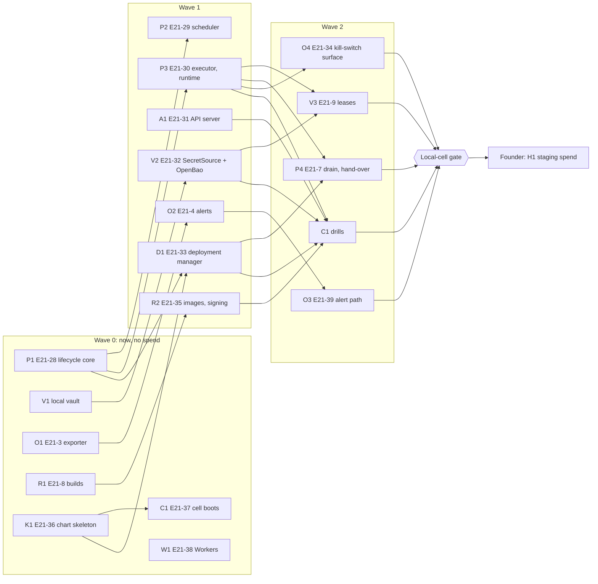

# Plan: from R0 to a managed cell (paper and demo only)

A **path brief** in the sense of the [first live trade brief](first-live-trade.md): it lists the
stories, in lanes, that take the product from today's binaries to one managed cell. Each slice is
one story's tests PR or implementation PR under DEC-77. Docs only: it writes no code.

**Status.** This plan rests on [DEC-967](../decisions/DEC-967.md), which records the founder's
answers as the coordinator relayed them and is **Proposed until the founder confirms it**. Until
then lanes take only work that spends nothing and touches no R0 file (DEC-967 "Until the founder
confirms"), which is everything in Waves 0 to 2 below.

## What the founder decided (DEC-967, as relayed)

- **After R0, straight to managed cells** (infrastructure §1.1, §3.2), not one always-on VM.
- **Build the service pieces now, in parallel, in crates R0 does not touch.**
- **The only spend is Cloudflare Workers for `web/`.** No VM, cluster, managed database, object
  store, key management service, registry, paging tool or paid CI runner. So every piece is built
  and tested on a **local and CI cell** (kind or k3d) before any hosting is bought, and every
  hosting cost is a founder decision listed [below](#hosting-spend-for-the-founder-to-approve-later).

## What the cell is, and what it is not

The cell is infrastructure §3's workspace deployment, on Kubernetes, as §3.2's managed shape: each
process its own pod, a workspace's data service, executors and runtimes on one node (pod affinity,
§3.1's host-local market-data channel), one Postgres per cell. It runs:

| Process (infrastructure §3.1) | Count | Built in this plan by |
|---|---|---|
| Agent runtime | One per agent deployment (DEC-08) | Lane P (E21-30) |
| Account executor | One per broker account | Lane P (E21-30) |
| Scheduler | One per workspace | Lane P (E21-29) |
| Workspace control services: the API server ("A2" in [`deploy/README.md`](../../../deploy/README.md), the process that serves E10-10's contract) | One set per workspace deployment | Lane A (E21-31) |
| Vault (OpenBao, DEC-434 item 14), behind `SecretSource` | One per cell | Lane V (V1, E21-32) |
| Deployment manager | One per cell | Lane D (E21-33) |
| Metrics exporter, alert rules, kill-switch surface | Per process; one alert path per cell | Lane O (E21-3, E21-4, E21-34, E21-39) |
| Journal Postgres | One per cell, synchronous standby before live only (§4.1) | Lane K (chart), Lane C (drills) |

**Out of scope here:** the model gateway, the cold exporter and anchorer (E5-7), the market-data
service's live ingest, the token-exchange process's hosting (it waits on E10-13 and DEC-821's
connection manager), the global control plane (E20), billing (E14) and the shared data plane. The
cell runs without them: the runtime's research path stays off, and data comes as fixtures or the
founder's own paper feed.

**Never in this plan:** live. Every image is built without the `live` feature (ES-23, DEC-529
item 3's compile-only rule stands), every environment is `paper` or a venue demo, every process's
egress is default-deny with no live trading host (OPS-5, E21-1), and the only live-host URL
compiled in is DEC-821's token endpoint in the token-exchange client. Live waits for the Phase 2
gate, counsel and the M13 penetration test (infrastructure §1.1). No test places a real order or
reads a credential (`AGENTS.md` rules 7 and 8): the local cell's broker is a fixture
(a broker fixture built on `mandate-sim`'s fill model, or `mandate-rh-sim` on loopback
where its build applies), and Alpaca paper keys are never in CI.

## The rule that makes the lanes parallel

No lane edits these files until R0 closes (DEC-967 item 2):

- `crates/mandate-paper/src/lib.rs`
- `crates/mandate-shell/src/control.rs`
- `crates/mandate-shell/src/adapters.rs`
- `crates/mandate-shell/src/paper/` (every file)

A lane uses `mandate-shell` and `mandate-paper` only through what they already make public, and
puts new code in new crates. A slice that finds it needs one of these files changed stops and
queues that change behind R0 as its own slice (marked **after R0** below); it does not work around
it with a copy. Other `mandate-shell` files (`tail.rs`, `watch.rs`, `lt10.rs`) are also live R0
territory: a lane that needs them asks the R0 lane's claim holder first.

Every new crate gets its `xtask/layers.toml` entry, and a safety-critical one its CODEOWNERS line
and lint header, in the same change (`AGENTS.md` Conventions). Every new dependency is a
`docs/dependencies.md` row, which the founder owns: adding the row is the approval, so each lane's
first dependency is a founder decision (listed under [Dependencies](#dependencies-the-founder-approves)).

## Lanes

Eight lanes. A lane is a sequence of stories one builder holds; lanes run in parallel and merge one
PR at a time. **SC** marks a safety-critical story: tests PR first, reviewed by an agent on a
different model, zero missed mutants, green CI (`AGENTS.md` Safety-critical paths, DEC-79).

### Lane P: long-running processes (runtime, executor, scheduler)

| Order | Story | What | Existing crates it needs | New crate |
|---|---|---|---|---|
| P1 | **E21-28** (SC) | The process lifecycle core: the states `starting → replaying → ready ⇄ not_ready → draining → exited`, the liveness and readiness predicates of infrastructure §3.4, the drain bound (§7.3) and the crash-loop bound, as a pure fold over inputs with injected time | `mandate-journal` (writer epoch, `Fenced`), `mandate-time` | `mandate-process` (pure, SC) |
| P2 | **E21-29** (SC) | The scheduler process: one per workspace, the `clock:` stream's writer, the clock-offset measurement journaled per journal §5.4 (OPS-14) | `mandate-journal`, `mandate-journal-pg`, `mandate-time`, `mandate-process` | `mandate-scheduler` (SC) |
| P3 | **E21-30** (SC) | The runtime and executor as long-running processes: one runtime per agent, one executor per account, each loop driven by journal tailing with `LISTEN`/`NOTIFY` as a hint (DEC-17), the kill switch and risk exits read first (ES-06), probes served from `mandate-process`. E21-2's acceptance criteria, run in the local cell | `mandate-runtime`, `mandate-executor`, `mandate-journal-pg`, `mandate-artifacts-fs`, `mandate-alpaca` (paper), `mandate-sim` (the CI broker fixture), `mandate-shell` (public items only), `mandate-process` | `mandate-daemon` (binaries, SC) |
| P4 | **E21-7** (SC, exists) | Drain and hand-over: warm standby, drain, epoch hand-over, the kill switch during hand-over (infrastructure §7.3) | P1 to P3, D1 | — |
| P5 | **after R0** | Point `mandate-daemon` at the shell's run path where it differs from the public items P3 used | `mandate-shell` | — |

P3 is the lane's largest slice: split it into the executor first (it carries the kill switch and
protection), then the runtime.

### Lane A: the workspace API server (A2)

| Order | Story | What | Existing crates it needs | New crate |
|---|---|---|---|---|
| A1 | **E21-31** (SC) | The API server process: HTTP transport over `mandate-api`'s contract, the session and authorization stack, tenant-scoped reads, probes, drain, a loopback or pod-local bind behind the cell's one ingress (§9), and no secret in its environment (DEC-822 item 4). It serves each E10-10 route as that route's story lands; it adds no route of its own | `mandate-api`, `mandate-authn`, `mandate-identity`, `mandate-identity-seal`, `mandate-identity-system`, `mandate-passkey`, `mandate-tenant`, `mandate-audit`, `mandate-approval`, `mandate-connections`, `mandate-journal-pg`, `mandate-process` | `mandate-api-server` (SC) |
| A2 | E10-10 to E10-14 (exist) | The routes themselves, in their lanes (L1, L2) | as their rows say | — |

A1 needs an HTTP server dependency, which no crate has today: the founder's row D-1.

### Lane V: the vault (V1, then OpenBao)

| Order | Story | What | Existing crates it needs | New crate |
|---|---|---|---|---|
| V1 | E10-13 slice V1 (exists, DEC-692) | Finish the local vault: today `mandate-vault-local` has its startup checks only. The encrypted `pending/` and `tokens/` reads and writes, the per-file owner and mode checks, and `mandate vault import` from stdin | `mandate-vault-local`, `mandate-connections` (its vault port), `mandate-cli` | — |
| V2 | **E21-32** (SC) | The `SecretSource` interface (DEC-434 item 14) with two backends: the local vault (V1) and OpenBao, one conformance suite both pass; per-process policies (§5.2) and leases (§5.2, E21-9's renewal rule); OpenBao in the local cell from a pinned image in dev-server mode for tests only | `mandate-vault-local`, `mandate-connections`, `mandate-process` | `mandate-vault` (SC) |
| V3 | E21-9 (SC, exists) | Leases only to the executor for its one connection, the key-permission checks at every start | V2, P3 | — |

### Lane D: the deployment manager

| Order | Story | What | Existing crates it needs | New crate |
|---|---|---|---|---|
| D1 | **E21-33** (SC; journal spec first if needed) | Reads the control stream (`AgentDeployed`, `AgentStopped`, kill switches) and the processes' readiness, and starts, stops and replaces processes through an orchestrator port with a Kubernetes adapter and a Compose adapter. Crash loop → the agent left `Paused` with an alert (infrastructure §3.4). If E19-8's DEC chooses the deployment manager's guaranteed restart, D1 implements it; it does not choose | `mandate-journal`, `mandate-journal-pg`, `mandate-process`, `mandate-spec` (the deployment's mandate version), `mandate-runtime` (its mode fold, read-only) | `mandate-deploy-manager` (SC) |

Before D1's tests: confirm which stream and which event record a deployment manager's pause. If
the journal spec's catalogue has none, a journal spec change with test vectors comes first
(DEC-77), as E21-25 does for drills.

### Lane O: observability and the kill-switch surface

| Order | Story | What | Existing crates it needs | New crate |
|---|---|---|---|---|
| O1 | E21-3 (exists) | The OpenTelemetry metrics API with a Prometheus pull exporter, the label lint, the decision cycle unchanged with the exporter failing (OPS-11) | `mandate-process` (once P1 lands; the exporter can start without it) | `mandate-telemetry` (not a core crate; layering forbids core crates from depending on it) |
| O2 | E21-4 (exists) | The §8.2 alerts from journal events and metrics, opaque payloads (OPS-10) | `mandate-journal`, `mandate-notify` (its payload rules, for operator alerts) | — |
| O3 | **E21-39** | The cell's own alert path: Prometheus and Alertmanager in the chart, the metric-sourced §8.2 rules as code, an alert sink with no paging vendor until the founder picks one (DEC-434 item 20, H6) | O1, O2, K1 | — |
| O4 | **E21-34** (SC) | The kill-switch surface in the cell: `mandate agent pause` and `kill` in the binary (deploy/README *Deferred*: `agent.rs` has the code, the binary offers only `deploy`), runnable as a one-off Kubernetes Job or `docker compose run` that needs only Postgres; and the OPS-4 test in the local cell with the exporter, the API, the deployment manager and the control plane down | `mandate-cli`, `mandate-runtime`, `mandate-executor` (`kill.rs`, read-only) | — |

### Lane R: release builds, signing and promotion

| Order | Story | What | Existing crates it needs | New crate |
|---|---|---|---|---|
| R1 | E21-8 (exists) | Reproducible static builds from `main`, SBOM, the build digest journaled | the binaries' crates | — |
| R2 | **E21-35** | Images by digest from those builds (static binaries on an empty base: no shell, non-root, read-only root), signed with cosign; the start-up signature check (OPS-15) that refuses an unsigned binary outside dev and CI; promotion `main` → the local cell's CI run → staging, once staging exists. CI signs with an ephemeral test key; the founder's hardware key (ES-17) signs only what goes to a hosted cell | `mandate-process` (the start-up check's hook) | — |

### Lane K: packaging (Helm and Compose, per M11)

| Order | Story | What | Existing crates it needs | New crate |
|---|---|---|---|---|
| K1 | **E21-36** (SC) | One Helm chart and one Compose file for a workspace deployment, from the same process list: a pod (or service) per process, pod affinity per workspace (§3.2), requests equal to limits for the executor and scheduler (§3.3), default-deny `NetworkPolicy` per process type with exactly §3.1's egress (OPS-5, E21-1), no inbound to the data plane, the migration Job under the migration-owner role before processes roll (OPS-13), secrets only as mounted files (DEC-822 item 4). E13-1 and E13-2 (hybrid) reuse it | `mandate-cli` (`db migrate`, as `deploy/` uses it) | — |

K1 starts with what exists today (Postgres, the migration Job, a `mandate journal verify` Job) and
gains each process as its lane's image lands.

### Lane C: the local and CI cell

| Order | Story | What | Existing crates it needs | New crate |
|---|---|---|---|---|
| C1 | **E21-37** (its drills exercise SC paths; the harness itself is tooling) | `cargo xtask cell up` and `cell drill`: a kind (or k3d) cluster on the CI runner and on a developer machine, the chart installed from the PR's images, and the drills: kill each process at each step with zero duplicates; two executors for one account, the older `Fenced` before it sends (OPS-3); a request to each live trading host fails at the network layer (OPS-5); the kill switch with the exporter, API and deployment manager down (OPS-4); the upgrade drill (OPS-7); a restore of the cell's Postgres verified by journal §11 (OPS-8). Each drill fails on a seeded bug before it is trusted. A CI job under ten minutes (DEC-464), sharded by drill | everything above; `mandate-journal-pg` and `mandate-cli` from the start | — |

C1's first slice needs no process lane: it boots K1's skeleton and runs the migration and a
journal verification, so the cell runs in CI from Wave 0.

### Lane W: `web/` on Cloudflare Workers (the one approved spend)

| Order | Story | What | Existing crates it needs | New crate |
|---|---|---|---|---|
| W1 | **E21-38** | Build and serve `web/` on Workers on fixtures, from a pinned adapter (founder row D-6), the deploy from `main` only, no secret in the bundle, the account's API token in GitHub environment secrets, never in PR jobs (ES-12). It talks to a cell only once a hosted cell exists | none (npm) | — |

## Order

- **Wave 0** (start now, in parallel): P1, V1, O1, R1, K1 and C1's first slice, W1. None needs
  another lane.
- **Wave 1**: P2 and P3 after P1; A1 once the HTTP dependency (D-1) is approved and E10-10's first
  routes are on `main`; V2 after V1; D1 after P1 and K1; O2 after O1; R2 after R1.
- **Wave 2**: P4 after P3 and D1; V3 after V2 and P3; O3 after O2 and K1; O4 after P3; C1's drills
  as each process image lands.
- **After R0 closes**: P5, and any queued change to the four R0 files.
- **The local-cell gate**: every C1 drill passes in CI on `main` for a week of merges. Only then is
  the founder asked for H1, the staging cell.

What the lanes need from each other is small on purpose: `mandate-process` (P1) is the one crate
four lanes import, so it lands first and its interface is reviewed before P3, A1, V2 and D1 build
on it.

## Hosting spend for the founder to approve later

None of these is approved (DEC-967 item 3). Each is asked only when its row's trigger is reached.
Costs are **rough monthly list prices in USD at the smallest useful size, as the recording agent
knows them; re-check each at decision time**. They are not quotes. The infrastructure design's
cost model (§10) is the formula; these are its first inputs.

| ID | Decision | Trigger | Options, rough cost per month |
|---|---|---|---|
| H0 | Does the demo host (DEC-822, a Hetzner CX22) keep running after the 2026-10-26 demo? | The demo ends | Keep it, about $5 to $7; or retire it once a staging cell exists |
| H1 | **Hosting provider and region for the first cell**, staging first (DEC-434 items 13 and 19) | The local-cell gate | Managed Kubernetes on a hyperscaler (control plane $0 to $75, plus 3 small nodes $60 to $200): about $100 to $300. Self-run k3s on 3 small VMs at a budget provider: about $25 to $60, with the operating work on us. Item 13 also requires compliance-mode object lock, a key service and two US regions, which narrows the providers |
| H2 | Journal Postgres for the cell (DEC-434 item 15) | H1 | Self-run in the cell, as item 15 prefers: volumes and snapshots, about $5 to $30. A managed service with a synchronous standby: about $100 to $400. The standby itself is required only before live (§4.1) |
| H3 | Object storage with compliance-mode object lock (journal §6.2, infrastructure §4.2) | H1, or E5-7's shipping job | At small volume, about $1 to $25, growing with records kept six years; a second region before live roughly doubles it. Confirm compliance-mode lock, not only governance mode, per provider |
| H4 | Key management for OpenBao's auto-unseal (DEC-434 item 14, §5.2) | H1 | A cloud key service: about $1 to $5. Without one, a manual unseal by the founder after every vault restart |
| H5 | Container registry for signed images | R2 reaches a hosted cell | Free for public images on the repository's host; a private registry about $0 to $20 |
| H6 | Paging and on-call tool (DEC-434 item 20) | O3, before design partners | A free tier, or about $10 to $30 per user |
| H7 | Larger CI runners, if the cell job cannot stay under ten minutes on standard runners by sharding (DEC-464) | C1 | About $0.01 to $0.05 per runner-minute: a few dollars to tens of dollars a month at today's PR rate |
| H8 | A hardware signing key for ES-17, if the founder holds none | R2 reaches a hosted cell | One-off, about $50 to $90 |
| H9 | The production cells, a second region, a synchronous standby, the global control plane | The Phase 2 gate, counsel and the penetration test | Not estimated here; roughly double H1 to H3 per region, plus the control plane (DEC-440 item 16) |

Already approved, for comparison: Cloudflare Workers for `web/` (DEC-967 item 3), on the paid plan
from about $5 a month.

## Dependencies the founder approves

Each is a `docs/dependencies.md` row, added in the slice that first uses it, which the founder
approves by merging the row (the registry is founder-owned). The lane names alternatives in the
row; these are the expected first rows.

| ID | Needed by | Kind | Note |
|---|---|---|---|
| D-1 | A1 (and P1's probes, if they are HTTP) | An async HTTP server crate | No crate serves HTTP today. P1 can serve probes over a Unix socket with `exec` probes and no new crate; the lane records that choice as a reversible engineering DEC |
| D-2 | O1 | The OpenTelemetry metrics API and a Prometheus exporter (ES-18) | Already the design's choice; the row is new |
| D-3 | D1 | A Kubernetes API client, or plain HTTPS to the API server through the existing `reqwest` and `rustls` | The second adds no crate |
| D-4 | K1, C1 | CI tools: `kind` or `k3d`, `helm`, `kubeconform`; pinned in `.github/workflows/ci.yml` and `.cursor/install.sh` together (`AGENTS.md` Setup), downloaded from GitHub releases only | Tools, not crates, but pinned and reviewed the same way |
| D-5 | K1, V2, C1 | Container images: PostgreSQL 18, OpenBao, Prometheus, Alertmanager, each pinned by digest | Our own images need none: static binaries on an empty base |
| D-6 | W1 | The Workers adapter for Next.js and its CLI (npm) | Each an npm row |
| D-7 | R1, R2 | `cosign`, an SBOM generator, `cargo-auditable` (ES-14, ES-17) | Tools, pinned as D-4 |

## What each lane may assume, and where it stops

Each lane takes these from the existing design and decisions, and stops for a DEC proposal instead
of guessing (the [task template](../templates/task.md)'s stop conditions):

- The drain bound, the crash-loop bound and the lease length are infrastructure §3.4, §7.3 and §5.2's
  "(Proposed)" defaults: lanes use them as written and record any change in a DEC.
- What an exit does while the journal is unavailable is DEC-434 item 21, still the founder's: every
  process holds, and E21-26's test is the contract.
- A process that is not ready still forwards and acts on the kill switch (§3.4); no lane may gate
  the kill switch on readiness, on the API, or on the deployment manager.
- The local cell's results are local-cell results, never staging's (DEC-967 item 5).
