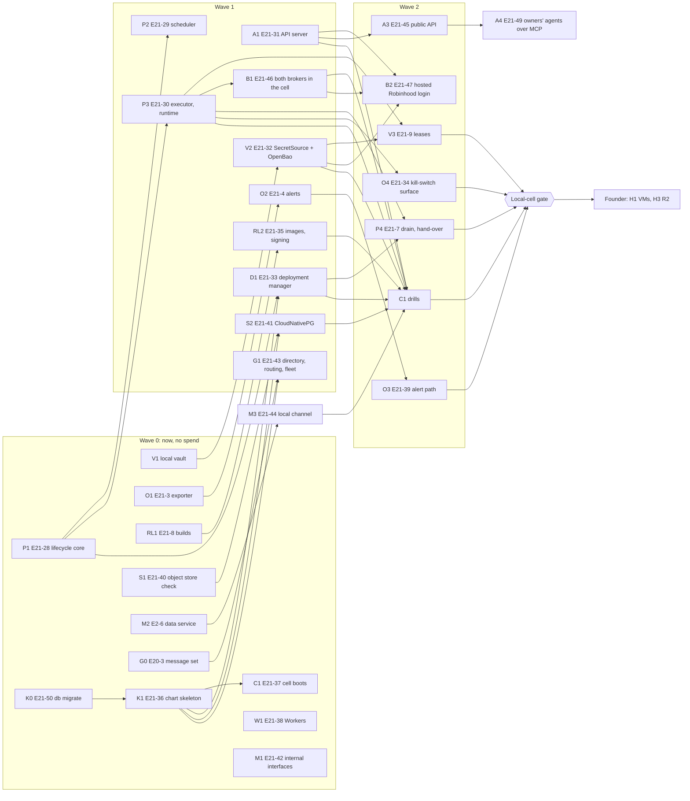

# Plan: from R0 to a managed cell (paper and demo only)

A **path brief** in the sense of the [first live trade brief](first-live-trade.md): it lists the
stories, in lanes, that take the product from today's binaries to one managed cell. Each slice is
one story's tests PR or implementation PR under DEC-77. Docs only: it writes no code.

**Status.** This plan rests on [DEC-967](../decisions/earlier-900-1999.md#dec-967), Accepted by the founder on
2026-10-17. Lanes start now; nothing is bought until the local-cell gate passes, and no lane
touches an R0 file until R0 closes.

## What the founder decided (DEC-967)

- **After R0, straight to managed cells** (infrastructure §1.1, §3.2), not one always-on VM.
- **Build the service pieces now, in parallel, in crates R0 does not touch.**
- **Spend:** Cloudflare Workers for `web/` now; the two cell #1 droplets (DigitalOcean, [DEC-995](../decisions/DEC-995.md)), Cloudflare R2 and the
  second-region cold-store copy are approved **effective when the local-cell gate passes** (item
  16). Until then every piece is built and tested on a **local and CI cell** (k3d or kind), and the
  remaining hosting costs stay founder decisions, listed
  [below](#hosting-spend-what-is-approved-and-what-is-still-to-decide).
- **One architecture, small first** (DEC-967 item 6): "dont over engineer, but dont under
  engineer." See [One architecture](#one-architecture-from-one-node-to-many-cells).
- **Cell #1: k3s on two DigitalOcean droplets in New York (`nyc3`)** ([DEC-995](../decisions/DEC-995.md), **Proposed until the founder confirms it**; it would replace item 7's Hetzner VMs in Ashburn, whose account could not be created); **the journal's Postgres in
  the cell under the CloudNativePG operator** (item 8); **object storage on Cloudflare R2**, off the
  droplets, behind a plain S3 endpoint and a lock check (item 9); **MinIO only as an optional cache**
  (item 10). The compute and R2 are approved, effective at the local-cell gate (item 16), at item
  16's Hetzner figure until DEC-995 is confirmed.
- **Real orders through the founder's own Robinhood account from cell #1** (item 15), and **users
  reach the API from their own code and their own agents** (items 13 and 17).

## One architecture, from one node to many cells

The same Helm chart is the product at every size. What changes with size is configuration and
node count, never the application, the chart's structure or a lane's code:

| Size | Where | What changes |
|---|---|---|
| Developer machine and CI | kind or k3d | Nothing but the values file: one node, a fixture broker, a local S3 test store |
| Cell #1 | k3s on two DigitalOcean droplets, New York (`nyc3`) | The values file: two nodes when the founder buys the second droplet, R2's endpoint, the tunnel |
| Busier cell | The same k3s, more nodes | Node count; a workspace still sits on one node (§3.2) |
| More cells | One chart install per cell | A second install, its own Postgres, vault and bucket |
| Managed Kubernetes later | GKE, EKS or similar | The storage class and the ingress values; the chart and images are unchanged |

So every work item holds to these rules:

- **Only portable Kubernetes.** Deployments, StatefulSets through the CloudNativePG operator,
  Jobs, `NetworkPolicy`, `PersistentVolumeClaim` by storage-class name, Secrets mounted as files.
  No k3s-only, DigitalOcean-only or other provider-only API in any crate or template; the storage class (k3s's
  local-path, later a CSI driver) and the ingress are values. The cell's only ingress is a
  `cloudflared` pod (an outbound tunnel), so no cloud load balancer is needed or assumed.
- **Storage is a plain S3 endpoint plus a lock check.** WAL archives, base backups, artifacts and,
  later, cold segments go to an S3-compatible endpoint named in configuration, and a start-up
  check confirms the write-once retention journal spec §6.2 requires before anything relies on
  it (E21-40). Providers swap by configuration.
- **Nothing that matters only at large scale goes in the first slices:** no multiple regions, no
  service mesh, no autoscaling, no multi-cell routing, no dedicated node pools. Each is a values
  change or a later story when traffic asks for it.
- **The single-VM systemd path in `deploy/` (DEC-822) is a dev and demo convenience, not the
  production path.** It stays for the 2026-10-26 demo and local use; no story in this plan adds a
  process to it or depends on it, and the chart replaces it as the way the product is deployed.

## What the cell is, and what it is not

The cell is infrastructure §3's workspace deployment, on Kubernetes, as §3.2's managed shape: each
process its own pod, a workspace's data service, executors and runtimes on one node (pod affinity,
§3.1's host-local market-data channel), one Postgres per cell. It runs:

| Process (infrastructure §3.1) | Count | Built in this plan by |
|---|---|---|
| Agent runtime | One per agent deployment (DEC-08) | Lane P (E21-30) |
| Account executor | One per broker account | Lane P (E21-30) |
| Scheduler | One per workspace | Lane P (E21-29) |
| Workspace control services: the API server ("A2" in [`deploy/README.md`](../../../deploy/README.md), the process that serves E10-10's contract) | One set per workspace deployment | Lane A (E21-31) |
| Vault (OpenBao, DEC-434 item 14), behind `SecretSource` | One per cell | Lane V (V1, E21-32) |
| Deployment manager | One per cell | Lane D (E21-33) |
| Metrics exporter, alert rules, kill-switch surface | Per process; one alert path per cell | Lane O (E21-3, E21-4, E21-34, E21-39) |
| Journal Postgres, under the CloudNativePG operator: a primary and a synchronous standby, WAL archived to object storage, point-in-time recovery (DEC-967 item 8) | One cluster per cell | Lane S (E21-41) |
| Object storage: a plain S3 endpoint with a lock check, Cloudflare R2 for cell #1 (DEC-967 item 9) | One bucket set per cell, off the cell's VMs | Lane S (E21-40) |

**Out of scope here,** except where E21-48 needs it before the first live order: the model gateway, the cold exporter and anchorer (E5-7, which E21-48 needs), the market-data
service's live ingest, the token-exchange process's hosting (it waits on E10-13 and DEC-821's
connection manager), the control plane beyond lane G's first slice (licensing, metering, the relay, E14 billing) and the shared data plane. The
cell runs without them: the runtime's research path stays off, and data comes as fixtures or the
founder's own paper feed.

**Live, and only one kind of it.** Cell #1 places real orders through Robinhood for the
founder's own agentic account (DEC-967 item 15, the founder's decision in this session). That is
the only live trading in this plan. Every other connection is `paper` or a venue demo; only the
Robinhood executor's image is a signed live build, and only it has egress to Robinhood's host;
every other process's egress is default-deny with no live trading host (OPS-5, E21-1). Live for
any other user still waits for the Phase 2 gate, counsel and the M13 penetration test
(infrastructure §1.1). **Tests never trade.** No test, CI job or agent places a real order or reads
a credential (`AGENTS.md` rules 7 and 8): in tests the broker is a fixture (one built on
`mandate-sim`'s fill model, or `mandate-rh-sim` on loopback), Alpaca paper keys are never in CI, and
only the founder logs in to Robinhood and confirms a live order.

## The three API surfaces

The founder asked, as relayed, that the plan build the control plane's and the data plane's APIs
too (DEC-967 item 11). There are three surfaces, each its own lane, all packaged the same way:

| Surface | Implements | What exists today | First slice | How it runs in cell #1 without later rework |
|---|---|---|---|---|
| **1. Workspace services API** (lane A, first: the web app, the CLI and the owner's MCP adapter, E10-6, all call it) | [Workspace API spec](../../specs/workspace-api.md) v0.1; E10-10 to E10-14 | `mandate-api`: the contract (problem documents, request and response shapes, principals, the idempotency key), pure, with no transport; the identity crates; `mandate-audit`'s reads | E21-31: the server process over that contract, serving the routes already on `main`, with sessions, tenant scope and probes | One Deployment per workspace deployment behind the cell's one ingress (the `cloudflared` pod). More traffic is more replicas of the same Deployment: every mutating call commits its control-stream event first (API-3), so replicas share nothing but the journal |
| **2. Global control plane** (lane G) | [Control-plane design](../../design/control-plane.md) v0.1; E20 | Nothing built (design §7); `actor.build` digests are journaled | E21-43: the directory (E20-1), cell routing (the directory maps a workspace to its cell's API endpoint, and clients cache the route), fleet health from heartbeats (E20-5), and the cell's `cp-agent` with enrollment (E20-2). Licensing, metering, billing, the relay, distribution and the anchor witness come later | Its own Helm release from the same chart conventions, in its own namespace with its own database, keys and egress (DEC-440 item 16 wants separate accounts and keys from every cell). On cell #1's k3s only if the founder accepts that (H10); moving it to its own cluster later is a values change. The cell reaches it only outbound through `cp-agent` (design §3), and its outage stops no trading (OPS-12) |
| **3. Data plane** (lane M) | [Data-plane spec](../../specs/data-plane.md) v0.2 (§3, §5, §6); infrastructure §3.1's internal channels | `mandate-marketdata` (historical bars and trades into Parquet, `inspect`); `mandate-alpaca`'s latest-quote and asset reads; `mandate-time`'s calendar. No live stream, no data service (spec §9) | Two halves. **Market data:** E2-6 (the workspace data service) then E2-5 (Alpaca streaming, on recorded fixtures in CI), served to runtimes and executors over the host-local channel (E21-44). **Internal interfaces:** E21-42, which pins down that workspace services and the agent processes meet only in the journal | The data service is a pod per workspace, on the workspace's node by pod affinity (§3.2). The host-local channel stays on the node and is never a network route (E21-44's DEC picks the mechanism, a per-workspace Unix socket being the expected one), so spreading a workspace over nodes stays the data-plane spec change §3.2 says it is, not a chart rewrite. The shared data plane (spec §6) stays Won't for v1 |

What "internal interfaces" means here: workspace services (the API server, the deployment manager,
the approval service) never call a runtime, an executor or the scheduler. They append to the
control stream; each stream's owner copies what it needs into its own stream (journal §2) and acts
(DEC-17: journal tailing with `LISTEN`/`NOTIFY` as a hint). The only other channels are the
host-local market-data channel and the probes. That is what lets every process scale, restart and
hand over on its own, and it is what E21-42 makes checked rather than assumed.

## Users call the API; the web app is one client

The founder, in this session: "Lets not couple web with this, web will call the API but users will
also be able to" (DEC-967 item 13). So the workspace API is the product's public interface, and
`web/` is one client of it, hosted apart from the cell:

- **No private routes.** Every operation the web app uses is a documented operation of the
  versioned API (`/v1`, workspace API spec §3.2), reachable with a user's own token. A web-only
  route, a shared database, or a server-side shortcut from `web/` into the cell is refused in
  review and caught by a contract test (E21-45).
- **Users get their own tokens.** Sender-constrained (DPoP) user tokens, as the spec already gives
  the CLI (§3.3 item 2), issued and revoked through the API, scoped by role (§3.7). Owner-connected
  agents keep their narrower client scope (§3.8, DEC-141).
- **One published contract.** The OpenAPI 3.1 document generated from the Rust types (§3.1) is
  published from `main` per version, with an SDK generated from it and rate limits per §3.10.
- **Same rules for every caller.** A request from a user's script is owner input like a click in
  the web app: the same builder, risk gate and autonomy rules, and it never changes the envelope
  (`AGENTS.md` rule 11).
- **Deployment.** `web/` on Workers reaches the cell only at the API's public endpoint (through
  the tunnel), the same address a user's code uses.

## Brokers: Alpaca and Robinhood through one path

The founder, in this session: "I want Robinhood integrated too", then "complete integration and no
special work", then "real trade through robinhood", not the simulator (DEC-967 items 12, 14 and
15; spelling corrected in the quotes). What the plan does:

- **One connector path.** Robinhood runs in the cell exactly as Alpaca does: its executor process
  (E21-30), its connection record and hosted login through the API (E21-47), its credential in the
  vault leased only to that executor (E21-32, E21-9), its rules as a capability profile
  ([DEC-531](../decisions/DEC-531.md), ADR-0004), its egress limited to its own host. No
  Robinhood-only code, binary or runner beyond the connector crate itself.
- **Real trades, from cell #1.** The founder's Robinhood connection in cell #1 is a `live`
  connection: real orders on the founder's own agentic account, under the founder's mandate, with
  the envelope DEC-529 used (allocation and `max_order_usd`) and `ask` for openings until the founder raises them through a confirmed mandate
  version. It replaces the R0 runner as the way the founder trades on Robinhood once E21-48's
  conditions hold; until then the R0 runner stays the path (DEC-529).
- **The simulator is only for tests.** Robinhood has no paper or demo environment, and no test or
  agent may reach Robinhood (rule 8), so CI and the local cell drill the same code against
  `mandate-rh-sim` as a sidecar on loopback (DEC-124, DEC-922). The product never runs against it.
- **What must hold before the first real order from the cell** (E21-48), each from an existing
  rule, not new work: a signed live executor image (OPS-15, the founder's hardware key); egress to
  Robinhood's host for that executor only; the journal's synchronous standby on a second node, so
  cell #1 needs both droplets (OPS-2: live needs a standby in a second failure domain; two droplets in
  one DigitalOcean region are two machines, not separate sites, and are not guaranteed to sit
  on separate hosts, since DigitalOcean offers no placement groups that promise it; the plan
  discloses that, DEC-995 item 6); write-once storage proven by E21-40, and E5-7 shipping segments within a
  minute of closing to the locked store and its second-region copy (journal §6.2: before live
  capital); backups with no secret outside the vault (DEC-822 item 4's condition); the hosted login
  (E21-47) and the vault (E21-32) in place, so the token never sits on a disk outside the vault;
  `cargo xtask live-feature` changed to allow `mandate-daemon` as well as the runner, with CI still
  only compiling `live` (DEC-967 item 15 narrows DEC-529 item 3 for this), and the image built
  and signed by the founder, never by CI or an agent; a live quote source, either the `sip`
  profile or DEC-529 item 12's cross-checked Robinhood quote once trading spec §4.2 extends it to a
  standing deployment (H11); DEC-529 item 11's account conditions; E9-4's step-up for the
  confirmation, deployment and grants, since `cli_confirm` is paper-only; and, until the founder
  decides otherwise, the M13 penetration test and counsel's review (DEC-967 item 15, Proposed).

## The rule that makes the lanes parallel

No lane edits these files until R0 closes (DEC-967 item 2):

- `crates/mandate-paper/src/lib.rs`
- `crates/mandate-shell/src/control.rs`
- `crates/mandate-shell/src/adapters.rs`
- `crates/mandate-shell/src/paper/` (every file)
- `crates/mandate-paper/src/lt10.rs`, and `crates/mandate-paper/Cargo.toml`'s `live` feature (the
  R0 runner's own)

A lane uses `mandate-shell` and `mandate-paper` only through what they already make public, and
puts new code in new crates. A slice that finds it needs one of these files changed stops and
queues that change behind R0 as its own slice (marked **after R0** below); it does not work around
it with a copy. Every other file R0's lanes touch is also live R0 territory, and a lane that needs
one asks the R0 lane's claim holder first: in `mandate-shell`, `tail.rs`, `watch.rs`, `lt10.rs`,
`tracer.rs`, `envelope.rs` and `robinhood.rs`; in `mandate-paper`, `door.rs`, `wiring.rs` and
`robinhood.rs`.

Every new crate gets its `xtask/layers.toml` entry, and a safety-critical one its CODEOWNERS line
and lint header, in the same change (`AGENTS.md` Conventions). Every new dependency is a
`docs/dependencies.md` row, which the founder owns: adding the row is the approval, so each lane's
first dependency is a founder decision (listed under [Dependencies](#dependencies-the-founder-approves)).

## Lanes

Thirteen lanes (P, A, V, D, O, R, K, C, S, G, M, B, W). A lane is a sequence of stories one builder holds; lanes run in parallel and merge one
PR at a time. **SC** marks a safety-critical story: tests PR first, reviewed by an agent on a
different model, zero missed mutants, green CI (`AGENTS.md` Safety-critical paths, DEC-79).

### Lane P: long-running processes (runtime, executor, scheduler)

| Order | Story | What | Existing crates it needs | New crate |
|---|---|---|---|---|
| P1 | **E21-28** (SC) | The process lifecycle core: the states `starting → replaying → ready ⇄ not_ready → draining → exited`, the liveness and readiness predicates of infrastructure §3.4, the drain bound (§7.3) and the crash-loop bound, as a pure fold over inputs with injected time | `mandate-journal` (writer epoch, `Fenced`), `mandate-time` | `mandate-process` (pure, SC) |
| P2 | **E21-29** (SC) | The scheduler process: one per workspace, the `clock:` stream's writer, the clock-offset measurement journaled per journal §5.4 (OPS-14) | `mandate-journal`, `mandate-journal-pg`, `mandate-time`, `mandate-process` | `mandate-scheduler` (SC) |
| P3 | **E21-30** (SC) | The runtime and executor as long-running processes: one runtime per agent, one executor per account, each loop driven by journal tailing with `LISTEN`/`NOTIFY` as a hint (DEC-17), the kill switch and risk exits read first (ES-06), probes served from `mandate-process`. E21-2's acceptance criteria, run in the local cell | `mandate-runtime`, `mandate-executor`, `mandate-journal-pg`, `mandate-artifacts-fs`, `mandate-alpaca` (paper), `mandate-sim` (the CI broker fixture), `mandate-shell` (public items only), `mandate-process` | `mandate-daemon` (binaries, SC) |
| P4 | **E21-7** (SC, exists) | Drain and hand-over: warm standby, drain, epoch hand-over, the kill switch during hand-over (infrastructure §7.3) | P1 to P3, D1 | — |
| P5 | **after R0** | Point `mandate-daemon` at the shell's run path where it differs from the public items P3 used | `mandate-shell` | — |

P3 is the lane's largest slice: split it into the executor first (it carries the kill switch and
protection), then the runtime.

### Lane A: the workspace API server (A2), the first API surface

| Order | Story | What | Existing crates it needs | New crate |
|---|---|---|---|---|
| A1 | **E21-31** (SC) | The API server process: HTTP transport over `mandate-api`'s contract, the session and authorization stack, tenant-scoped reads, probes, drain, a loopback or pod-local bind behind the cell's one ingress (§9), and no secret in its environment (DEC-822 item 4). It serves each E10-10 route as that route's story lands; it adds no route of its own | `mandate-api`, `mandate-authn`, `mandate-identity`, `mandate-identity-seal`, `mandate-identity-system`, `mandate-passkey`, `mandate-tenant`, `mandate-audit`, `mandate-approval`, `mandate-connections`, `mandate-journal-pg`, `mandate-process` | `mandate-api-server` (SC) |
| A2 | E10-10 to E10-14 (exist) | The routes themselves, in their lanes (L1, L2) | as their rows say | — |
| A3 | **E21-45** | The API as the public interface: user tokens, the published OpenAPI per version, a generated SDK, rate limits, and a contract test that the web app uses only documented operations | A1, `mandate-identity`, `mandate-authn` | — |
| A4 | **E21-49** (SC), with E10-6, E10-8 and E10-14 (exist) | Owner-connected agents as a first-class caller (DEC-967 item 17): the MCP server as a thin adapter over the published API, the client token's closed scope, served from the cell | A1, A3, `mandate-identity`, `mandate-authn` | the MCP server's crate, named by E10-6 |

A1 needs an HTTP server dependency, which no crate has today: the founder's row D-1.

### Lane V: the vault (V1, then OpenBao)

| Order | Story | What | Existing crates it needs | New crate |
|---|---|---|---|---|
| V1 | E10-13 slice V1 (exists, DEC-692) | Finish the local vault: today `mandate-vault-local` has its startup checks only. The encrypted `pending/` and `tokens/` reads and writes, the per-file owner and mode checks, and `mandate vault import` from stdin | `mandate-vault-local`, `mandate-connections` (its vault port), `mandate-cli` | — |
| V2 | **E21-32** (SC) | The `SecretSource` interface (DEC-434 item 14) with two backends: the local vault (V1) and OpenBao, one conformance suite both pass; per-process policies (§5.2) and leases (§5.2, E21-9's renewal rule); OpenBao in the local cell from a pinned image in dev-server mode for tests only | `mandate-vault-local`, `mandate-connections`, `mandate-process` | `mandate-vault` (SC) |
| V3 | E21-9 (SC, exists) | Leases only to the executor for its one connection, the key-permission checks at every start | V2, P3 | — |

### Lane D: the deployment manager

| Order | Story | What | Existing crates it needs | New crate |
|---|---|---|---|---|
| D1 | **E21-33** (SC; journal spec first if needed) | Reads the control stream (`AgentDeployed`, `AgentStopped`, kill switches) and the processes' readiness, and starts, stops and replaces processes through an orchestrator port with a Kubernetes adapter and a Compose adapter. Crash loop → the agent left `Paused` with an alert (infrastructure §3.4). If E19-8's DEC chooses the deployment manager's guaranteed restart, D1 implements it; it does not choose | `mandate-journal`, `mandate-journal-pg`, `mandate-process`, `mandate-spec` (the deployment's mandate version), `mandate-runtime` (its mode fold, read-only) | `mandate-deploy-manager` (SC) |

Before D1's tests: confirm which stream and which event record a deployment manager's pause. If
the journal spec's catalogue has none, a journal spec change with test vectors comes first
(DEC-77), as E21-25 does for drills.

### Lane O: observability and the kill-switch surface

| Order | Story | What | Existing crates it needs | New crate |
|---|---|---|---|---|
| O1 | E21-3 (exists) | The OpenTelemetry metrics API with a Prometheus pull exporter, the label lint, the decision cycle unchanged with the exporter failing (OPS-11) | `mandate-process` (once P1 lands; the exporter can start without it) | `mandate-telemetry` (not a core crate; layering forbids core crates from depending on it) |
| O2 | E21-4 (exists) | The §8.2 alerts from journal events and metrics, opaque payloads (OPS-10) | `mandate-journal`, `mandate-notify` (its payload rules, for operator alerts) | — |
| O3 | **E21-39** | The cell's own alert path: Prometheus and Alertmanager in the chart, the metric-sourced §8.2 rules as code, an alert sink with no paging vendor until the founder picks one (DEC-434 item 20, H6) | O1, O2, K1 | — |
| O4 | **E21-34** (SC) | The kill-switch surface in the cell: `mandate agent pause` and `kill` in the binary (deploy/README *Deferred*: `agent.rs` has the code, the binary offers only `deploy`), runnable as a one-off Kubernetes Job or `docker compose run` that needs only Postgres; and the OPS-4 test in the local cell with the exporter, the API, the deployment manager and the control plane down | `mandate-cli`, `mandate-runtime`, `mandate-executor` (`kill.rs`, read-only) | — |

### Lane R: release builds, signing and promotion (slices RL1, RL2, named apart from Cloudflare R2)

| Order | Story | What | Existing crates it needs | New crate |
|---|---|---|---|---|
| RL1 | E21-8 (exists) | Reproducible static builds from `main`, SBOM, the build digest journaled | the binaries' crates | — |
| RL2 | **E21-35** (SC) | Images by digest from those builds (static binaries on an empty base: no shell, non-root, read-only root), signed with cosign; the start-up signature check (OPS-15) that refuses an unsigned binary outside dev and CI; promotion `main` → the local cell's CI run → staging, once staging exists. CI signs with an ephemeral test key; the founder's hardware key (ES-17) signs only what goes to a hosted cell | `mandate-process` (the start-up check's hook) | — |

### Lane K: packaging (Helm and Compose, per M11)

| Order | Story | What | Existing crates it needs | New crate |
|---|---|---|---|---|
| K0 | **E21-50** (SC; first) | `mandate-cli db migrate`: forward-only migrations under the migration-owner role, taking over from `deploy/`'s table and the embedded migrator (OPS-13, ES-08); `mandate db migrate --journal <DSN> [--schema journal]`, its codes and how K1 and S2 run it are in [DEC-1180](../decisions/DEC-1180.md) | `mandate-cli`, `mandate-journal-pg` | — |
| K1 | **E21-36** (SC) | One Helm chart and one Compose file for a workspace deployment, from the same process list: a pod (or service) per process, pod affinity per workspace (§3.2), requests equal to limits for the executor and scheduler (§3.3), default-deny `NetworkPolicy` per process type with exactly §3.1's egress (OPS-5, E21-1), no inbound to the data plane, the migration Job under the migration-owner role before processes roll (OPS-13), secrets only as mounted files (DEC-822 item 4). E13-1 and E13-2 (hybrid) reuse it | `mandate-cli` (`db migrate`, from K0) | — |

K1 starts with Postgres, the migration Job (once K0 lands) and a `mandate journal verify` Job,
and gains each process as its lane's image lands.

### Lane C: the local and CI cell

| Order | Story | What | Existing crates it needs | New crate |
|---|---|---|---|---|
| C1 | **E21-37** (its drills exercise SC paths; the harness itself is tooling) | `cargo xtask cell up` and `cell drill`: a k3d cluster (k3s in containers, cell #1's own distribution; kind if k3d cannot run on the runner) on the CI runner and on a developer machine, the chart installed from the PR's images, and the drills: kill each process at each step with zero duplicates; two executors for one account, the older `Fenced` before it sends (OPS-3); a request to each live trading host fails at the network layer (OPS-5); the kill switch with the exporter, API and deployment manager down (OPS-4); the upgrade drill (OPS-7); a restore of the cell's Postgres verified by journal §11 (OPS-8). Each drill fails on a seeded bug before it is trusted. A CI job under ten minutes (DEC-464), sharded by drill | everything above; `mandate-journal-pg` and `mandate-cli` from the start | — |

C1's first slice needs no process lane: it boots K1's skeleton, runs K0's migration and a journal
verification, so the cell runs in CI from early Wave 0. Its live-host drill runs on the drilled
images, all built without `live`; the one live image of E21-48 is never started in CI.

### Lane S: storage (object storage and the journal's Postgres)

| Order | Story | What | Existing crates it needs | New crate |
|---|---|---|---|---|
| S1 | **E21-40** (SC; first) | The object-store compatibility check and its interface: can R2 give journal spec §6.2's write-once retention and its start-up lock check, by per-object S3 Object Lock headers or by R2's bucket lock rules? A plain S3 endpoint and a `LockCheck` that reads the provider's real retention setting and refuses anything weaker. If R2 has bucket-level locks only, either the check reads R2's bucket-lock rule and accepts nothing weaker, or the cold store alone goes to a provider with standard Object Lock in compliance mode (for example Backblaze B2), recorded as a DEC. The check runs against an S3 test store in CI and, once H3 is approved, against R2 itself | `mandate-journal-cold` (what the cold store needs), `mandate-artifacts-fs` (the artifact layout to keep) | `mandate-objectstore` (SC) |
| S2 | **E21-41** (SC) | The journal's Postgres in the cell under CloudNativePG: two instances with `synchronous_commit = on` and one synchronous standby, the journal's roles and `migrations/` applied by the migration Job (OPS-13), WAL archived to the S1 endpoint, point-in-time recovery restored and verified (OPS-8). On one node the standby shares the node, disclosed as no second failure domain; the second VM gives it one | `mandate-journal-pg`, `mandate-cli` (`db migrate`, `journal verify`), S1 | — |
| S3 | E21-5 (SC, exists) | The backup drill and restore procedure, on S2's archive | S2, E21-25 | — |
| S4 | E5-7 (SC, exists) | The cold exporter as a process in the chart: segments shipped within a minute of closing to S1's locked store and its second-region copy (L-2), retention and holds; B3 needs it before live capital (journal §6.2) | `mandate-journal-cold`, S1, K1 | — |

MinIO is not in this lane. It may come later only as an optional in-cell cache, never the only
copy or the backup, and only after the founder and counsel decide its AGPL-3.0 licence (DEC-967
item 10, DEC-434 item 16).

### Lane G: the global control plane's first slice

| Order | Story | What | Existing crates it needs | New crate |
|---|---|---|---|---|
| G0 | E20-3 (SC, exists; journal spec first) | The closed message set and its journal events, before any message flows | `mandate-journal` | — |
| G1 | **E21-43** (SC) with E20-1, E20-2, E20-5 (exist) | Directory, cell routing and fleet health as one small service, and `cp-agent` in the cell; packaged as its own Helm release | `mandate-api` (the problem-document conventions), `mandate-identity` (role names only; no personal data, E20-1), `mandate-journal-pg` (its own database), `mandate-process` | `mandate-cp` (the service), `mandate-cp-agent` (SC: it hands verified instructions to workspace services) |
| G2 | later: E20-4, E20-6 to E20-10, E14 | Licensing, signed manifests, metering, the relay, distribution, the anchor witness | — | — |

### Lane M: the data plane

| Order | Story | What | Existing crates it needs | New crate |
|---|---|---|---|---|
| M1 | **E21-42** (SC) | The internal interfaces, checked: workspace services reach agent processes only through the journal | `mandate-journal`, the crates of lanes A, D and P | — |
| M2 | E2-6 (SC, exists) | The workspace data service: normalized records, receive times, a bounded hot cache | `mandate-marketdata`, `mandate-time`, `mandate-domain`, `mandate-alpaca` | the data service's crate, named by E2-6 |
| M3 | **E21-44** (SC) | The host-local channel in the cell | M2, K1 | — |
| M4 | E2-5 (SC, exists), E2-13 | Alpaca streaming on recorded fixtures, then the fault-injection suite | `mandate-alpaca`, M2 | — |

### Lane B: brokers in the cell (Alpaca paper and Robinhood, one path)

| Order | Story | What | Existing crates it needs | New crate |
|---|---|---|---|---|
| B1 | **E21-46** (SC) | Both connectors in the cell's executor process: Alpaca against paper and recorded fixtures, Robinhood against `mandate-rh-sim` as a pod sidecar; capability profiles only | `mandate-alpaca`, `mandate-robinhood`, `mandate-mcp` (`rh-sim` feature), `mandate-rh-sim`, `mandate-executor`, `mandate-daemon` (P3) | — |
| B2 | **E21-47** (SC; connections spec first) | Hosted Robinhood login: the OAuth callback through the API server, the token into the vault, leased to that one executor, tested against the simulator | `mandate-connections`, `mandate-vault` (V2), `mandate-api-server` (A1), `mandate-robinhood` | — |
| B3 | **E21-48** (SC; after E5-7 and E9-4, and the penetration test and counsel until the founder decides otherwise) | Real Robinhood trades from cell #1: the signed live executor image, the `live-feature` check allowing `mandate-daemon`, its egress, the standby on the second node, the storage conditions, the founder's first live order from the cell | B1, B2, RL2, K1, S1, S2 | — |

B1 and B2 must not edit the R0 files; where the R0 runner's own Robinhood wiring sits in
`crates/mandate-paper` or `crates/mandate-shell/src/paper/`, B1 reuses the connector crates
underneath it and leaves the runner alone. P5 (after R0) then retires the runner's separate path in
favour of the cell's, so there is one path, not two.

### Lane W: `web/` on Cloudflare Workers (the one approved spend)

| Order | Story | What | Existing crates it needs | New crate |
|---|---|---|---|---|
| W1 | **E21-38** | Build and serve `web/` on Workers on fixtures, from a pinned adapter (founder row D-6), the deploy from `main` only, no secret in the bundle, the account's API token in GitHub environment secrets, never in PR jobs (ES-12). It talks to a cell only once a hosted cell exists | none (npm) | — |

## Order

- **Wave 0** (start now, in parallel): K0 first, then P1, V1, O1, RL1, K1 and C1's first slice, W1,
  S1's interface and its CI half, M2, and G0's journal spec change. M1 starts as the rules for the
  crates that exist and gains one rule as each lane's crate lands.
- **Wave 1**: P2 and P3 after P1; A1 once the HTTP dependency (D-1) is approved and E10-10's first
  routes are on `main`; V2 after V1; D1 after P1 and K1; O2 after O1; RL2 after RL1; S2 after S1, K0
  and K1; M3 after M2 and K1; G1 after G0 and K1; B1 after P3.
- **Wave 2**: P4 after P3 and D1; V3 after V2 and P3; O3 after O2 and K1; O4 after P3; B2 after
  B1, A1 and V2; A3 after A1; A4 after A3; C1's drills as each process image lands.
- **Wave 3**: B3, once B1, B2, RL2, S1, S2 and E5-7 are green, H1 (both VMs) and H3 are bought,
  and the penetration test and counsel have answered, unless the founder decides they are not
  needed for the founder's own account (DEC-967 item 15).
- **After R0 closes**: P5, and any queued change to the R0 files.
- **The local-cell gate**: every C1 drill passes in CI on `main` (DEC-967 item 16), and, as this
  plan's own tightening, keeps passing for a week of merges. Then the founder buys H1 (the VMs) and H3 (R2), and S1's check against R2 itself runs
  before anything is stored there. **If the founder confirms [DEC-990](../decisions/earlier-900-1999.md#dec-990)
  item 2** (rush the hosted cell for the 2026-10-26 demo), the plan's week is dropped: H1 and H3 are
  bought when every C1 drill has first passed in CI on `main`; the cell carries paper and demo data
  only; S1's check still runs first; and B3 keeps its own conditions above. Whether cell #1 also
  counts as DEC-434 item 19's minimal staging cell is asked with H1.

What the lanes need from each other is small on purpose: `mandate-process` (P1) is the one crate
four lanes import, so it lands first and its interface is reviewed before P3, A1, V2 and D1 build
on it.

## Hosting spend: what is approved and what is still to decide

H1, H3 and L-2 are approved, effective when the local-cell gate passes (DEC-967 item 16); the
founder orders them. The rest are not approved, and each is asked only when its trigger comes.
Costs are **rough monthly list prices in USD at the smallest useful size, as the recording agent
knows them; re-check each at decision time**. They are not quotes. The infrastructure design's
cost model (§10) is the formula; these are its first inputs.

| ID | Decision | Trigger | Options, rough cost per month |
|---|---|---|---|
| H0 | Does the demo host (DEC-822, a Hetzner CX22, which predates DEC-995) keep running after the 2026-10-26 demo? It is a dev and demo convenience now (DEC-967 item 6) | The demo ends | Keep it, about $5 to $7; or retire it once cell #1 runs |
| H1 | **Proposed ([DEC-995](../decisions/DEC-995.md), awaiting the founder); the gate and trigger are DEC-967 item 16's and DEC-990 item 2's, and until DEC-995 is confirmed the approved figure is item 16's Hetzner $35 to $45: cell #1's compute, k3s on two DigitalOcean droplets in New York (`nyc3`)** (DEC-995, replacing DEC-967 item 7's Hetzner VMs; DEC-434 items 13 and 19) | When every C1 drill first passes on `main` (DEC-990 item 2) | Two droplets of about 4 vCPU and 8 GB: about $48 a month each, **about $96 for two** at list price, which the founder confirms when buying. Plus two 40 GB block volumes, about $4 each. A cloud firewall denying all inbound costs nothing; ingress is the Cloudflare Tunnel and operator access is Cloudflare Access (free tier). No managed database, managed Kubernetes or load balancer. DigitalOcean has no Ashburn region; Toronto is the alternative region, a values change |
| H2 | The journal's Postgres (DEC-434 item 15) | — | **Decided as relayed** (DEC-967 item 8): in the cell under CloudNativePG, so no separate spend; it runs on H1's VMs and archives to H3 |
| H3 | **Approved at the gate (item 16; DEC-990 item 2 would move it to the drills' first pass): object storage on Cloudflare R2**, location hint eastern North America (DEC-967 item 9) | The local-cell gate, and S1's check against R2 passing | Storage about $0.015 per GB-month after a 10 GB free tier, no egress fee, operations about $4.50 per million writes and $0.36 per million reads after their free tiers: about **$0 to $2** at cell #1's scale (a few GB of WAL, backups and artifacts). Grows with records kept six years (§4.5) |
| H3b | Fallback for the cold store only, if S1 finds R2's locks weaker than journal spec §6.2 needs: **Backblaze B2** with standard S3 Object Lock in compliance mode | S1's finding | About $6 per TB-month, first 10 GB free; at cell #1's scale about $0 to $1. Recorded as its own DEC when taken |
| H4 | Key management for OpenBao's auto-unseal (DEC-434 item 14, §5.2) | H1 | DigitalOcean has no key management service. Options: a cloud key service elsewhere, about $1 to $5; or a manual unseal by the founder after every vault restart, which costs nothing and adds a step after every node reboot |
| H5 | Container registry for signed images | Lane R's E21-35 reaches a hosted cell | Free for public images on the repository's host; a private registry about $0 to $20 |
| H6 | Paging and on-call tool (DEC-434 item 20) | O3, before design partners | A free tier, or about $10 to $30 per user |
| H7 | Larger CI runners, if the cell job cannot stay under ten minutes on standard runners by sharding (DEC-464) | C1 | About $0.01 to $0.05 per runner-minute: a few dollars to tens of dollars a month at today's PR rate |
| H8 | A hardware signing key for ES-17, if the founder holds none | Lane R's E21-35 reaches a hosted cell | One-off, about $50 to $90 |
| L-1 | Live for anyone but the founder's own Robinhood account (other users; Alpaca live) | The Phase 2 gate, counsel and the penetration test | No hosting cost of its own. The founder's own account is decided (DEC-967 item 15) |
| L-2 | **Approved at the gate (item 16):** the second-region copy of the cold store that journal §6.2 requires before live capital | Before B3 | At cell #1's scale about $0 to $1: a second R2 bucket in another location hint, or B2 |
| H11 | The live equity quote source for E21-48 (trading spec §4.2, DEC-529 item 12) | Before B3 | Either the `sip` profile from a paid market-data plan, roughly $100 a month at retail list price; or $0, by extending DEC-529 item 12's cross-checked Robinhood quote to a standing deployment, which needs a trading spec change the founder approves |
| H10 | Where the control plane's first slice runs (DEC-440 item 16) | G1 reaches a hosted cell | On cell #1's VMs as a separate release, namespace, database and keys: no extra cost, but not the separate accounts item 16 recommends. On its own small VM: about $8 to $20 |
| H9 | The production cells, a second region, a standby in a second failure domain, the global control plane | The Phase 2 gate, counsel and the penetration test | Not estimated here; roughly double H1 to H3 per region, plus the control plane (DEC-440 item 16) |

Already approved, for comparison: Cloudflare Workers for `web/` (DEC-967 item 3), on the paid plan
from about $5 a month.

**Cell #1 in total, on DigitalOcean (DEC-995, Proposed):** two droplets with volumes, about $104 a month,
plus R2 at about $0 to $2, plus Workers at about $5: **roughly $110 a month**, more than twice
the $40 to $50 Hetzner total DEC-967 item 16 approved; that spend is not approved until DEC-995 is. Starting on one droplet halves the compute, at the cost of a standby
that shares the primary's node (E21-41), but real Robinhood trades (E21-48) need the second droplet,
because live needs the standby in a second failure domain (OPS-2).

## Dependencies the founder approves

Each is a `docs/dependencies.md` row, added in the slice that first uses it, which the founder
approves by merging the row (the registry is founder-owned). The lane names alternatives in the
row; these are the expected first rows. **If the founder confirms
[DEC-990](../decisions/earlier-900-1999.md#dec-990) item 1**, these seven kinds are pre-approved: the coordinator
checks that each row matches its kind and merges it, and anything outside them still goes to the
founder.

| ID | Needed by | Kind | Note |
|---|---|---|---|
| D-1 | A1 (and P1's probes, if they are HTTP) | An async HTTP server crate | No crate serves HTTP today. P1 can serve probes over a Unix socket with `exec` probes and no new crate; the lane records that choice as a reversible engineering DEC |
| D-2 | O1 | The OpenTelemetry metrics API and a Prometheus exporter (ES-18) | Already the design's choice; the row is new |
| D-3 | D1 | A Kubernetes API client, or plain HTTPS to the API server through the existing `reqwest` and `rustls` | The second adds no crate |
| D-4 | K1, C1 | CI tools: `kind` or `k3d`, `helm`, `kubeconform`; pinned in `.github/workflows/ci.yml` and `.cursor/install.sh` together (`AGENTS.md` Setup), downloaded from GitHub releases only | Tools, not crates, but pinned and reviewed the same way |
| D-5 | K1, S2, V2, C1 | The CloudNativePG operator and its chart; container images for PostgreSQL 18, OpenBao, Prometheus, Alertmanager and `cloudflared`, each pinned by digest; k3s itself for cell #1 | Our own images need none: static binaries on an empty base |
| D-6 | W1 | The Workers adapter for Next.js and its CLI (npm) | Each an npm row |
| D-7 | RL1, RL2 | `cosign`, an SBOM generator, `cargo-auditable` (ES-14, ES-17) | Tools, pinned as D-4 |

## What each lane may assume, and where it stops

Each lane takes these from the existing design and decisions, and stops for a DEC proposal instead
of guessing (the [task template](../templates/task.md)'s stop conditions):

- The drain bound, the crash-loop bound and the lease length are infrastructure §3.4, §7.3 and §5.2's
  "(Proposed)" defaults: lanes use them as written and record any change in a DEC.
- What an exit does while the journal is unavailable is DEC-434 item 21, still the founder's: every
  process holds, and E21-26's test is the contract.
- A process that is not ready still forwards and acts on the kill switch (§3.4); no lane may gate
  the kill switch on readiness, on the API, or on the deployment manager.
- The local cell's results are local-cell results, never staging's (DEC-967 item 5).
