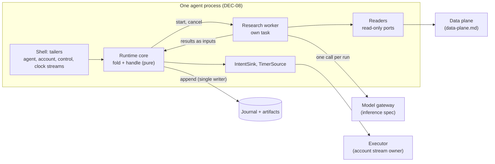

# Agent Harness Spec (v1)

| | |
|---|---|
| **Status** | v0.1, draft for review ([DEC-431](../project/decisions/DEC-431.md)). Items 1 to 14 and 20 to 25 of DEC-431 are agent readings; items 15 to 17 were decided by the founder on 2026-10-03; items 18 and 19 are Proposed for the founder, and the spec proceeds on the conservative option of each. Where this spec needs a rule in another spec, it says so, and that rule lands in that spec's own change |
| **Implements** | [HLD §5](../HLD.md#5-agent-runtime), [§6 flows B to D](../HLD.md#6-key-flows), [§9](../HLD.md#9-intelligence-layer); PRD FR-3.9, FR-5.1; backlog E19 (new), and the harness halves of E6-1, E15-1, E15-3, E17-2, E17-5, E17-7, E17-8 |
| **Depends on** | [Mandate spec](mandate.md) §2, §6, §8; [journal spec](journal.md) §2, §5, §8, §9; [trading domain spec](trading-domain.md) §5.5, §7.4, §11; [inference spec](inference.md) (the callee: what happens to a model call); [data-plane spec](data-plane.md) (market data, news, filings; its §4.6 owns the capture of retrieved items, DP-3) |
| **Related** | [ADR-0002](../adr/0002-autonomous-ideation-and-retail.md), [ADR-0003](../adr/0003-earned-autonomy.md), [harness engineering note](../product/11-harness-engineering.md), [DEC-432](../project/decisions/DEC-432.md) |

The **agent harness** is the code that turns a confirmed mandate version into a running agent
process and drives that agent's loop. It holds the model at arm's length: deterministic code
gathers the data, a model reads it and writes an opinion, and deterministic code does everything
else.

## Contents

1. [Scope](#1-scope)
2. [Principles](#2-principles)
3. [Invariants](#3-invariants)
4. [Components](#4-components)
5. [Construction and lifecycle](#5-construction-and-lifecycle)
6. [The loops](#6-the-loops)
7. [Budgets, deadlines, and degradation](#7-budgets-deadlines-and-degradation)
8. [Evaluation and change control](#8-evaluation-and-change-control)
9. [Adversaries](#9-adversaries)
10. [Interfaces](#10-interfaces)
11. [What exists today](#11-what-exists-today)
12. [Decisions](#12-decisions)
13. [Open questions](#13-open-questions)
14. [Backlog](#14-backlog)
15. [Owner and explain runs: the desk](#15-owner-and-explain-runs-the-desk) (E12-5, E19-15; [DEC-2240](../project/decisions/DEC-2240.md))

## 1. Scope

### 1.1 What the harness is

1. **Construction.** Reading a confirmed mandate version and the configuration it pins, checking
   them, and starting one agent process (DEC-08).
2. **The trading loop.** Perception, memory, signal models, the order builder, autonomy,
   escalation, the gate dry run, and the handoff to the executor
   ([HLD §5](../HLD.md#5-agent-runtime)). The rules for each step are in the mandate and trading
   specs. This spec says how the process drives them, in what order, and what happens at each
   boundary.
3. **The research loop.** The research agent of
   [mandate spec §8.4](mandate.md#84-the-research-agent-dec-97-adr-0002): when it runs, what data it
   gathers, what goes into the model's inputs and what never does, how its output is checked and
   judged, its budgets, and its records.
4. **Evaluation.** How research-agent versions are judged, and how a prompt, retrieval, or model
   change is versioned.

### 1.2 What the harness is not

- **It never sizes, prices, or places an order** (`AGENTS.md` rule 4, DEC-04). The order builder
  sizes ([mandate spec §8.3](mandate.md#83-order-builder-conviction_linear-dec-47-dec-60)), the gate
  decides, and the executor sends. The harness hands intents to the executor through `IntentSink`
  and never talks to a broker (rule 12).
- **It never changes the envelope** (rule 11). It reads a confirmed version. Only the working
  universe and its theses change at runtime, and only through
  [§8.5](mandate.md#85-admission-and-removal-dec-97-dec-101-dec-103).
- **It is not the risk gate.** Its gate call is a dry run that can only narrow a proposal. The
  binding gate runs on the account stream, which the executor owns.
- **It is not the model gateway.** Every model call goes through the gateway of the
  [inference spec](inference.md). The harness has no route to a model endpoint (inference spec §8.2).
- **It is not the data plane.** It reads market data, news, filings, and reference data through the
  data plane's read interface (§10.2).
- **It does not compile mandates.** The compiler ([mandate spec §7](mandate.md#7-compiler-and-platform-proposals-dec-97))
  runs in workspace control services.
- **It does not run user-supplied code.** WebAssembly plug-ins are Won't (v1).
- **It holds no credentials.** Broker credentials stay with the executor's connector and the vault;
  model provider keys stay with the gateway (rule 7, INF-14).

### 1.3 Terms

| Term | Meaning |
|---|---|
| Runtime core | `mandate-runtime`: the pure state machine. `fold` replays an event; `handle` is the only producer of effects |
| Shell | `mandate-shell`: the process that runs the core's effects, tails streams, and binds the stages |
| Research worker | The research-run logic, in its own crate `mandate-research-run` (planned, layer 5, below `mandate-runtime`), with every I/O behind a port the shell implements (§4). It gathers data, calls the gateway, and hands results to the core. It never appends to the journal |
| Research run | One bounded pass of the research loop: a cut-off instant, one retrieval, one model call, and one set of candidate theses and invalidations |
| Research entry | The research agent's registry entry ([inference spec §4.1](inference.md#41-registry-entry)): identity, template, output schema, deadline, and token limit. This spec adds its **retrieval plan** and **validation bounds** to what the entry's content hash covers (§10.1). The mandate pins that hash ([§8.1](mandate.md#81-signal-model-contract-dec-52-dec-97)) |
| Retrieval plan | The fixed, deterministic list of reads a run makes before its call: which data, for which instruments, over which window, with which caps |
| Cut-off (`as_of`) | The instant a run reads data up to. No read returns a record whose knowledge time ([data-plane spec §5.2](data-plane.md#52-two-time-axes)) is after it (DP-1). It is the call's `as_of` (inference spec §3.1) |
| Data universe | The instruments research may read about: the profile's pinned data universe where one exists (the research basket in the thin slice, DEC-103), otherwise the instruments in `universe.asset_classes` |

## 2. Principles

1. **The model writes opinions; code acts.** A model output is a candidate thesis or an
   invalidation. It is never an order, an approval, a mandate change, or a request for an action.
2. **Code gathers; the model reads.** All retrieval happens before the call, in deterministic code,
   from allowlisted sources (inference spec §8.3). The model is given no tools (INF-5).
3. **Journal before use.** Every retrieved item is journaled as `ObservationRecorded` before the
   model reads it ([data-plane spec §4.6](data-plane.md#46-the-research-query-interface), DP-3), and
   a model response is committed to the agent stream before anything reads it to decide.
4. **Replay never calls a model** (INF-10). Every decision is rebuilt from the journal and its
   artifacts.
5. **Missing means safe** (INF-4). An error, a spent budget, or a refusal is a missing output. A
   missing output never enlarges a buy and never forces a sell (MI-10).
6. **Research is slow and optional; trading is not.** Nothing on the trading path waits for research
   (INF-13).
7. **Least context.** A model sees public data, the agent's own memory, and the owner's description.
   Nothing else (INF-8).
8. **Pinned, not tuned.** The template, retrieval plan, output schema, bounds, deadline, and model
   identity are inside the content hash. Changing any of them is a new signal-model version, which is
   a mandate change the owner confirms (§8.4).

## 3. Invariants

Every rule in this spec must keep these true. Each is a named test (ADR-0001 ES-11) whose oracle
computes the expected result its own way and is shown to catch a seeded bug before it is trusted. A
**compromised model** is a gateway double that returns, for every call, an arbitrary schema-valid
output chosen by the test.

The harness assumes the gateway holds INF-1 to INF-16. Where an invariant below depends on one, it
names it; the gateway's own tests prove the INF side, and these prove the caller side.

| ID | Invariant | How it is tested |
|---|---|---|
| HI-1 | **Opinions only.** No model output or research run produces an `IntentProposed`, an `ApprovalResponded`, an owner command, or any other order or owner input. Model output reaches the order path only as a research-agent output that §8.3 combines | Property: with a compromised model, every `IntentProposed` follows a `DecisionMade` from the order builder whose dry run allowed it. `mandate-research-run` sits at layer 5, below `mandate-runtime` (layer 6), so it cannot name `IntentSink` (rung 1, `xtask/layers.toml`) |
| HI-2 | **Journal before use.** Every item a call's inputs hold is in a committed `ObservationRecorded` before the core emits the call effect (data-plane spec §4.6, DP-3). Every model output any decision reads is in a committed `ModelInvocationRecorded` earlier in `seq` than the first event that depends on it (INF-10, caller side) | Property over random append failures, including `Ambiguous` and `Unavailable`, and crashes between retrieval and the reply: no call effect precedes its observations' commit; no thesis record, `ModelOutputRecorded`, or `DecisionMade` cites a response without an earlier committed record; a crash after retrieval leaves every item on the stream (DP-3's replay test) |
| HI-3 | **Replay without a model.** Folding the agent stream reproduces every thesis record, `ModelOutputRecorded`, and `DecisionMade` byte for byte | Replay with a gateway port that fails the test on any call; compare drafts with stored bodies |
| HI-4 | **Reads only, and no tools.** The retrieval plan's readers can only read. No reader, and nothing in the model's output, can place, cancel, or change an order; approve; append to any stream; change a mandate, policy, allowlist, or universe; read the vault; or reach a host other than the data plane. The model names no read (INF-5) | A test enumerates every data port `mandate-research-run` declares and asserts each only returns data (rung 2). The layer rule does not hold this: a layer-5 crate could still declare a write port, so review keeps it out (rung 3). The output schema has no member the harness executes |
| HI-5 | **The envelope does not move.** No research run, under any model output, changes an envelope field or the policy (MI-16, INF-16) | Property: the mandate version and the policy digest are equal before and after any sequence of research runs with a compromised model |
| HI-6 | **Missing is safe.** Every error kind of [inference spec §3.3](inference.md#33-error-kinds), and every harness rejection of §6.5, yields no output for that run. The order builder then counts the model as missing: 0 for exits, fully bearish for buys (§8.3, MI-10, INF-4) | Property: for each error kind and each rejection, the builder's buy value is at most its value with the model removed, and no sell is proposed that is not proposed without it |
| HI-7 | **Research never blocks trading.** For any input sequence, the trading loop's drafts are the same whatever the research worker's latency, failure, or crash, apart from the research outputs that arrive as inputs (INF-13, caller side) | Property: replay one input sequence with research latency drawn at random, including never finishing; the drafts not caused by research are identical |
| HI-8 | **Runs are bounded.** At most one run is in flight per agent. No run starts before `next_proposal_at` (§5.3). No run reads more than its retrieval plan's caps or makes more than one model call. Spend caps are the gateway's (INF-7) | Property over random schedules and crashes, with an independent count of runs and calls from the journal and the meter stream |
| HI-9 | **A spent budget means fewer ideas, never more risk.** With a binding cap or budget, no buy draft is larger than without it, no opening or increase exists that does not exist without it, no sell is proposed that is not proposed without it, and every risk-exit, protective-order, and kill-switch draft is byte-identical (DEC-120, INF-7, rule 2). Stale research outputs may shrink or withhold buys (§7.3 step 3), and a discretionary exit that waited on a research verdict may be absent, as under any model outage (MI-10); both are the intended effect | Property: one input sequence run with and without a binding cap; compare every draft pairwise by an independent oracle on size and side |
| HI-10 | **Injected text is bounded.** Whatever a news item or filing says, it can at most yield a thesis or an invalidation. A thesis enters the working universe only through §8.5, and its first order is decided by the autonomy rules with the admission ceiling (§6.2 step 5). An invalidation only removes (MI-19). With a compromised model, no limit is breached | The adversarial bench (E19-6): injection fixtures for every source, and a compromised model; zero limit breaches, zero orders without a dry-run allow |
| HI-11 | **Inputs hold only what they may.** A call's inputs contain only: data from the data plane at or before the cut-off, the agent's own memory (§6.4), the owner's `behavior.description`, and the working-universe facts §6.4 lists. Never a credential, a vault reference, personal data, a dollar figure of the agent or account, or another agent's or workspace's data (INF-8, caller side) | Canary test: plant canary values in the vault, in another agent's memory, in another workspace, and in the agent's equity; scan every prompt artifact of a run for them |
| HI-12 | **No credentials in the harness.** The harness process holds no broker credential, no vault access, and no provider key (INF-14, caller side) | The process starts and runs with the vault and every provider key absent from its environment; a static check that the research path names no vault port |
| HI-13 | **No look-ahead.** Every read filters on knowledge time at or before the run's cut-off (DP-1); published or event time is a displayed field only. A thesis's `as_of` is the cut-off, never a time the model states | Property: a data-plane double holding records whose event time is before the cut-off and knowledge time after it; no observation or artifact of the run contains them |
| HI-14 | **Risk reduction does not depend on research.** With the gateway and the research worker removed, every exit, protective order, and kill switch still runs (rule 13, INF-13) | Run the trading loop with no research worker and a failing gateway; the kill switch, owner exits, and the family-F flatten cases still pass |
| HI-15 | **Mode gates research.** No run proposes while the effective mode is not `normal`. No call is made while the mode is `paused` or `stopped` | Property over random mode changes, including during a run |
| HI-16 | **One writer.** Only the runtime core appends to the agent stream (journal spec §1, principle 3). The research worker hands results to the core as inputs | An xtask check, added by E19-3, that `mandate-research-run` depends on no journal crate (rung 2); a fenced-writer test |
| HI-17 | **The version in effect judges.** An output whose model identity differs from the pin of the version in effect when it is judged is ignored (`not_pinned`). Admission is judged under the version in effect, never the one the run started under | Property over random version changes during runs |
| HI-18 | **The platform decides the facts.** A thesis's identity, timing, asset class, sources, and corroboration come from platform data, never from the model's text (MI-16, DEC-132 items 6 and 7) | Property: a compromised model that states false facts for each of these fields; the journaled record carries the platform's values |
| HI-19 | **An invalidation removes at once** ([mandate spec §8.6](mandate.md#86-thesis-lifetime-and-revision-lineages-dec-118-dec-111), MI-19). No research run starts while the journal cannot record an invalidation verdict (§6.2 preconditions). Once a verdict is accepted, the instrument is removed in the same fold step, and no opening or increasing draft in it follows | Property over random theses, invalidations, and renewals: an independent oracle replays the verdicts and asserts the instrument is exits-only from the step after each; a start attempted before the record exists emits no call |
| HI-20 | **The kill switch is accepted in every state the process is up.** In `Recovering`, `Running`, `Paused`, and `Holding`, a kill switch or owner Stop is applied before any other input, and the agent goes to `Stopping` (rule 13). While no process is up, §13 item 1 applies | Extends E19-1's crash-in-every-state property: a kill switch arriving in every state, including during reconciliation, ends in `Stopping` with the agent-scoped plan and no cancel-all or close-position |
| HI-21 | **No model call inside the tick.** The decide step never calls or waits on the gateway. Every model output, fast tier included, enters the core as an input after its record commits, and a missing or late output is missing (§6.8, rule 3, MI-10). No exit's latency depends on a model provider | A gateway double that stalls for ever on every call: the decide step stays within ES-24's budget, and every exit, protective-order, and kill-switch draft is identical to a run with no gateway at all |
| HI-22 | **Every candidate has a journaled verdict.** Every candidate thesis and invalidation of a judged run is journaled with its verdict, a harness check's reason or the admission's (§6.5). No run is judged while no record can hold a harness verdict (§6.2 preconditions) | Property with a compromised model: the count of journaled verdicts equals the count of candidates in the committed responses, by an oracle that parses the response artifacts itself |
| HI-23 | **Only cited licensed text is kept, in what the harness writes** (DEC-431 item 17). The harness never writes licensed text a thesis did not cite to the journal's artifact store: not in an observation, a prompt artifact, or an evidence artifact (§6.6). The model's response is outside this invariant: it may echo licensed text, a disclosed residual (§6.6) | Plant a canary phrase in an uncited licensed item; scan every observation, prompt, and evidence artifact the run wrote. The same phrase in a cited item is found, among those, only in the thesis's evidence artifact. The response artifact is not scanned |

## 4. Components

- **The runtime core** is the only component that decides and the only writer of the agent stream.
  It stays pure: no clock, no randomness, no I/O.
- **The research worker** runs on its own task, scheduled apart from the core, so a slow or hung
  call cannot delay a tick (HI-7). The core tells it when to start and when to cancel. It hands every
  result back as an input. Its logic lives in `mandate-research-run` (layer 5): below
  `mandate-runtime`, so it cannot name `IntentSink` (HI-1), and with no journal dependency (HI-16).
  The shell (layer 8) implements its gateway, data-plane, and artifact ports.
- **The readers** run the retrieval plan against the data plane and the folded journal. They have
  read ports only (HI-4).
- **The executor** owns the account stream, the binding gate, risk exits, protection, and
  reconciliation. It copies `UniverseChanged` from the agent stream's thesis records (journal spec
  §2).

## 5. Construction and lifecycle

### 5.1 Construction

The deployment manager starts a process with a workspace id, an agent id, and a deployment id. In
Phase 1 the founder's CLI plays that role. The process then:

| Step | Reads | Checks | On failure |
|---|---|---|---|
| 1. Identify | The control stream's latest `AgentDeployed` for the agent | The deployment exists, has no `AgentStopped` after it, and names a mandate version | Exit; the deployment manager alerts the owner |
| 2. Load the mandate | The mandate document by its hash from the configuration store (journal spec §8) | Its SHA-256 equals the version; it passes the schema and every V-rule that reads only the document | Exit; nothing is appended |
| 3. Load the policy | The effective policy values and the workspace profile | The overlay is computable. A key it cannot read is taken at its strictest value (rule 3) | Exit if no policy can be read |
| 4. Load signal models | Each model's registry entry by `(id, version, content_hash)` (V-007, inference spec §4.1) | Every pinned triple is registered and not withdrawn. The research entry carries a retrieval plan and validation bounds and re-hashes to its content hash | A withdrawn or unloadable model is missing from the start (§8.1). Construction continues |
| 5. Check the description | `behavior.description` | The gateway's prompt guard (inference spec §8.3) passes on it | Research is disabled for this version and the owner is alerted with opaque text: every call would end `input_rejected` |
| 6. Load configuration | The source allowlist version, the instrument snapshot, the calendars, the screens | Each object re-hashes | Exit if the trading loop needs it; otherwise research alone is disabled |
| 7. Take the writer | `writer_epoch + 1` on the agent stream (journal spec §5.1) | The stream head matches | `Fenced` or a head mismatch: exit |
| 8. Recover | Fold every followed stream, then `handle(Started)` | The startup hold `awaiting_reconciliation` is journaled before anything is re-handed (DEC-131) | — |

**What construction pins** for the life of the version: the mandate version, each signal model's
`(id, version, content_hash)`, the research entry, the allowlist version in effect, and the harness
build digest (`actor.build`, journal spec §3). A new mandate version re-runs steps 2 to 6 inside the
running process (§5.4). It never retakes the writer.

**A failed start leaves protection in place.** Protective orders rest at the broker, and risk exits
and the account-scoped kill switch belong to the executor. The agent-scoped kill switch while the
process is down is §13 item 1.

### 5.2 Process states

```mermaid
stateDiagram-v2
    [*] --> Constructing: deployment manager starts the process
    Constructing --> Recovering: steps 1 to 7 pass
    Constructing --> [*]: a check fails (exit, owner alerted)
    Recovering --> Running: reconciliation confirms (hold lifts)
    Recovering --> Paused: reconciliation finds unexplained orders or positions
    Running --> Running: mode normal or exits_only; a version applies
    Running --> Paused: owner pause, a risk limit, or an anomaly
    Paused --> Running: owner resume with step-up, or the limit lifts
    Running --> Stopping: kill switch or owner Stop
    Paused --> Stopping: kill switch or owner Stop
    Recovering --> Stopping: kill switch or owner Stop, applied first
    Holding --> Stopping: kill switch or owner Stop
    Stopping --> Stopped: flatten confirmed or handed off
    Running --> Holding: goal complete, on_complete hold_protected or disarm_ladder
    Holding --> Retired: owner releases or closes
    Running --> Retired: on_complete release, or profit_stop reached and flat
    Stopped --> Retired: AgentStopped journaled
    Retired --> [*]
```

`Running`, `Paused`, `Holding`, and `Stopped` map onto the HLD lifecycle's `Live`, `Paused`,
`Completed`, and `Stopped`, and onto [mandate spec §2](mandate.md#2-lifecycle)'s `Deployed`,
`Holding`, and `Retired`. The modes inside them are [trading spec §7.4](trading-domain.md#74-agent-modes)'s.
A crash in any state returns to `Constructing`.

| State | Entered by | What it blocks | How it ends, and who ends it |
|---|---|---|---|
| Constructing | The deployment manager (or the CLI) | Everything: no process exists to act | The steps pass (the process), or a check fails (the process exits; the deployment manager retries with back-off and alerts the owner). A kill switch or Stop committed while no process is up is §13 item 1 (DEC-431 item 19); once the process is up, §5.1 step 8 handles it first |
| Recovering | Step 8; mode `paused` through the local hold `awaiting_reconciliation` | Openings, increases, and research. An exit already handed off is re-handed only if the fold allows | The account stream records a `ReconciliationRun` at or after the last observed submission with nothing outstanding (the core lifts the hold). A mismatch pauses the agent until the owner acknowledges with step-up ([trading spec §11](trading-domain.md#11-reconciliation)). A kill switch or owner Stop is accepted here and applied first, ahead of the hold: the agent goes to `Stopping`, and an `Unknown` order holds exits only in its own instrument (rule 13, HI-20) |
| Running, `normal` | Recovery, resume, or a lifted limit | Nothing beyond the mandate and the gate | A mode change, Stop, a kill switch, goal completion, or a crash |
| Running, `exits_only` | A restriction of [mandate spec §5.9](mandate.md#59-restrictions-and-the-effective-mode) | Openings and increases. Research runs review-only: it may invalidate, never propose (§6.7) | The restriction lifts by its own path (MI-3) |
| Paused | Owner pause, `flatten_and_pause`, a reconciliation mismatch | New orders except re-placing protection; research and model calls (HI-15). Resting protection stays; the kill switch works | Owner resume with step-up for an owner pause; the owner's acknowledgment for a latched limit. A resume never lifts a latched limit. A kill switch or Stop goes to `Stopping` |
| Stopping | Kill switch or owner Stop | Everything except the flatten and protection re-placement. A run in flight is cancelled | The executor confirms the flatten, or it is handed off whole ([trading spec §5.5](trading-domain.md#55-kill-switch)) |
| Holding | `GoalCompleted` with `hold_protected` or `disarm_ladder` | Openings (the `goal_complete` restriction). No research: the goal is done | The owner releases or closes, with step-up. A kill switch or Stop goes to `Stopping` (HI-20) |
| Stopped, Retired | Stop completes; `AgentStopped` | Everything | Terminal. The process exits after `AgentStopped` is committed |

### 5.3 Research run states

```mermaid
stateDiagram-v2
    [*] --> Idle
    Idle --> Due: risk clock reaches next_proposal_at, and the mode allows
    Due --> Retrieving: the core starts the run
    Due --> Idle: mode, version, or a disabled research agent; nothing is called
    Retrieving --> Calling: ObservationRecorded batch committed (§6.2 step 2)
    Calling --> Judging: ModelInvocationRecorded committed with outcome ok
    Calling --> Idle: ModelInvocationRecorded committed with an error outcome
    Retrieving --> Cancelled: mode tightens, kill switch, Stop, or a version change (§5.4)
    Calling --> Cancelled: as above
    Judging --> Idle: candidates checked and judged; records committed in one batch
    Cancelled --> Idle: a late result is journaled and never used
```

- **When a run is due.** At most one run is in flight per agent. A run is due when the risk clock
  reaches `mandate_research::next_proposal_at(last_call, behavior.research.interval_s)`. `last_call`
  is the later of the last `ModelInvocationRecorded` with purpose `research` and the last
  reservation the gateway's meter stream holds for this agent (inference spec §3.6). A crash loop
  therefore cannot call faster than the interval, because the reservation is appended before the
  call leaves. Event sources such as a news burst never bring a run forward.
- **A late result.** A result that arrives after its run was cancelled is still journaled as
  `ModelInvocationRecorded`, with the gateway's outcome, so the record of the call is complete. No
  output event follows it, and nothing reads it.

### 5.4 Boundaries

| Boundary | Trading loop | Research loop |
|---|---|---|
| Regular-session close | Unchanged. The core evaluates at its cadence; discretionary equity exits defer to the open ([§6.2](mandate.md#62-evaluation) step 2); an evaluation runs at the open | Runs continue. A thesis admitted outside the session waits for its stagger offset, counted from the next regular-session open for equities (§8.4) |
| Midnight America/New_York | `RiskDayStarted` on the account stream; the ask budget resets (§6.4) | The spend caps reset by risk day (inference spec §7.3). A run in flight continues; its call counts against the risk day the gateway's meter assigns it |
| Restart | §5.1 step 8: replay, startup hold, reconciliation | A run in flight is lost. Its reservation stays counted (DEC-432 item 4). Its call is never re-sent under the old `call_id` (inference spec §3.4), and any output it had is never used, because nothing was journaled. A run whose record committed but whose judging batch did not is not judged after the restart: it ends there. The next run waits for `next_proposal_at` |
| Version change ([§2.2](mandate.md#22-applying-a-new-version)) | A reducing or neutral version applies immediately; an increasing one at the next evaluation with no `Unknown` order. Pending approvals are cancelled | A version that changes the research agent's pin, clears `behavior.research`, or pins the universe cancels the run in flight. Any other version lets it finish, and its candidates are judged under the version in effect (HI-17) |
| Kill switch, Stop | The core applies the final mode first, cancels approvals, and hands one agent-scoped flatten plan | The run is cancelled at once. No run starts again |
| Pause | Mode `paused`; pending approvals cancelled | The run is cancelled. No call until resume (HI-15) |
| Policy change | The overlay applies at the next evaluation ([§4.3](mandate.md#43-policy-hierarchy-dec-51-dec-98)) | A lower spend cap binds at the gateway's next reservation; a longer `research_interval_s` binds at the next due time |
| Model withdrawn | Outputs of the withdrawn model count as missing (§8.1) | The run is cancelled; the gateway refuses calls with `model_withdrawn` |

## 6. The loops

### 6.1 The trading loop

The trading loop is the E6-1 tick, unchanged ([task brief](../project/tasks/E6-1-agent-runtime-and-kill-switches.md),
DEC-131). For each input: act on folded state; apply the input; recompute the effective mode; expire
what is due; decide; emit effects, every draft before the handoff it authorizes.

| Stage | Source of truth | Harness duty |
|---|---|---|
| Perception | The scheduler's `ClockAdvanced`, market observations, account-stream facts, control-stream commands | Feed them to the core in `seq` order. A notification is only a hint (DEC-17) |
| Memory | Folds of the agent and account streams | No separate mutable store. Any search index over the journal is derived from it and rebuilt from it |
| Signal models | Quant models in process; the research agent's latest fresh output per instrument ([§8.2](mandate.md#82-output)) | Pass the core only outputs for the instrument being sized |
| Order builder, autonomy | `mandate-builder` (§8.3, §6.2) | — |
| Escalation | `mandate-approval` (§6.4) | — |
| Gate dry run | `mandate-risk` | — |
| Executor handoff | `IntentSink` | Journal `IntentProposed` first, then hand off |

**Cadence.** The scheduler ticks every second. The core evaluates at `behavior.cadence.interval_s`
and on each event source the mandate lists. ADR-0001 ES-24's budget applies to the decide step: p99
under 1 ms in process.

**Research output between runs.** A research output is fresh for its `max_output_age_s` (§8.2). If
`behavior.research.interval_s` is longer, the output goes stale between runs, and stale counts as
missing: no new buys and no forced sells. That fails safe, so no extra rule is needed.

### 6.2 The research loop

**Preconditions.** No research run starts until all three hold. Each keeps a mandate or journal
rule whole rather than reading around it:

- **An invalidation can be journaled** (E19-5). Mandate spec §8.6 removes an instrument at once when
  its thesis is invalidated, and a removal needs a journaled cause. Until E19-5 adds the record, no
  run starts, so no thesis exists that could need one (§6.7, HI-19).
- **A harness verdict can be journaled** (E15-8). `ModelInvocationRecorded` must be closed with a
  member for the candidates' verdicts, or a verdict event must exist, so that no candidate is
  refused in silence (§6.5, HI-22). Journal spec v0.46 §9.19 closes it with a `verdicts` member
  ([DEC-998](../project/decisions/DEC-998.md)); this precondition holds once `mandate-journal`
  registers it.
- **Licensed text can be sent without being kept.** Until the inference spec's prompt record keeps
  licensed text out of the artifact store (§10.1 ask 5), the retrieval plan reads only sources whose
  text may be kept in full: market data and public filings. Licensed news waits (§6.6, HI-23).
  When it is read, the model's response may echo it (§6.6's residual), so a source is allowlisted
  only if its terms allow keeping that echo in the response for the retention period too; counsel's
  per-vendor answer covers it.

One run, in order:

1. **Start.** The core checks the mode (HI-15), that research is configured and not disabled or
   withdrawn, and that the run is due (§5.3). It assigns a run id from `IdGen` and a cut-off: the
   risk-clock instant at which it starts the run. It emits a start effect; nothing is journaled yet.
2. **Retrieve and capture.** The readers run the research entry's retrieval plan (§6.3) at the
   cut-off. The worker hands the items to the core, which journals each as `ObservationRecorded`
   ([journal spec §9.1](journal.md#91-agent-stream-payload-schemas-dec-177)) in one batch, **before**
   it emits the call effect. That is the data-plane spec's capture-at-use rule (§4.6, DP-3): the
   data-plane spec owns the duty, the journal spec owns the event, and this spec places it in the
   loop with the core as its writer (HI-2, HI-16). Each observation's `data_ref` is the item's
   record as §6.6 says. For each news or filing item the shell also builds the typed observation
   E17-5's drift detector folds (§6.3), and that record is what the observation's artifact holds, so
   replay rebuilds the fold from the journal.
3. **Call.** The worker sends one call to the gateway: purpose `research`, the pinned model
   reference, the typed inputs (§6.4), the cut-off as `as_of`, and a `deadline` of the call's
   dispatch instant plus the entry's `deadline_ms`, on the wall clock (inference spec §3.1). The
   retrieval time is not taken from the model's budget; the run's own wall-clock bound is §7.1's. The gateway renders the prompt from its pinned template,
   reserves the cost, guards the prompt, calls, and validates the output against the entry's output
   schema.
4. **Record.** The worker hands the gateway's result to the core, which journals
   `ModelInvocationRecorded` with the run id as `correlation_id` and, as its retrieved context, the
   event ids of step 2's observations rather than the items again. On any error outcome the run ends here (HI-6).
5. **Judge.** The core checks each candidate (§6.5), runs `mandate_research::admit` on each that
   passes, against its folded facts, and journals in one batch: the candidates' verdicts, a
   `ThesisProposed` or `ThesisRevised` for each thesis admission judged
   ([journal spec §9.4](journal.md#94-research-agent-thesis-records-dec-413)), and a
   `ModelOutputRecorded` for each thesis as journal spec §9.1 prescribes: `ignored` null for an
   admitted one, which is then the research agent's §8.2 output, and the reason for one §8.5 checks 1
   to 3 refuse.
6. **Copy.** The executor copies each admission to the account stream as `UniverseChanged`, with a
   `causation_id` naming the thesis record. Only the account stream's fold is the working universe
   ([§2.3](mandate.md#23-the-working-universe-at-runtime-dec-97)). A record with `admitted: true`
   admits nothing until that copy exists.

**One call per run in v0.1.** The model cannot ask for more data. A multi-call run, in which the
model's output names further reads that the harness then runs, would make the model choose its own
inputs, which inference spec §8.3 rules out for now. It is §13 item 6.

### 6.3 Retrieval

The retrieval plan is part of the research entry, so it is pinned by the content hash. Every read
takes its scope (workspace, agent, cut-off, data universe, allowlist version) from the harness. The
model never names a read.

| Read | What it gathers | Caps (defaults) | Scope |
|---|---|---|---|
| `bars` | Daily bars for each data-universe instrument, ending at or before the cut-off | 20 bars per instrument | Data universe |
| `quote` | The last quote at or before the cut-off, with its time and sanity flag | 1 per instrument | Data universe |
| `screens` | The results of each screen the plan names: registered, versioned, deterministic screens over the data universe | 50 instruments per screen | Data universe |
| `news` | Items from allowlisted news sources about data-universe instruments with knowledge time in the window before the cut-off (DP-1): item id, source id, published time (displayed only), headline, summary, link, content hash | 48 hours of knowledge time; 50 items; 2,000 bytes per item | Allowlisted sources (DEC-101). Licensed news waits for the third precondition of §6.2 |
| `filings` | Entries from allowlisted filing sources for held and screened instruments with knowledge time in the window before the cut-off: id, source id, form, filed time (displayed only), an excerpt, content hash | 7 days of knowledge time; 20 entries; 4,000 bytes per excerpt | Allowlisted sources |
| `instruments` | Reference facts for every instrument above: asset id, symbol, asset class, eligibility verdict, instrument group, leveraged-ETP flag | — | Instrument snapshot |
| `positions` | This agent's held instruments: held since, whether removed, the current thesis id. No quantities or dollar amounts | — | This agent only |
| `theses` | This agent's active theses, and its closed theses of the last 90 days with their E17-8 scores: the [§9.4](journal.md#94-research-agent-thesis-records-dec-413) members, without prompt or response | 50 | This agent only |

**There is nothing else.** No read fetches a URL, searches the open web, reads another agent's or
workspace's data, or reads any stream other than the folds above. When a cap cuts a read, the oldest
items go first, and the artifact records what was dropped.

**Every retrieved item is metered for drift.** The drift fold does not read `ObservationRecorded`'s
members: the event is closed with `source`, `instrument_id`, `as_of`, and `data_ref` (journal spec
§9.1), and `as_of` is the run's cut-off, shared by every item of the run. Instead, at retrieval the
shell builds for each news or filing item the typed observation `mandate-research`'s detector takes
(`InputObservation`): the source, the class, the observation instant, the content hash, and the
byte length. That same record is the artifact the item's `ObservationRecorded` names, so the fold
replays from the journal and its artifacts. The core folds each item once: an item id already
observed in an earlier run is not observed again, so re-reading it cannot fake `DuplicateContent`.
Text never reaches the detector (DEC-266 item 1).

**Which instant.** The observation instant is the item's knowledge time as the data plane reports
it ([data-plane spec §5.2](data-plane.md#52-two-time-axes)), never the retrieval instant. For a
live capture that is the platform's receipt time; for a backfill it is the source's own publication
time. The detector measures the source's traffic, and a backfill's arrival burst is ours, not the
source's: read by the retrieval instant, every item of a run would share one instant and the
baseline would be degenerate for ever.

### 6.4 Inputs

The harness passes the gateway typed inputs. The gateway renders the prompt from the entry's pinned
template (inference spec §3.1); callers never pass free-form prompt text.

| Goes in | Never goes in |
|---|---|
| The retrieved data of §6.3, each item marked as untrusted third-party data with its item id and source id | Credentials, tokens, vault references, provider keys |
| `behavior.description`, which construction checked against the prompt guard (§5.1 step 5) | Personal data: names, emails, phone numbers, broker account numbers, user ids |
| The cut-off, the data universe, `universe.asset_classes`, `universe.max_instruments`, and the current working universe | Allocation, limits, equity, P&L, or any other dollar figure of the agent or account. Sizing is not the model's business |
| Held instruments, and the agent's own theses and their scores | Other agents' or other workspaces' data, the aggregate-flow monitor, operator halts |
| For a revision, once allowed (§6.5): the predecessor and its score | Approval content, owner commands, notification text, autonomy rules, delegations, tripwires, the review date |

**Untrusted data is marked, not trusted to stay marked.** The template puts retrieved text in
delimited data sections and says it is data. That lowers, but does not remove, the chance that
injected text steers the model. HI-10 is what bounds the result.

### 6.5 Output and checks

The output schema is `{"theses": [...], "invalidations": [...]}`. The gateway refuses any output
that fails it (`schema_invalid`), so ranges, counts, and the horizon bound are enforced there. The
schema sets: `conviction` in [−1, 1], `confidence` in [0, 1], `horizon_s` from 1 day to the entry's
maximum (default 30 days), at most 4 theses, and invalidations that name distinct thesis ids.

The harness splits every thesis field into what the model says and what the platform decides
(HI-18). A model that stated its own asset class, corroboration, or timing would decide §8.5 checks
for itself, which MI-16 forbids (DEC-132 items 6 and 7).

| Field | Who fills it | Rule |
|---|---|---|
| `instrument` | Model, as a symbol | Resolved to an `asset_id` from the instrument snapshot |
| `direction`, `conviction`, `confidence`, `horizon_s` | Model | Schema ranges. `direction` is passed through, so that §8.5 check 1 journals a non-long one |
| Thesis text, `invalidation` | Model | Stored as artifacts; screened below |
| `evidence` | Model, as item ids | Each must be an item this run retrieved |
| `predecessor_thesis_id`, autopsy | Model, revisions only | Refused until §8.6 item 5 allows revisions |
| `thesis_id`, `lineage_id`, `revision` | Platform | A new thesis starts its own lineage. A thesis for an instrument with an active thesis is a renewal: same lineage and revision. A revision is its predecessor's revision plus one |
| `as_of`, `expires_at` | Platform | `as_of` is the cut-off; `expires_at = as_of + horizon_s` (§8.2) |
| `asset_class` | Platform | From the instrument snapshot |
| `evidence_sources`, `evidence_ref` | Platform | The sources of the cited items, as retrieved; the cited items as an artifact |
| `corroboration` | Platform | Derived from the retrieved items and market data by E17-7's rule (§13 item 3) |
| `model_id`, `model_version`, `content_hash`, `allowlist_version` | Platform | From the pins |

**Harness checks** run after the gateway's schema check and before admission. They cover only what
needs platform data. Each failure is journaled with its reason among the candidates' verdicts, never
as a §8.5 reason:

| Reason | When |
|---|---|
| `unknown_instrument` | The symbol does not resolve in the instrument snapshot |
| `unknown_evidence` | An evidence id is not an item this run retrieved |
| `duplicate_instrument` | A second thesis for an instrument already in this output |
| `forbidden_language` | The text states a price target or a likely profit (DEC-126). The research agent may be directional (§8.1), so a word like "buy" alone is not refused. The gateway's output limits are the first layer (inference spec §4.3); this is the second |
| `revisions_not_enabled` | A revision before §8.6 item 5 allows it |
| `unknown_thesis` | An invalidation names a thesis that is not this agent's active thesis |

Everything else goes to admission, so §8.5's ordered checks decide and are journaled: a non-long
direction, a predecessor mismatch, a pinned universe, the cost cap, a halt, the floor, the allowlist,
corroboration, the lineage cap, and a full universe.

### 6.6 Records

| Event | Stream | When | Status |
|---|---|---|---|
| `ObservationRecorded` | agent | Every retrieved item, before the call effect (§6.2 step 2) | Closed in [journal spec §9.1](journal.md#91-agent-stream-payload-schemas-dec-177). The duty is the [data-plane spec's §4.6](data-plane.md#46-the-research-query-interface) (DP-3) |
| Meter reservation and settlement | `meter:{workspace_id}` (gateway) | Before the call leaves, and on completion | Closed in [journal spec §9.19](journal.md#919-model-gateway-records-dec-998) (`MeterReserved`, `MeterSettled`; DEC-998) |
| `ModelInvocationRecorded` | agent | After every call, whatever the outcome, including a late one | Closed in [journal spec §9.19](journal.md#919-model-gateway-records-dec-998) with DEC-432 item 11's members and this spec's two: the run id as `correlation_id`, and the retrieved context as `observations`, the event ids of the run's `ObservationRecorded` |
| Candidate verdicts | agent | With the judging batch | The `verdicts` member of `ModelInvocationRecorded` (journal spec §9.19 rule 151, DEC-998 item 1). Until `mandate-journal` registers it, no run is judged (§6.2 preconditions, HI-22) |
| `ThesisProposed`, `ThesisRevised` | agent | Every thesis admission judged | Closed in [journal spec §9.4](journal.md#94-research-agent-thesis-records-dec-413) |
| `ModelOutputRecorded` | agent | Each judged thesis, `ignored` null only when admitted | Closed in [journal spec §9.1](journal.md#91-agent-stream-payload-schemas-dec-177) |
| `UniverseChanged` | account | The executor's copy of an admission or removal | Closed in journal spec §9.3 |
| Invalidation verdict | agent | Each accepted invalidation (§6.7) | **Missing.** E19-5 adds it to the journal spec first. Until then no research run starts (§6.2 preconditions) |
| `OwnerAlertSent` | control | A guard hit on the description, a lineage retirement, a construction failure | In journal spec §9 |

**What is kept, and for how long** (DEC-431 item 17, the founder's: keep only what a thesis cited).
Journal artifacts are kept for the retention period, six years at least (journal spec §6.2), so
the journal holds no licensed text that no thesis cited:

| Content | What the journal keeps |
|---|---|
| Market data, public filings and XBRL facts | The data itself, as the observation's artifact. It is public or ours to keep (data-plane spec §4.5) |
| A licensed news item, cited or not | Its record without text, as the observation's artifact: source, item id, allowlist version, knowledge and published times, raw-bytes digest, byte length, class |
| A licensed news item a thesis cited | Its text too, as the thesis's `evidence_ref` artifact, captured when the thesis is judged (data-plane spec §4.5's "captured at use") |
| The rendered prompt | The gateway's `request_digest`, and a prompt artifact in which each licensed item's text is replaced by its raw-bytes digest (§10.1 ask 5) |
| The model's response | In full, as the model's output of record. **Disclosed residual:** a response may quote licensed text, cited or not, and the harness cannot strip it without changing the record. So a source whose terms do not allow that echo to be kept for the retention period is not allowlisted (DEC-431 item 17's rule; §6.2 precondition 3) |

Replay of decisions (HI-3) needs none of the dropped text: it reads the responses, the observations,
and the verdicts. A byte-exact prompt can be rebuilt only while the point-in-time store still holds
every item's text, which is the licence's horizon; regression evaluations (§8.3) therefore use only
runs inside it. Notifications about any of this carry only opaque ids (rule 6).

### 6.7 Invalidation

[§8.6](mandate.md#86-thesis-lifetime-and-revision-lineages-dec-118-dec-111) removes an instrument
at once when its thesis's invalidation condition holds. The condition is the model's own text, so
deterministic code cannot evaluate it. `mandate_research::expire_theses` takes the verdict from its
caller (DEC-132 item 13). The harness supplies it like this:

- Every run's inputs include the agent's active theses. The output may list a thesis id in
  `invalidations`, with the item ids that show the condition holds.
- An accepted invalidation removes the instrument at once, exactly as §8.6 says: the verdict is
  journaled, the executor copies `UniverseChanged` (`thesis_invalidated`), and the instrument is
  exits-only from then on (MI-19, HI-19). Removal adds no risk, so the verdict is taken on the
  model's word, with no corroboration and no approval (rule 2).
- In `exits_only`, a run is review-only: its theses are discarded unjudged and only its
  invalidations count.
- **The record does not exist yet, so research does not run yet.** No agent-stream event carries an
  invalidation verdict for `UniverseChanged` to name as its cause. E19-5 adds one to the journal
  spec first. Until it lands, no research run starts (§6.2 preconditions): with no thesis, there is
  nothing to invalidate, and §8.6 holds unchanged. The same record serves the founder's DEC-433
  item 19, under which revoking a source invalidates every live thesis that cites it.

### 6.8 Fast decision models

The founder put a hosted fast tier in v1 (DEC-432 item 13, decided 2026-10-03), served through the
gateway under the same pinning, deadline, metering, and evaluation-gate rules as any model. Where its
call runs is a safety-path question, so it is DEC-431 item 18, Proposed for the founder. Until the
founder decides, this spec takes the conservative reading, and it is the only one consistent with
HI-7, HI-14, INF-13, and ES-24's 1 ms budget for the decide step:

- **The fast call never runs inside the trading tick** (HI-21). A fast worker, built like the
  research worker, calls the gateway off the tick at the cadence the mandate sets, and the result
  enters the core as `Input::ModelOutput` after its `ModelInvocationRecorded` commits.
- **A missing or late output is missing.** The tick uses the model's latest fresh output (§8.2);
  with none, §8.3 counts the model as missing: 0 for exits, fully bearish for buys (rule 3, MI-10).
- **No exit's latency depends on a model provider.** Exits, protective orders, risk exits, and kill
  switches never wait for a fast output; a stalled provider only makes outputs stale.
- The fast tier has no retrieval plan of its own: its inputs are observations the tick already
  journaled. The retail profile still excludes `fast` until counsel answers question 33 (mandate
  spec §4.3). The work is E19-10, beside E15-2.

## 7. Budgets, deadlines, and degradation

### 7.1 Per agent

| Budget | Value | Set by | Enforced by |
|---|---|---|---|
| Model spend per risk day | `behavior.research.cost_cap_usd_per_day`; **$5** for each agent in the internal paper phase (DEC-431 item 15) | The owner, in the envelope (DEC-120), at most the policy's `research_cost_cap_usd_per_day`; the founder for the internal agents | The gateway's reservation (inference spec §7.3) and §8.5 check 7 at admission |
| Proposal interval | `behavior.research.interval_s` | The owner, at least the policy's `research_interval_s` | The run schedule (§5.3) |
| Runs in flight | 1 | Fixed | The core |
| Calls per run | 1 | Fixed in v0.1 (§6.2) | The core |
| Call deadline | The entry's `deadline_ms` | Pinned with the model (DEC-432 item 1) | The gateway (INF-3) |
| Output tokens | The entry's `max_output_tokens` | Pinned with the model | The gateway |
| Retrieval caps | §6.3's table | The research entry | The readers |
| Theses per run, horizon | 4; 30 days | The research entry's output schema | The gateway's schema check |
| Run wall time | Retrieval timeout (60 s) plus the call deadline. The only bound on a run's total time; the call's own deadline is measured from its dispatch (§6.2 step 3) | The research entry | The worker; the run is cancelled |

The defaults in the table are engineering values (DEC-431 item 7). They are inside the content hash,
so changing one is a new research-agent version that the owner confirms (§8.4). The dollar figures
are the founder's, decided 2026-10-03 (DEC-431 item 15): hard caps that degrade to fewer ideas, never
to more risk, revisited after the spike's paper runs.

### 7.2 Per workspace

| Budget | Enforced by |
|---|---|
| Daily model-spend quota ([HLD §8](../HLD.md#8-multi-tenancy-and-security), "Quotas"): **$20** for each internal workspace in the paper phase (DEC-431 item 15) | The gateway (`budget_exhausted`, inference spec §7.3) |
| Monthly inference spend | Alerts at 50%, 80%, and 100% of the monthly cap ([DEC-434](../project/decisions/DEC-434.md) item 18) |
| Calls per second | The gateway's per-workspace bucket (`rate_limited_local`) |
| Allowed endpoints and regions | The workspace policy (`policy_denied`, INF-12) |

### 7.3 Degradation

When a budget binds or a dependency fails, the harness gives up ideas in this order, and nothing
else:

1. The run ends with no output (HI-6).
2. No new run starts until the next due time, and the gateway refuses until the cap resets or the
   dependency returns.
3. Research outputs go stale. Stale counts as missing: no new buys in research-held instruments, and
   no forced sells (§8.3).
4. Theses reach their horizon and their instruments become removed: exits only, paced by the conduct
   controls (§8.6).

Exits, protection, kill switches, pending approvals, and quant models are untouched at every step
(HI-9, HI-14).

**Harness treatment of each gateway error kind** ([inference spec §3.3](inference.md#33-error-kinds)):

| Kind | Treatment |
|---|---|
| `policy_denied`, `credential_invalid` | Missing. The run is not retried; research stays on schedule, and the operator is alerted |
| `budget_exhausted`, `rate_limited_local` | Missing. The next run waits for its due time |
| `input_rejected` | Missing. Repeated hits on retrieved data alert the operator with the rule, not the content |
| `model_withdrawn` | Missing; research is disabled for this version |
| `deadline_exceeded`, `provider_unavailable`, `rate_limited_provider` | Missing. The gateway has already retried what it may; the harness does not retry within the run. Three runs in a row ending `deadline_exceeded` alert the operator with opaque text, since they may still cost money (inference spec §3.3) |
| `content_refused`, `schema_invalid`, `identity_mismatch` | Missing. Never retried within the run, because sampling again until something parses would select outputs (DEC-432 item 3) |

## 8. Evaluation and change control

### 8.1 Forward paper evaluation (E17-8)

Thesis quality is judged only on forward paper outcomes the model could not have seen (DEC-99). The
window, metric, and threshold are fixed before the evaluation starts (DEC-122). The evaluator
(`mandate_research::score`) reads only journaled theses, close series, and the cost model, and runs
on the team's internal paper workspaces (DEC-103). The harness's duty is to make every thesis
scoreable: every judged thesis has a record, an `as_of` from the cut-off, and a bounded horizon.

### 8.2 Scorecards (E15-3)

A scorecard shows each signal model's results beside the pre-registered baselines, from the owner's
own journaled results only. It never changes weights or approval routing (DEC-47), is never
aggregated across users, and stays off approval screens until counsel answers compliance question
35 (DEC-126).

### 8.3 Regression evaluations

A **regression evaluation** replays a fixed set of recorded runs (retrieved inputs and cut-offs)
against a candidate research entry, through the gateway, in the internal paper workspaces. It
measures mechanics only:

| Measure | Pass condition |
|---|---|
| Outputs that pass the schema | At least the current entry's rate on the same set |
| Harness check failures, by reason | No reason rises without an explanation in the change |
| Admission verdicts | Every candidate's verdict follows from §8.5 alone (the oracle recomputes it) |
| Injection fixtures (E19-6) | Zero admissions that cite only injected items; zero limit breaches |
| Cost per run | Within the entry's maximum cost |

A regression evaluation is never evidence that theses are good; only §8.1 is (DEC-99). Its results
are never shown to owners as performance. It complements, and does not replace, the gateway's
evaluation gate before a model is offered ([inference spec §4.3](inference.md#43-evaluation-gate-before-a-model-is-offered)).

### 8.4 What a change is

| Change | What it is | Who confirms |
|---|---|---|
| Template, retrieval plan, output schema, validation bound, deadline, token limit, or model identity | A new research entry, so a new content hash, so a new signal-model version (§8.1). A mandate that pins the old one needs a new version to move, and that version is risk-increasing ([§9.2](mandate.md#92-classification)'s signal-model row) | The owner, with step-up (rule 11) |
| The provider changes weights behind a pinned snapshot | Not allowed as the pin (INF-2). If detected, the operator withdraws the entry; outputs are missing until a new version pins a new identity | The operator, then the owner |
| The source allowlist | Versioned platform configuration (DEC-101), recorded in every thesis. Not a mandate version | Platform review; journaled as `ConfigSnapshotRegistered` |
| Harness code (readers, checks, scheduler) | A platform build, named by `actor.build` on every event. Not a mandate version | CI and independent review, as for the gate |
| A model withdrawn | `PlatformOperatorAction` `model_withdrawn`; outputs count as missing (§8.1, INF-15) | The operator |

So the platform cannot change what a running research agent is shown, how it is asked, or which
model answers without the owner confirming a new version. And a DEC-99 pass belongs to the content
hash evaluated (DEC-431 item 16, decided by the founder 2026-10-03): every change to the research
entry (template, retrieval plan, bounds, or model) needs its own forward paper evaluation (§8.1,
E17-8) before users' agents may pin it.

## 9. Adversaries

| Adversary | Attack | Blocked or disclosed by |
|---|---|---|
| Careless user | Sets a very large cost cap | The policy maximum and the workspace quota (§7.2) |
| Careless user | Pastes an account number or a key into the description | The guard check at construction disables research for that version and alerts the owner (§5.1 step 5); the gateway's guard is the second layer |
| Careless user | Sets `autonomy.admission: auto` | W-006 on the confirmation screen; the eligibility floor, `max_instruments`, and the limits still bind |
| Bad model | Invents an instrument or evidence | `unknown_instrument`, `unknown_evidence` (§6.5) |
| Bad model | Reports high confidence everywhere | Confidence is labelled self-reported and uncalibrated (DEC-126); admission is `ask` by default (MI-17); the builder clips to limits |
| Bad model | Floods theses or long horizons | The schema's caps (§6.5), `max_instruments`, the cost cap |
| Bad model | States its own asset class, corroboration, or timing | The platform fills those fields (HI-18) |
| Bad model | Writes a price target or a profit promise | The gateway's output limits, then `forbidden_language` |
| Malicious content | Prompt injection in a news item or filing | HI-10: at most a thesis, then §8.5 (allowlist, corroboration, floor) and the admission ceiling. E17-5 meters the source; its escalation seam is DEC-266 item 4 |
| Malicious content | Injection that tries to make the model read another tenant's data | The model names no read; scope comes from the harness (§6.3) |
| Malicious content | Injection that tries to exfiltrate data | No outbound path exists, and the inputs hold only public data and the agent's own memory (HI-11) |
| Malicious content | Injection that forces invalidations to churn the book | An invalidation only removes; exits are paced by the conduct controls; re-entry waits for `reentry_cooldown_s` ([§5.3](mandate.md#53-position-exposure-order-size-count-and-cooldown)) |
| Malicious content | Text aimed at the approver ("approve now") | The approval card shows model text as quoted research-agent text with links to its sources (DEC-126). Disclosed, not blocked |
| Malicious insider | Changes the template or swaps the model | A new content hash needs the owner's confirmation (§8.4); the gateway never substitutes (DEC-67). With one aggregator in front of every call (DEC-432 item 14), that rests on INF-2 with DEC-432 item 9's locked routing and item 10's reported-identity check |
| Malicious insider | Adds a planted source to the allowlist | Corroboration needs an independent source or market data; every thesis records the allowlist version, so the change is visible; allowlist changes are reviewed like code |
| Malicious insider | Reads another workspace's prompts | Artifacts live in the workspace deployment, encrypted per workspace (journal spec §6.5); break-glass access only, journaled (journal spec §7) |
| Bad tick | A bad bar or quote makes a thesis look corroborated | Admission is `ask` by default; the gate uses sane marks and the collar; the thesis does not size the order |
| Model outage | The provider is down or slow | Missing means safe (HI-6); research stops; theses expire at their horizon (§7.3) |
| Runaway cost | A crash loop or a retry storm | One run in flight; the interval counts from the last reservation; no re-send under an old `call_id`; reservations stay counted (§5.3, inference spec §7.3) |

## 10. Interfaces

### 10.1 The model gateway ([inference spec](inference.md))

**What the harness relies on.** Inference spec §1.2 and INF-1 to INF-16. In particular: exactly one
of a schema-valid output from the pinned model or a typed error (§3.3); no call outlives its
deadline; reservations before the call and spend that never decreases within a risk day (INF-7,
DEC-432 item 4); the caller appends `ModelInvocationRecorded` (§3.6); no tools (INF-5); the prompt
guard (§8.3). Because the founder chose one aggregator for every call (DEC-432 item 14), DEC-67 on
this path rests on two of DEC-432's readings by name: item 9 (routing locked to endpoints serving
the identical weights) and item 10 (a reported identity that differs from the pin is
`identity_mismatch`, so missing).

**How a research call fills the request** (inference spec §3.1):

| Field | Value |
|---|---|
| `call_id` | A ULID from the core's `IdGen` |
| `workspace_id`, `agent_id` | The agent's |
| `purpose` | `research` |
| `model` | The research agent's pinned id, version, and content hash |
| `inputs` | §6.4's typed inputs |
| `as_of` | The run's cut-off |
| `deadline` | The call's dispatch instant plus the entry's `deadline_ms`, on the wall clock (§6.2 step 3) |
| `max_output_tokens` | The entry's |

**What this spec asks of the inference spec**, for its next revision:

1. **The registry entry carries the retrieval plan and the validation bounds**, inside its content
   hash, so the owner's pin covers what the model is shown (§6.3, rule 11). Inference spec §4.1
   lists the template and its input contract; the plan is what fills that contract.
2. **The caller can read its own reservations** in the meter stream, so the run schedule counts from
   the last reservation (§5.3).
3. **`ModelInvocationRecorded` gains two members** when E15-8 closes it: the retrieved-context list
   (§6.3) and room for the candidates' verdicts (§6.6). The run id rides in `correlation_id`.
   Answered by journal spec v0.46 §9.19 (`observations`, `verdicts`; DEC-998).
4. **The guard is callable without a call**, so construction can check the description (§5.1 step
   5) and spend nothing.
5. **The prompt record keeps no licensed text** (DEC-431 item 17, §6.6). For a call whose inputs
   hold licensed text, `prompt_ref` names the rendered prompt with each licensed item's text
   replaced by its raw-bytes digest, and `request_digest` stays the digest of the full prompt. Until
   that lands, research reads no licensed text (§6.2 preconditions).

### 10.2 The data plane ([data-plane spec](data-plane.md))

| Need | Contract |
|---|---|
| Point-in-time reads | Every query takes a cut-off and returns only records whose knowledge time is at or before it (DP-1, [§5.2](data-plane.md#52-two-time-axes)). Published time is a displayed field only (HI-13) |
| Bars and quotes | For the data universe; each quote carries its time and the sanity flag of [trading spec §4](trading-domain.md#4-market-data) |
| News and filings | Only from sources on the allowlist version the query names. Each item carries an item id, a source id, a published time, a content hash, and its byte length |
| Reference data | The instrument snapshot by hash: asset id, symbol, asset class, eligibility verdict, instrument group, leveraged-ETP flag |
| Screens | Registered, versioned, deterministic screens over the data universe |
| Scope | A query is scoped to one workspace. The shared plane carries facts only, never directional views (DEC-62) |
| Licence | Whether an item is licensed text, so that only a cited item's text is kept (DEC-431 item 17, DEC-433 item 20, §6.6) |
| Capture | The data plane's capture-at-use rule: every item the model reads is journaled as `ObservationRecorded` first (§4.6, DP-3). The harness's core is the writer (§6.2 step 2) |

### 10.3 The runtime core, the executor, and the journal

- **New core inputs:** a run's retrieval result, a gateway result, and a cancellation
  acknowledgment. `handle` applies each, and the core journals what it must. The existing
  `Input::ModelOutput` stays the path for quant models and becomes the path for fast-tier outputs
  (§6.8).
- **New core effects:** start a run; cancel a run.
- **The executor** copies `UniverseChanged` from thesis records, and later from invalidation
  verdicts (E19-5). It is unchanged otherwise.
- **The journal** gains the closed `ModelInvocationRecorded` and the meter stream (E15-8, closed in
  journal spec v0.46 §9.19, registration in `mandate-journal` pending) and an
  invalidation verdict (E19-5). `ObservationRecorded` exists and is closed (journal spec §9.1); it
  needs no new member, because the drift detector's typed observation is the artifact it names
  (§6.3).

## 11. What exists today

As of 2026-10-03.

| Component | State |
|---|---|
| Runtime core (`mandate-runtime`) | **Built:** the pure state machine, fold and handle, modes and local holds, kill switches with an agent-scoped flatten plan type, and the approval path. Model outputs enter as `Input::ModelOutput`. `ModelInvocationRecorded` folds as a no-op. No research start, cancel, or result inputs |
| Process shell (`mandate-shell`) | **Partly built:** stage adapters, the fail-closed effect runner, the journal envelope, and the `mandate-paper` binary. Most adapters still answer `Unimplemented`, so the binary refuses at its first probe. No research worker |
| Research contract (`mandate-research`) | **Built, pure:** §8.5's seventeen ordered checks (`checks`, `admit`), the lineage fold, expiry and removal, the stagger offset, `next_proposal_at`, the drift detector (E17-5), the flow monitor and operator halt (E17-6), and forward-paper scoring (E17-8). It never calls a model |
| Thesis records | **Specified:** journal spec §9.4 is closed. The `mandate-journal` registration is in progress (DEC-414) |
| `ModelInvocationRecorded` | **Specified:** journal spec v0.46 §9.19 closes it and the meter stream (DEC-998). The `mandate-journal` registration is pending (E15-8) |
| Model gateway | **Specified as a draft:** [inference spec](inference.md) v0.1; no code (E15-6 to E15-10) |
| LLM research loop | **Spike only:** `python/research_spike` (E17-0) gathers bars and news, makes one call per UTC day through an aggregator, parses strictly, sizes by a fixed rule, and keeps its own JSONL journal. It is not product code and has no gate; its paper runs await the founder's go |
| Retrieval plan, readers, checks, run scheduler in Rust | **Planned** (E19-2, E19-3) |
| News, filings, screens, allowlist | **Specified as a draft** ([data-plane spec](data-plane.md) v0.1); no code. `mandate-marketdata` downloads Alpaca historical bars into Parquet; there is no news or filings store and no allowlist file |
| Deployment manager | **Planned** (M8). The CLI starts processes in Phase 1 |
| Regression evaluations, adversarial bench | **Planned** (E19-6, E19-7) |
| Fast tier | **Decided, not specified:** a hosted model in v1 (DEC-432 item 13); where its call runs is DEC-431 item 18 (§6.8, E19-10) |

## 12. Decisions

[DEC-431](../project/decisions/DEC-431.md) records this spec's choices. Items 1 to 14 and 20 to 25
are agent readings under DEC-79 and DEC-176: each is a reversible engineering choice, tightens a
rule, or closes a gap by the reading that adds no risk.

**Decided by the founder on 2026-10-03:**

| Item | Decision | Where this spec carries it |
|---|---|---|
| 15 | $5 per agent per risk day and $20 per internal workspace per day for the internal paper phase, as hard caps that degrade to fewer ideas and never to more risk; revisited after the spike's paper runs | §7.1, §7.2 |
| 16 | A DEC-99 pass belongs to one content hash: every change to the research entry needs its own forward paper evaluation before users' agents may pin it | §8.4 |
| 17 | Keep only what a thesis cited, as journal artifacts; allowlist only sources whose terms allow that; counsel confirms per vendor | §6.2 preconditions, §6.6, HI-23 |

**Proposed for the founder**, with the conservative option in force:

| Item | Question | Recommendation, and the option in force meanwhile |
|---|---|---|
| 18 | Where the hosted fast tier's call runs (DEC-432 item 13) | Off the trading tick, its output arriving as an input, missing or late meaning missing, and no exit's latency depending on a provider (§6.8, HI-21). In force now |
| 19 | Who makes the agent-scoped kill switch work while the agent process is down (§13 item 1) | The executor flattens the agent from the control stream after a deadline, with the deployment manager's restart as the second line. Meanwhile it is disclosed, and E19-8 is Must before live trading |

Provider and vendor choice, and provider data terms, are DEC-432 items 14 and 15, not repeated here.

## 13. Open questions

1. **The agent-scoped kill switch while the agent process is down.** The account-scoped kill switch
   is the executor's, but the agent-scoped flatten plan comes from the runtime core. If the process
   cannot start, an owner's agent kill switch waits for it. Either the executor plans and runs the
   agent-scoped flatten from the control stream after a deadline, or the deployment manager
   guarantees a restart that handles the kill switch first. Rule 13 says the kill switch is always
   available, so one of these must hold before live trading (E19-8). The choice is DEC-431 item 19,
   Proposed for the founder. Once the process is up, HI-20 covers every state.
2. **Admission against a moving account.** The core judges §8.5 checks 13 and 17 on its folded view
   of the account stream, and the executor's copy comes later. Whether the executor checks again
   before copying, and what the thesis record says if it refuses, belongs to E17-3. Until then the
   account stream's fold alone is the working universe (§2.3).
3. **How corroboration is derived.** `mandate-research` takes it as a platform fact; no document
   says how the platform derives it from retrieved items and market data (E17-7). The harness
   supplies the inputs; the rule is E17-7's.
4. **The invalidation record** (§6.7, E19-5): its event type, its members, and whether the executor
   copies `UniverseChanged` from it directly. It must also carry DEC-433 item 19's case, a revoked
   source.
5. **Drift escalation** is DEC-266 item 4, the founder's. Until then the detector computes and
   reports, and every thin-slice admission is `ask` under the internal research profile.
6. **Multi-call runs.** Whether a run may make a second call with reads the first call's output
   named. It would let the model choose its inputs, so it needs its own spec change and a matching
   inference spec change.
7. **Where research runs.** This spec keeps the worker inside the agent process (DEC-08). If memory
   or CPU limits make that costly, a separate research process per agent could hand results through
   the journal. The invariants do not change.

## 14. Backlog

The work is epic **E19 Agent harness** in the [backlog](../project/06-backlog-v1.md#e19-agent-harness-dec-431).
Existing stories keep their ids: E6-1 (the runtime), E15-1 (the LLM research signal model), E15-3
(scorecards), E15-6 to E15-10 (the gateway, the registry, `ModelInvocationRecorded`, metering,
locality), E17-2 (the thesis contract), E17-5 (drift), E17-7 (vetted sources), and E17-8 (forward
paper). E19 holds only what none of them covered.

## 15. Owner and explain runs: the desk

*Added for E12-5 and E19-15 ([DEC-2240](../project/decisions/DEC-2240.md), agent readings;
[DEC-2241](../project/decisions/DEC-2241.md), [DEC-2242](../project/decisions/DEC-2242.md), and
[DEC-2243](../project/decisions/DEC-2243.md), Proposed for the founder). It builds on E19-13's
agentic loop (lane AH's harness design input, ADR-0005 when it merges: its §4 run kinds, §5
tools, §9 run records) and adds no loop, no gateway path, and no run record of its own.
§1 to §14 are lane AH's and are not changed here.*

The **desk** is where an owner talks to their agent: "why did you buy X?", "why did you ask me?",
"what are you watching?", "why was this refused?". Two of E19-13's run kinds serve it:

| Kind | Trigger | What it produces |
|---|---|---|
| `owner` | A desk message, journaled on the control stream as `OwnerQuestionSubmitted` (§15.6) and copied by the runtime | An answer that cites the records it rests on |
| `explain` | The runtime raises an ASK (`ApprovalRequested`) | The plain-language explanation shown under that approval |

[DEC-192](../project/04-decision-log.md#decisions) is the rule both serve: "why" is answered from
the journal, a model phrases the answer and adds no fact, and a fact the journal lacks reads "not
recorded". §15.5 says which part of that the checks enforce and which part is disclosed.

### 15.1 Scope and preconditions

- **Slice 1 (the 2026-10-26 demo)** is read-only: both kinds get read and think tools only, and the
  `answer` tool (§15.5). No action tool is in their tool set. Slice 2 (§15.12, planned) adds
  proposals the owner confirms.
- **Where they run.** In the agent process, on E19-13's loop beside the tick, never in it (HI-7,
  HI-21). They follow every run rule of E19-13: at most one run in flight per agent; owner and
  explain runs pre-empt queued runs and never trading; mode gates them (HI-15), so while the agent
  is `paused` or `stopped` no owner or explain run starts and the desk serves the fallback (§15.5).
- **Not advice.** They say what the agent did and why, from the record. They never recommend a
  trade, an answer to an approval, a mandate change, or any other action to the owner (compliance
  doc; `AGENTS.md` "Do not"). The disclaimer is the founder's (§15.8).
- **Preconditions.** No owner or explain run calls a model until all of these hold: E19-13's change
  to INF-5 admits the pinned tool set, and its run records are registered in `mandate-journal`;
  `OwnerQuestionSubmitted` is registered (§15.6); DEC-997 is accepted; and, for the workspace,
  either DEC-2241 (wording), DEC-2242 (who pays), and DEC-2243 (what may reach a hosted provider)
  are all accepted, or the workspace is one of the platform's own demo and development workspaces,
  on the platform's key, with the deployment flag `desk.model_answers` on (off by default). Until
  then the desk answers with the fallback: the records, no model text. CI and the demo use
  recorded-fake gateway fixtures only, with no network.
- **What it shares with the agent's other runs** (disclosed). Owner and explain runs draw on the
  agent's daily model budget, so members' questions can spend it and leave fewer research and
  monitoring runs that day, the safe direction (HI-9). Under one run in flight per agent, a desk run
  of up to 60 s delays a queued monitoring run by as much, and with it any invalidation or
  discretionary exit that run would propose; at most one desk run goes ahead of a queued monitoring
  run (§15.7). Risk exits, protection, and kill switches never wait for any run (HI-14).

### 15.2 Invariants

Each is a named test whose oracle computes the expected result its own way and is shown to catch a
seeded bug first, under E19-13's **compromised model**: a gateway double that picks any
schema-valid tool call or answer at every turn. E19-13's invariants (HI-1 to HI-28 as ADR-0005 §10
amends them) hold for these runs as for any; these add what is particular to the desk.

| ID | Invariant | How it is tested |
|---|---|---|
| EX-1 | **Read only in slice 1.** An owner or explain run's tool set holds read tools, `note`, and `answer` only. Under any model behaviour, the only records the run itself causes are E19-13's run records for it; no `IntentProposed`, thesis, invalidation, approval answer, owner command or request, draft, or version follows from it (rules 4, 11, 12) | Rung 2: a test asserts the owner and explain tool sets are the listed tools and that each read tool's port returns data only. Property with a compromised model, in a harness where the run is the only writer: an independent fold of the agent, account, and control streams before and after each run differs only by that run's records; and in a concurrent harness, no record whose `causation_id` chain reaches the run is of any other type |
| EX-2 | **The agent's own records only.** Every tool reads only the folds of this agent's process: its agent stream, the account-stream records that name this agent's intents or id, and the mandate document of the version in effect. No control-stream record: owner input reaches the tools only through the runtime's agent-stream copies. `memory.runs` never returns another member's owner run. A ref that is not this agent's, another workspace's, or absent returns the same `not_found`, with the same body and timing class | Property over a cell with two workspaces and several agents, canaries planted in each: random questions and tool requests naming refs drawn from every agent and workspace; an oracle that knows each record's owner finds no foreign canary in any tool result, prompt artifact, answer, or record, and the foreign and absent `not_found` results are byte-identical |
| EX-3 | **Scope comes from construction, never the model.** The workspace and agent are the process's (§5.1); no tool argument names a workspace, stream, agent, role, or principal; an argument the tool's schema does not name is refused by the schema check | Schema test over every tool; a property that every tool call's effective scope equals the process's |
| EX-4 | **Every segment cites a record the run read.** An answer is shown only if it has at least one segment and each segment cites at least one ref returned by a tool of the same run, or it has no segment and at least one `not_recorded` item; a `not_recorded` item is a closed topic code rendered from the platform's template, never model text (§15.5) | Property with a compromised model citing random refs, refs of other runs, and nothing, and putting facts in `not_recorded`: no answer with an uncited segment or an unread citation is shown; the oracle rebuilds the readable set from the run's journaled tool results |
| EX-5 | **No fixture advice phrase is shown.** No shown answer contains a phrase of the advice fixture list (§15.5): a recommendation to buy, sell, hold, approve, skip, or change the mandate, a price target, or a likely profit (DEC-126). Paraphrases outside the list are a disclosed residual (§15.10) | Property: a compromised model that embeds each fixture phrase in any case and spacing; none is shown. A list of neutral sentences ("the agent bought", "the gate refused") all pass, so the check is not vacuous. A seeded mutant that drops any one phrase from the checker's copy is caught. The list is a versioned file of the desk crate, `fixtures/advice-phrases.txt`, inside the entry's content hash |
| EX-6 | **No quantity, price, limit value, dollar figure, P&L, or account reference from a record, and no number from the question, in a prompt.** A thesis's conviction and confidence, which the research model itself wrote, do reach it. Tool results reach the model through the redacted projection (§15.4), and the question and every free-text field enter the prompt through the numeric scrub (§15.4). Spelled-out numbers are a disclosed residual. What does reach the provider is DEC-2243's question | Canary test: canary quantities, prices, limit values, dollar amounts, P&L, and account refs in every record field the tools read, in the question, and in thesis text and headlines; none appears in any prompt artifact |
| EX-7 | **Bounded.** A run makes at most §15.7's turns and tool calls and ends within its deadline, and its spend is reserved through the gateway against the agent's, the workspace's, and the deployment's budgets before any byte leaves (INF-7) | Property over random model behaviour; independent counters over the run's journaled records and the meter fold |
| EX-8 | **Journaled before shown.** No answer is shown, and no turn reads a tool result, before its record commits (HI-24). A failed or `Ambiguous` append shows no model text | Fault injection on every append |
| EX-9 | **Off every risk path.** An approval is raised, delivered, answered, and timed out exactly as without an explain run; a missing or late explanation only leaves the card without one. No owner or explain run delays a tick, an exit, protection, or a kill switch (rule 3, HI-14, HI-21). Their spend can make later research calls `budget_exhausted` sooner, which is the safe direction (HI-9) | Property over the approval flow, with no other run queued: one input sequence run with the explain run absent, stalled until its deadline, and failing; every draft and the account stream are byte-identical across the three |
| EX-10 | **Nothing in notifications.** No notice, push payload, page title, or URL carries answer text, a question, or a cited record's content (rule 6, API-10) | Payload capture on every notice; a URL lint over the desk routes |
| EX-11 | **Replay without a model.** Every shown answer, its checks, and its outcome are rebuilt from the journal (HI-3, INF-10) | Replay with a gateway that fails on any call |
| EX-12 | **Provenance is complete.** Every shown answer's `written_after_reading` equals the set of untrusted results returned before its `answer` call, and the menu offered at each turn equals the trigger's menu (ADR-0005 §16 items 2 and 3) | Property with an adaptive compromised model (it picks its calls from the run so far, §16 item 9): an oracle that re-folds the run's tool results recomputes the set and the menu; seeded bugs (a result dropped, a tool added mid-run) are caught |
| EX-13 | **Nothing beyond the reader's row.** Every field a run's tools return is in the cited-record projection for its type (§15.4, workspace API §4.6.1), and reaches only that run's readers (§15.3): an owner run's only the asking operator, under the chat row; an explain run's the view row's holders, and then only the approval, thesis, universe-entry, and mode projections | Property: for every tool, menu, and returned row, an oracle built from §4.6.1's projection table and §15.3's reader table, written apart from the tools, accepts every returned field and every route serving it; seeded bugs (a tool returning a gate check's rule-set version, the explain menu gaining `records.decisions`, an owner run's record served to another member) are caught |

### 15.3 Who asks, and who reads

| Surface | Authorized by (workspace API §3.7) | Notes |
|---|---|---|
| Send a desk message | *Chat thread with the agent* | A client has no chat. Other members do not see the question at the desk; the journal's *Read records* holders (workspace admin, auditor, service account) can, as they can every record (workspace API §4.8, journal spec §7) |
| Read one's own thread, its answers, the cited records, the fallback records, and the owner run's transcript | *Chat thread with the agent*, the asking member only | The decision and order fields an owner run returns (the autonomy outcome and its rule, the dry run's verdict and reason code, a refused order's binding-gate verdict and first reason code) reach only this member, under the chat row. [DEC-192](../project/04-decision-log.md#decisions) (Accepted) assembles a "why" answer from "the decision's `DecisionMade`, its thesis, the rule or delegation that decided it, and the gate's result"; keeping those fields to the asking operator is this section's own tightening (DEC-2240 item 4, under DEC-176) |
| Read an approval's explanation, its cited records, and the explain run's transcript | *View agents, positions, decisions* | With the approval (workspace API §4.3). The explain menu (below) returns the approval's, thesis's, universe entry's, and mode's fields of workspace API §4.6.1, which are §4.3's and §4.7's (D2, D4) plus refs and the admission verdict, all within the view row's "decisions" Never through a client's `read` scope (workspace API §3.8) |
| Transcript of a research run (ideation, monitoring) | *Read records* in slice 1 | Its tool results hold news, filings, and quotes, and licensed text must stay where DEC-431 item 17 keeps it (HI-23); the model-output trace (J2) is already *Read records*. A redacted research transcript under the view row is a later change |

No permission row is added or widened: what reaches a member beyond the view row's existing reads
reaches only the asking operator, under the chat row.

### 15.4 Tools

Each tool is read-only, typed, and pinned with its argument schema in the run kind's entry (inside
its content hash, ADR-0005 §5). Every returned row carries a `ref`, the opaque handle
`ev:<event_id>` or `art:<sha256>`; only a returned ref may be cited. A fold's row takes the ref of
the event that last changed it: a position its last fill's, a universe entry its `UniverseChanged`'s,
the mode its last `AgentModeChanged`'s or restriction's, or the agent stream's `StreamOpened`'s before any, a run its first record's; the mandate's is
`art:` and its document's hash. Where E19-13's final tool set (#1540) defines a read of the same
meaning, the desk uses that tool under that name with the projection below; every other tool here
is the desk's own (§15.6 item 6). These are the fields each returns, and the cited-record
projections of workspace API §4.6.1 are exactly these fields plus the figures:

| Tool | Arguments | Returns (redacted projection) | Caps |
|---|---|---|---|
| `records.decisions` | `instrument?` (symbol), `from?`, `to?` | `DecisionMade` records, newest first: ref, time, symbol, side, purpose, autonomy outcome and its rule or delegation name, the dry run's verdict and reason code, `requested_by` | 25 rows |
| `records.decision` | `ref` | One decision: `records.decisions`'s fields, the refs of its thesis and of what followed (approval, order), and whether an owner request caused it | 1 |
| `records.approvals` | `state?` | Approvals: ref, time, symbol, side, purpose, state, outcome, the rule that asked | 25 rows |
| `records.approval` | `ref` | One approval, as §4.3's single read serves it without figures: symbol, asset class, side, purpose, `decided_by` (the rule or default that asked), deadline, state, and the refs of its decision and thesis | 1 |
| `records.orders` | `instrument?` | Orders and fills: ref, time, symbol, side, state, fill time, and for a refused one the binding gate's verdict and first reason code, as the orders read model shows them | 25 rows |
| `memory.positions` | — | Instruments held and whether each is removed | 50 rows |
| `memory.universe` | — | The working universe: symbol, state (active, removed, refused), reason, thesis ref | 50 rows |
| `memory.theses` | `state?` | Theses: ref, symbol, direction, conviction and confidence (labelled self-reported and uncalibrated, DEC-126), `as_of`, `expires_at`, state, admission verdict | 25 rows |
| `memory.thesis` | `ref` | One thesis: `memory.theses`'s fields, its text and invalidation (quoted research-agent text), and its run's ref | 1; 4,000 bytes |
| `memory.runs` | `kind?` | Past ideation, monitoring, and explain runs, never an owner run: ref, kind, trigger, start, end reason, and their structured summaries (typed fields, never prose; ADR-0005 §16 item 8), marked untrusted | 10 rows |
| `mandate.read` | — | The deployed version's structural fields: version ref, goal type, asset classes, `max_instruments`, autonomy rules by name, limit kinds by name | 1 |
| `mode.read` | — | This agent's effective mode and each restriction that binds it, by name, with what it blocks and how it lifts | 1 |

**Citable types**, the closed list every returned row is one of: decision, approval, order, position,
universe entry, thesis, run, mode, and the mandate's structural fields. A gate view's checks,
rule-set version, quotes, and marks stay *Read records* (workspace API §4.8, J6), and an owner
request's body and a signal output are not citable (EX-13).

**The redacted projection.** Results carry identifiers, times, symbols, sides, reason codes, rule
and limit names, states, and the agent's own model text. Never a quantity, price, limit value,
dollar figure, P&L, account reference, broker number, or another agent's id. The web app renders a
cited record with its figures through the cited-record read (workspace API §4.6.1), so the owner sees the numbers
and the provider does not.

**The numeric scrub.** Before the question, thesis text, or a headline enters a prompt, a
deterministic scrub replaces every run of digits, with any sign, separator, or unit attached, with
`[number]`. Times reach the model as typed fields of tool results, never through the scrubbed text.
The stored question keeps the member's words; only the prompt is scrubbed. Spelled-out numbers
pass: a disclosed residual.

**Untrusted results.** A result is untrusted when it holds model or third-party text: a thesis's
text and invalidation, a headline, and a run summary. Every untrusted result is delimited and marked
as data in every prompt (spotlighting, ADR-0005 §16 item 5). That is defence in depth only: no
invariant rests on it. EX-1, EX-3, and EX-4 bound what injected text can do.

**The menu is fixed by the trigger, before anything untrusted is read** (ADR-0005 §16 item 2).
Tools outside a run's menu are left out of its schema:

| Run | Menu |
|---|---|
| `owner`, slice 1 | Every read tool above, `note`, and `answer`. No action tool |
| `explain` | `records.approval`, `memory.thesis`, `memory.universe`, `mode.read`, `note`, and `answer`; `memory.universe` filtered by code to the approval's instrument. Every field is within the view row (§15.3) |
| `owner`, slice 2 | The slice-1 menu, plus the action tools only when the owner chose to make a request (a control the web app shows, journaled with the message), never because the model or a result asked; §15.12 |

**Provenance** (ADR-0005 §16 item 3). Every shown answer and explanation records which untrusted
results were in the run's context when it was written: the refs of the untrusted results returned
by every tool call before its `answer` call, as `written_after_reading`. The desk shows it under the
answer ("written after reading: …", each a link), so the owner, a reviewer, and a later explain run
can see what may have steered it. It is derived from the run's journaled tool calls, never from the
model's text.

### 15.5 The answer, the checks, and the fallback

The run ends by calling `answer` with `{"segments": [{"text": …, "cites": [ref, …]}],
"not_recorded": [code, …]}`, where each code is one of the closed list `reason_for_trade`,
`reason_for_ask`, `reason_for_refusal`, `watchlist`, `figures` (shown from the records, never by the
model), `future_actions` (the plan view's, not the desk's), and `other`, each rendered by the
platform from a fixed template. The harness checks it deterministically, in this order, and returns
the first failure to the model as the tool's result, as ADR-0005 §5's feedback does, so the model
may correct it within the run's bounds; the last answer that passes is shown:

| Result | When |
|---|---|
| `empty` | No segment and no `not_recorded` code |
| `uncited_segment` | A segment cites nothing |
| `unknown_citation` | A segment cites a ref no tool of this run returned |
| `advice_language` | The text holds a phrase of the advice fixture list (`fixtures/advice-phrases.txt`): "you should", "I recommend", "consider buying", "you may want to approve", "skip this", "price target", "likely profit", and the list's other phrasings (DEC-126). Describing what the agent did ("the agent bought", "the rule asked you") is not advice |
| `too_long` | More than 8 segments, or more than 2,000 characters |
| `shown` | Every check passed |

An answer with no segment and at least one `not_recorded` code is shown as "not recorded" with
each code's template text (DEC-192). Each shown segment is quoted text attributed to the agent (API-18), followed
by its cited records rendered from the product read models.

**What the checks hold of DEC-192, and what they do not.** They enforce that every sentence of model text
cites a record the run read and that the owner sees that record beside it. They cannot tell whether a
sentence says what its record says: a model may cite a real record and misstate it. That residual
is disclosed, not blocked (§15.10, DEC-2240 item 7): the template says to add no fact, and the
cited record is always shown beside the text.

**The fallback**, one definition for every case. Whenever the desk has no shown answer for a
question (no run started, as in a customer workspace before §15.1's decisions, or a run ended
without one: a bound, the deadline, a model error, a spent budget, a mode change), the question's
state is `unavailable` and the desk shows generic text that no explanation could be written, with
the deterministic fallback records: computed at read time from the agent's folds, independent of any
run, through the cited-record projections (workspace API §4.6.1), namely the agent's latest 10
decisions and its current mode, newest first, served inline with the message under the asker's chat
row (no run, so no run-scoped link), stamped with the watermarks read (API-14). No model text. A lost or failed run is never re-run by
the platform; the owner may ask again, which is a new run and a new cost.

**Every state to its exit.** The run's own lifecycle (crash, restart, version change, mode change,
deadline) is E19-13's. For the desk:

| Event | What the owner sees |
|---|---|
| The guard refuses the question | `OwnerQuestionSubmitted` is journaled with no question (journal spec §9.23); the runtime copies nothing and starts no run. The desk shows it `refused`, with generic text asking the member to leave out keys, account numbers, and personal details |
| No run starts for a question within 60 s of its `recorded_at` (the agent paused or stopped, the process down, a precondition of §15.1 unmet, or a run in flight) | The desk shows it `unavailable`, with the fallback. The runtime starts no run for a question whose `recorded_at` is more than 60 s before the risk clock at its copy (two deployment clocks, within the scheduler's tolerance, journal spec §5.4); the desk's own `unavailable` uses the API's clock at the read. If a run still starts under watermark lag, its states override: `running` and then `answered` replace `unavailable`, so the desk never shows an answer and `unavailable` at once |
| The process restarts during a run | E19-13 ends it; the desk shows the fallback. Its reservations stay counted (inference §7.3) |
| The agent is paused, stopped, or killed | No owner or explain run starts; one in flight is cancelled at its next step (ADR-0005 §4). The desk serves the fallback for each later question |
| The approval an explain run explains resolves | The explanation, if already shown, stays with the resolved approval; a run still in flight ends, and the card is left without one. No second explain run starts for that approval |
| A question waits behind a run in flight | It runs next, ahead of queued runs, unless a monitoring run has already waited behind one desk run (§15.7); if it cannot start within 60 s of its `recorded_at`, it is `unavailable` with the fallback |
| The asking member loses the chat role | The run completes and is journaled; reading it needs the role again (API-2) |

### 15.6 Records

E19-13's records carry the runs ([#1540](https://github.com/kunwarshivam/mandate/pull/1540) at head
676e141c, journal spec §9.22 there), on the agent stream, written by the runtime core:
`RunStarted` with `kind` `owner` or `explain`, `trigger` `owner_question` or `approval` and its
`cause`, and the run's `menu`; one `ModelInvocationRecorded` per turn; `ToolCallRecorded` and
`ToolResultRecorded` for every tool call, the `answer` check's result as the result's `code`;
`RunSummaryRecorded`; and `RunEnded`, whose reason `answered` marks a shown answer. #1540's rule 173
allows one `explain` run per approval and, in its next push, one `owner` run per question. Whatever
names #1540 merges with, §15 means those records. One record is new, on the control stream
([journal spec §9.23](journal.md#923-desk-question-records-dec-2240)):

| Event | When |
|---|---|
| `OwnerQuestionSubmitted` | A member sends a desk message: the agent, the question as an artifact (or `null` with the guard's rule when the gateway's guard refuses it, so it is never stored). The runtime copies an accepted one at most once, as the `RunStarted` of an `owner` run whose `trigger.cause` names it, as it copies `OwnerRequestSubmitted`; a refused one is not copied |

**What §15 still asks of #1540** (lane AH agreed to items 1 and 2 on 2026-10-17, for its next push):

1. `ToolResultRecorded` gains `untrusted`, true for a result that holds third-party or model text
   (theses, headlines, run summaries).
2. A stream rule: at most one `owner` `RunStarted` per `trigger.cause`.
3. The `answer` tool's `ToolCallRecorded` carries `provenance` as an action's does, the untrusted
   results its prompt held, so `written_after_reading` is that list (ADR-0005 §16 item 3).
4. HI-11's closed input list gains the desk's inputs (the redacted projection of §15.4), under
   DEC-2243 once the founder decides it.

The desk's tools are declared here, in §15.4, with their class: every one is `read`, and `note` and
`answer` are `think`. Their names fill `RunStarted.menu` and `ToolCallRecorded.tool`, which #1540
types as text constrained by the menu, so no journal change is needed for them. The invariant names
HI-24 to HI-28 cited here are #1540's.

### 15.7 Bounds and spend

| Bound | Owner run | Explain run |
|---|---|---|
| Question | 1,000 characters | The platform's fixed question |
| Turns | 6 | 4 |
| Tool calls per turn; per run | 4; 16 | 4; 8 |
| `answer` calls | 3 | 2 |
| Result size | §15.4's caps; 16 KiB per result | The same |
| Deadline | `RunStarted.deadline`, the cut-off plus the entry's `max_run_s` of 60 s, on the risk clock | The same, or the approval's deadline if sooner |
| Rate | 30 questions per member per risk day; 1 waiting or in flight per member (a second is `rate_limited`); at most one desk run ahead of a queued monitoring run, so invalidations never starve | 1 per approval |

**Spend is settings, never constants** (DEC-2240 item 9). Every turn is reserved through the
gateway against the agent's daily model budget, the workspace's configured budget, and the
deployment cap (ADR-0005 §8), as E19-13 meters every run. On the platform's demo and development
deployment the cap is DEC-997's $50.00 a month. Who pays for a customer's runs is DEC-2242, Proposed.
The non-money bounds are engineering values in the entry; a bound reached ends the run with the
fallback, and changes nothing the agent may do (EX-9).

### 15.8 Wording and disclaimer

Compliance question 41 decides what an explanation must disclaim. Until the founder and counsel
answer it (DEC-2241, Proposed), every shown answer and explanation carries the placeholder key
`NOTE-EXPLAINER-NOT-ADVICE`, rendered as a named placeholder and never as drafted legal text; the
template describes and never advises; and §15.5's check refuses the advice fixture list.

### 15.9 The approval's explanation

- **When.** The runtime starts one `explain` run when it raises an ASK, after the
  `ApprovalRequested` commits, at most one per approval. The read of the approval starts nothing
  and writes nothing.
- **Shown only where DEC-2241 item 3 allows.** Until the founder decides it, the explanation is
  shown only in the platform's own demo and development workspaces, and only when both deployment
  flags `desk.model_answers` (§15.1) and `desk.approval_explanations` are on, each off by default. Elsewhere the run does not start.
- **What it changes.** Nothing about the approval: it is outside the approval's content and
  `content_hash` (API-12, mandate spec §6.4), shown below the content as quoted text with its
  cited records. The approver's answer does not record which explanation was shown, which is
  acceptable only while the flag is off; DEC-2241 asks whether `explain` text should be templated
  over record fields before it is turned on. The approval read returns at once with the explanation's state (`none`,
  `running`, `shown`, `unavailable`) and never waits for it (EX-9). It never says how to answer.

### 15.10 Adversaries

| Adversary | Attack | Blocked or disclosed by |
|---|---|---|
| Curious member | Asks about another workspace's or agent's records by ref | EX-2, EX-3: scope from construction; foreign refs read as absent |
| Bad model | Invents a reason | EX-4: every segment cites a record the run read, shown beside the text. A citation that does not support its sentence is disclosed (§15.5) |
| Bad model | Recommends a trade, or tells the approver to approve | EX-5's fixture list, the template, and the placeholder. A paraphrase outside the list is a disclosed residual, listed in DEC-2241 for counsel |
| Bad model | Loops on tool or answer calls to run up cost | §15.7's bounds, reserved spend (EX-7) |
| Malicious content | Injection in a thesis or headline that asks the run to act or read elsewhere | EX-1: no action tool in slice 1; EX-3: no tool takes a scope |
| Malicious content | Injection that tries to exfiltrate figures | EX-6: no figure from a record's fields is in the prompt; the model has no outbound path (HI-28) |
| Owner | Types figures or a key into a question | The numeric scrub (§15.4); the gateway's guard refuses a key before the question is stored |
| Many members asking at once | Cost and queueing | §15.7's rate and spend bounds; one run in flight per agent, so trading's runs wait only as E19-13 allows |
| Outage | The gateway or provider is down | The fallback; approvals, exits, and kill switches never wait (EX-9) |

### 15.11 What exists today

As of 2026-10-17: nothing of §15 is built. E19-13 (lane AH) is writing the loop, its run records,
and the tool contract; the gateway's HTTPS transport is in review (#1519); the workspace API server
is E21-31 (#1457). The work is backlog E19-15; the crate that holds the desk's tools, scrub, and
checks is safety-critical (tenant isolation and roles), so it gets a `layers.toml` entry, a
CODEOWNERS line, the lint header, and mutants on its diff.

### 15.12 Slice 2: actions asked at the desk (planned)

*Specified now so that slice 1 does not close the door on it; nothing of it is built in slice 1.*
The founder's framing (2026-10-17, relayed by the coordinator): the desk is the interactive session
with your agent, "like Claude Code for trading". In slice 2 an owner may ask at the desk for an
action, such as "sell half of X" or "stop watching Y".

1. **The model proposes, deterministic code builds, the owner confirms.** An owner run gains
   E19-13's action tools, each of which only proposes: an order request (instrument, side, and a
   `fraction` of the held quantity or none) becomes an owner request that the builder sizes, the
   gate dry-runs, and the autonomy rules classify (DEC-190); an envelope edit, such as removing an instrument
   from a pinned universe, becomes a draft version classified by mandate spec §9.2; the working
   universe of a research agent is never edited from the desk (rule 11). Each returns a card: the exact request with the
   builder's figures, the gate's verdict, the autonomy outcome, and its `card_digest`. The model
   never names a quantity, price, or limit.
2. **HI-26, owner words are confirmed** (ADR-0005 §6 item 5). No owner-run action proceeds unless
   the owner's own separate call, carrying that card's digest, sends it, under the owner's own row
   (*Make an owner request*, *Draft a mandate version*, *Confirm a version*) and with step-up for
   every desk-originated send (lane SU), which is stricter than the matrix for an owner request.
   The send journals `OwnerRequestSubmitted` or the draft and confirmation records; the runtime's
   builder, gate, and autonomy rules decide as for any owner request; a confirmed version is the
   only way the envelope moves (rule 11, DEC-141, API-5).
3. **Never the only way to reduce risk** (rule 13). Owner exits, pause, hold, and the kill switch
   keep their deterministic controls and API-7's guarantees.
4. **Invariants added with slice 2:** HI-26 as a property test (no `OwnerRequestSubmitted`, draft,
   or confirmation from a desk message without the owner's send of that card's digest before it);
   EX-14, a send whose digest differs from the card's is refused and commits nothing; EX-15, no
   member of a card holds model text (API-18).
5. **Depends on** E19-13's action tools, lane SU's step-up for desk sends, the card-send route of
   workspace API §4.6, and its own spec change and DEC.
