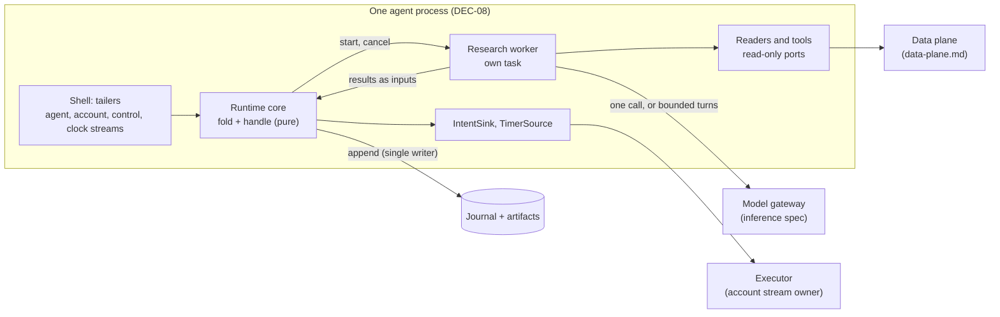

# Agent Harness Spec (v1)

| | |
|---|---|
| **Status** | v0.2, draft for review ([DEC-2203](../project/decisions/DEC-2203.md)): v0.1 ([DEC-431](../project/decisions/DEC-431.md)) with the research run made a bounded agent loop, the founder's decision of 2026-10-17. Items 1 to 14 and 20 to 25 of DEC-431 are agent readings, item 6 now superseded; items 15 to 17 were decided by the founder on 2026-10-03; items 18 and 19 are Proposed for the founder, and the spec proceeds on the conservative option of each. Where this spec needs a rule in another spec, it says so, and that rule lands in that spec's own change |
| **Implements** | [HLD §5](../HLD.md#5-agent-runtime), [§6 flows B to D](../HLD.md#6-key-flows), [§9](../HLD.md#9-intelligence-layer); PRD FR-3.9, FR-5.1; backlog E19 (new), and the harness halves of E6-1, E15-1, E15-3, E17-2, E17-5, E17-7, E17-8 |
| **Depends on** | [Mandate spec](mandate.md) §2, §6, §8; [journal spec](journal.md) §2, §5, §8, §9; [trading domain spec](trading-domain.md) §5.5, §7.4, §11; [inference spec](inference.md) (the callee: what happens to a model call); [data-plane spec](data-plane.md) (market data, news, filings; its §4.6 owns the capture of retrieved items, DP-3) |
| **Related** | [ADR-0002](../adr/0002-autonomous-ideation-and-retail.md), [ADR-0003](../adr/0003-earned-autonomy.md), [harness engineering note](../product/11-harness-engineering.md), [DEC-432](../project/decisions/DEC-432.md) |

The **agent harness** is the code that turns a confirmed mandate version into a running agent
process and drives that agent's loop. It holds the model at arm's length: deterministic code
gathers the data, a model reads it and writes an opinion, and deterministic code does everything
else.

## Change history

- **v0.2, amended ([DEC-2217](../project/decisions/DEC-2217.md), E21-62):** §10.1 adds the
  runtime's `gate` mode: the probe runs over fixture readers and an in-memory store, calling the
  gateway service's gate listener with purpose `evaluation`, its claims never trusted.
- **v0.2, amended ([DEC-2282](../project/decisions/DEC-2282.md), E21-62):** a research call's
  `model` is its run kind's entry: the mandate's `routes` member for the run kind, else the research
  agent's own pin (mandate spec v0.17, V-048). Every turn of a run calls one entry.
- **v0.2, amended ([DEC-2392](../project/decisions/DEC-2392.md), E19-12):** event triggers. With the
  mandate's `behavior.research.event_triggers` set (mandate spec v0.11 §8.4), an allowlisted news
  item or filing about an instrument with an active thesis brings a `monitor` run forward (§5.3,
  §6.9), bounded by the debounce, the per-day cap, and the cost cap, and journaled before the run
  starts (journal spec v0.87 rule 271). HI-8 says so. A triggered run is `monitor` whatever the
  mode, so it can only invalidate; it never proposes a thesis or an order.
- **v0.2 ([DEC-2203](../project/decisions/DEC-2203.md), [ADR-0005](../adr/0005-agentic-harness.md);
  E19-13):** the research run becomes a bounded agent loop, by the founder's decision of 2026-10-17
  that the platform's harness is agentic, "like Claude Code for trading" (quoted in DEC-2203):
  agentic where it thinks, deterministic where it touches money. The trading loop, the order builder,
  the gate, the autonomy rules, and the envelope do not change.
  - **Modes and runs.** The research entry pins `mode`: `single_call`, v0.1's run, unchanged, or
    `agentic` (§6.9), with run kinds `ideate`, `monitor`, and §15's `owner` and `explain`. The
    guaranteed path ends in today's structured output, judged once; action tools with mid-run
    verdicts are the next step.
  - **Tools** (§6.10): read tools over internal stores, think tools, and action tools that only
    propose; a menu per run kind, fixed before anything untrusted is read; provenance on every
    action.
  - **Bounds and budgets** (§6.11): every bound ends the run except result size; money is
    configuration, never a figure in this spec.
  - **Context and permissions** (§6.12, §6.13): a stable prompt order, typed run summaries read back
    as untrusted, autonomy as the permission mode, truthful feedback, platform-computed corroboration.
  - **Records** (journal spec v0.50 §9.23): `RunStarted`, `ToolCallRecorded`, `ToolResultRecorded`,
    `RunSummaryRecorded`, and `RunEnded`, beside one `ModelInvocationRecorded` per turn.
  - **Invariants.** HI-1, HI-3, HI-4, and HI-8 change; HI-2, HI-11, HI-22, and HI-23 are restated
    for turns; HI-24 to HI-28 are new.
  - **No runtime fallback and no resume.** A failed agentic run is missing; it is never retried as a
    single call, and a crash ends it (§6.9).

## Contents

1. [Scope](#1-scope)
2. [Principles](#2-principles)
3. [Invariants](#3-invariants)
4. [Components](#4-components)
5. [Construction and lifecycle](#5-construction-and-lifecycle)
6. [The loops](#6-the-loops)
7. [Budgets, deadlines, and degradation](#7-budgets-deadlines-and-degradation)
8. [Evaluation and change control](#8-evaluation-and-change-control)
9. [Adversaries](#9-adversaries)
10. [Interfaces](#10-interfaces)
11. [What exists today](#11-what-exists-today)
12. [Decisions](#12-decisions)
13. [Open questions](#13-open-questions)
14. [Backlog](#14-backlog)
15. [Owner and explain runs: the desk](#15-owner-and-explain-runs-the-desk) (E12-5, E19-15; [DEC-2240](../project/decisions/DEC-2240.md))

## 1. Scope

### 1.1 What the harness is

1. **Construction.** Reading a confirmed mandate version and the configuration it pins, checking
   them, and starting one agent process (DEC-08).
2. **The trading loop.** Perception, memory, signal models, the order builder, autonomy,
   escalation, the gate dry run, and the handoff to the executor
   ([HLD §5](../HLD.md#5-agent-runtime)). The rules for each step are in the mandate and trading
   specs. This spec says how the process drives them, in what order, and what happens at each
   boundary.
3. **The research loop.** The research agent of
   [mandate spec §8.4](mandate.md#84-the-research-agent-dec-97-adr-0002): when it runs, what data it
   gathers, what goes into the model's inputs and what never does, how its output is checked and
   judged, its budgets, and its records.
4. **Evaluation.** How research-agent versions are judged, and how a prompt, retrieval, or model
   change is versioned.

### 1.2 What the harness is not

- **It never sizes, prices, or places an order** (`AGENTS.md` rule 4, DEC-04). The order builder
  sizes ([mandate spec §8.3](mandate.md#83-order-builder-conviction_linear-dec-47-dec-60)), the gate
  decides, and the executor sends. The harness hands intents to the executor through `IntentSink`
  and never talks to a broker (rule 12).
- **It never changes the envelope** (rule 11). It reads a confirmed version. Only the working
  universe and its theses change at runtime, and only through
  [§8.5](mandate.md#85-admission-and-removal-dec-97-dec-101-dec-103).
- **It is not the risk gate.** Its gate call is a dry run that can only narrow a proposal. The
  binding gate runs on the account stream, which the executor owns.
- **It is not the model gateway.** Every model call goes through the gateway of the
  [inference spec](inference.md). The harness has no route to a model endpoint (inference spec §8.2).
- **It is not the data plane.** It reads market data, news, filings, and reference data through the
  data plane's read interface (§10.2).
- **It does not compile mandates.** The compiler ([mandate spec §7](mandate.md#7-compiler-and-platform-proposals-dec-97))
  runs in workspace control services.
- **It does not run user-supplied code.** WebAssembly plug-ins are Won't (v1).
- **It holds no credentials.** Broker credentials stay with the executor's connector and the vault;
  model provider keys stay with the gateway (rule 7, INF-14).

### 1.3 Terms

| Term | Meaning |
|---|---|
| Runtime core | `mandate-runtime`: the pure state machine. `fold` replays an event; `handle` is the only producer of effects |
| Shell | `mandate-shell`: the process that runs the core's effects, tails streams, and binds the stages |
| Research worker | The research-run logic, in its own crate `mandate-research-run` (planned, layer 5, below `mandate-runtime`), with every I/O behind a port the shell implements (§4). It gathers data, calls the gateway, and hands results to the core. It never appends to the journal |
| Research run | One bounded pass of the research loop at one cut-off instant. In `single_call` mode: one retrieval, one model call, and one set of candidate theses and invalidations. In `agentic` mode: a seed retrieval, then up to `max_turns` calls, with the model's reads and proposals between them (§6.9) |
| Run kind | An agentic run's `ideate` or `monitor`, picked by the core at the start (§6.9) |
| Read tool, proposal tool | The two classes of tool: a read only reads (§6.10); a proposal is the model's opinion, which deterministic code mediates on a path that already exists (§6.10) |
| Mode | The research entry's pinned `mode`: `single_call` (§6.2) or `agentic` (§6.9). Inside the content hash, so a change of mode is a new signal-model version (§8.4) |
| Turn | One gateway call of an agentic run. Its reply is either tool calls or the final answer |
| Tool | A read the research entry declares, with a pinned argument schema and result caps (§6.10). The model names a tool and its arguments; the harness scopes and runs it |
| Tool call | One tool, with arguments, that a turn's reply asks for. It is journaled as `ToolCallRecorded`, and its result as `ToolResultRecorded`, whatever the result (§6.6) |
| Loop bounds | The agentic run's pinned limits: turns, tool calls, result bytes, the run's cost ceiling, and its deadline (§6.11) |
| Research entry | The research agent's registry entry ([inference spec §4.1](inference.md#41-registry-entry)): identity, template, output schema, deadline, and token limit. This spec adds its **retrieval plan** and **validation bounds** to what the entry's content hash covers (§10.1). The mandate pins that hash ([§8.1](mandate.md#81-signal-model-contract-dec-52-dec-97)) |
| Retrieval plan | The fixed, deterministic list of reads a run makes before its call: which data, for which instruments, over which window, with which caps |
| Cut-off (`as_of`) | The instant a run reads data up to. No read returns a record whose knowledge time ([data-plane spec §5.2](data-plane.md#52-two-time-axes)) is after it (DP-1). It is the call's `as_of` (inference spec §3.1) |
| Data universe | The instruments research may read about: the profile's pinned data universe where one exists (the research basket in the thin slice, DEC-103), otherwise the instruments in `universe.asset_classes` |

## 2. Principles

1. **The model writes opinions; code acts.** A model output is a candidate thesis or an
   invalidation. It is never an order, an approval, or a mandate change. Its only requests are the proposals §6.10
   lists, each judged by deterministic code: a thesis, an invalidation, and, once declared, an exit
   request, an owner question, or a mandate-change draft the owner confirms.
2. **Code gathers; the model asks.** Every read runs in deterministic code, against the data plane's
   point-in-time store, from allowlisted sources (inference spec §8.3). In `single_call` mode the
   retrieval plan is all there is. In `agentic` mode the model may also ask for reads, but only
   through the entry's pinned read tools, and the harness, never the model, sets each read's
   scope (§6.10, INF-5).
3. **Journal before use.** Every retrieved item is journaled as `ObservationRecorded` before the
   model reads it ([data-plane spec §4.6](data-plane.md#46-the-research-query-interface), DP-3), and
   a model response is committed to the agent stream before anything reads it to decide. In an
   agentic run that holds per turn: a turn's record commits before its tool calls run, and a tool's
   results commit before the next turn reads them.
4. **Replay never calls a model** (INF-10). Every decision is rebuilt from the journal and its
   artifacts.
5. **Missing means safe** (INF-4). An error, a spent budget, or a refusal is a missing output. A
   missing output never enlarges a buy and never forces a sell (MI-10).
6. **Research is slow and optional; trading is not.** Nothing on the trading path waits for research
   (INF-13).
7. **Least context.** A model sees public data, the agent's own memory, and the owner's description.
   Nothing else (INF-8).
8. **Pinned, not tuned.** The template, mode, retrieval plan, tool declarations, loop bounds, output
   schema, bounds, deadline, and model identity are inside the content hash. Changing any of them is a new signal-model version, which is
   a mandate change the owner confirms (§8.4).

## 3. Invariants

Every rule in this spec must keep these true. Each is a named test (ADR-0001 ES-11) whose oracle
computes the expected result its own way and is shown to catch a seeded bug before it is trusted. A
**compromised model** is a gateway double that returns, for every call, an arbitrary schema-valid
output chosen by the test.

The harness assumes the gateway holds INF-1 to INF-16. Where an invariant below depends on one, it
names it; the gateway's own tests prove the INF side, and these prove the caller side.

| ID | Invariant | How it is tested |
|---|---|---|
| HI-1 | **Opinions only; proposals are mediated.** No model output or research run produces an `IntentProposed`, an `ApprovalResponded`, an owner command, or any other order or owner input. Model output reaches the order path only as a proposal the harness checks, admits, and puts through the builder, the gate's dry run, and the autonomy rules: a research-agent output that §8.3 combines. No tool sizes, prices, places, approves, skips, or confirms (§6.10) | Property: with a compromised model (an adaptive one that picks any schema-valid tool call from the run so far), every `IntentProposed` follows a `DecisionMade` from the order builder whose dry run allowed it. `mandate-research-run` sits at layer 5, below `mandate-runtime` (layer 6), so it cannot name `IntentSink` (rung 1, `xtask/layers.toml`) |
| HI-2 | **Journal before use.** Every item a call's inputs hold is in a committed `ObservationRecorded` before the core emits the call effect (data-plane spec §4.6, DP-3). Every model output any decision reads is in a committed `ModelInvocationRecorded` earlier in `seq` than the first event that depends on it (INF-10, caller side). In an agentic run, per turn: no tool call runs before its turn's `ModelInvocationRecorded` commits, and no turn's call effect precedes the commit of every earlier turn's `ToolCallRecorded` and the `ObservationRecorded` of every item those tool calls returned | Property over random append failures, including `Ambiguous` and `Unavailable`, and crashes between retrieval and the reply and between any two steps of a loop: no call effect precedes its observations' commit; no tool dispatch precedes its turn's record; no thesis record, `ModelOutputRecorded`, or `DecisionMade` cites a response without an earlier committed record; a crash after a batch of observations leaves every item it holds on the stream, and a crash before a read's batch shows its items to no model (DP-3's replay test). The oracle orders the effects and commits by its own log, never by the core's state |
| HI-3 | **Replay without a model; a run re-runs from its record.** Folding the agent stream reproduces every thesis record, `ModelOutputRecorded`, and `DecisionMade` byte for byte, and for an agentic run the loop's state after every turn. Driving an agentic run again, with a gateway that answers each turn from its recorded response by `request_digest`, a data plane at the same store snapshot and the run's frozen scope, each read the run recorded as `failed` failing again, the journal prefix up to each turn (the agent stream, and the positions of the account, control, and meter streams that its admissions read: checks 7, 9, 13, and 17, which a re-run's fixture records for each provisional verdict and again for the commit batch, since no record carries them), the registry and policy snapshots the run's records name, and an `IdGen` and clock replaying the recorded ids and instants, reproduces every record of the run byte for byte; a turn whose request differs finds no answer, so a divergence ends the re-run rather than inventing a reply | Replay with a gateway port and a data-plane port that each fail the test on any call; compare drafts with stored bodies and the loop state with an oracle that counts the run's records itself. Re-run random recorded runs; seeded bugs: a result reordered, a bound off by one, a turn missing an earlier result. Until licensed text is read (§6.2 preconditions) every item is kept in full; after, re-runs cover runs inside the licence's horizon, as §6.6 says of prompts |
| HI-4 | **Reads only read, from internal stores; the model chooses only from its menu.** The retrieval plan's readers and every read tool only read, from the data service's allowlisted store or the agent's own folds. No reader, no tool, and nothing in the model's output can place, cancel, or change an order; approve; append to any stream; change a mandate, policy, allowlist, or universe; read the vault; run code; or reach a host other than the data plane. In `single_call` mode the model names no read. In `agentic` mode it names only a tool in the run's menu, fixed at the start (§6.10), with arguments its pinned schema admits; the harness sets every read's workspace, agent, cut-off, data universe, and allowlist version (INF-5) | A test enumerates every data port `mandate-research-run` declares and asserts each only returns data (rung 2). The tool set is a closed enum dispatched to those ports and to the core's mediation only, so a tool with any other effect cannot be named (rung 1). Review keeps a write port out of the crate (rung 3). Property: with an adaptive compromised model, every port call carries the harness's scope and no other, and no call outside the run's menu reaches the harness |
| HI-5 | **The envelope does not move.** No research run, under any model output, changes an envelope field or the policy (MI-16, INF-16) | Property: the mandate version and the policy digest are equal before and after any sequence of research runs with a compromised model |
| HI-6 | **Missing is safe.** Every error kind of [inference spec §3.3](inference.md#33-error-kinds), and every harness rejection of §6.5, yields no output from the failing reply. For a `single_call` or `final_output` run that is the run's only output. For an `action_tools` run, invalidations and exit requests accepted in earlier turns stand, every pending thesis is discarded, and nothing after the failing reply is produced. The order builder then counts the failing reply's output as missing: 0 for exits, fully bearish for buys (§8.3, MI-10, INF-4) | Property: for each error kind and each rejection, the builder's buy value is at most its value with the model removed, and no sell is proposed that is not proposed without it, the run's own accepted invalidations and exit requests aside |
| HI-7 | **Research never blocks trading.** For any input sequence, the trading loop's drafts are the same whatever the research worker's latency, failure, or crash, apart from the research outputs that arrive as inputs (INF-13, caller side) | Property: replay one input sequence with research latency drawn at random, including never finishing; the drafts not caused by research are identical |
| HI-8 | **Runs are bounded, by independent counters.** At most one run is in flight per agent. No scheduled run starts before `next_proposal_at` (§5.3). No event-triggered run starts before the later of `last_call` and the latest event-triggered `RunStarted`, plus the mandate's `debounce_s`, or once `max_runs_per_day` event runs have started in the risk day; no item that started a run before starts another (by its `data_ref`); and each names the `ObservationRecorded` of the item that triggered it, journaled before it (§5.3, [DEC-2392](../project/decisions/DEC-2392.md)). No run reads more than its retrieval plan's caps. A `single_call` run makes one model call. An agentic run stays inside every bound of §6.11: turns, tool calls, result bytes, repeated denials, its deadline on the risk clock, and its cost ceiling (with inference spec §7.3's disclosed provider excess). Every bound but result size ends the run: one the core counts (`max_tool_calls`, `max_repeat_denials`, `action_tools`' `max_theses`) as `bound` with its name, the run's announced shape running out (the last turn completing, or the tool calls spent exactly) as `done` with that bound named, one the gateway refuses (`max_tool_calls_per_turn`, `final_output`'s `max_theses`, the per-turn tokens) as `error`, the run's ceiling or any other cap as `cost`, and the deadline as `deadline`. `RunEnded.tool_calls` counts every `ToolCallRecorded`, a reply refused `call_budget` included, so it can exceed `max_tool_calls` by that reply alone; no call beyond `max_tool_calls` ever runs. Spend caps are the gateway's (INF-7) | Property over random schedules, event items, model replies, tool results, clock ticks, and crashes: an oracle that counts runs (event runs per risk day, their spacing, and the items by `data_ref`), turns, tool calls, bytes, denials, and spend from the journal and the meter stream itself (never from the core's loop state) asserts every bound, that a run reaching one has no output after the batch that reached it, and that its `RunEnded` names that bound |
| HI-9 | **A spent budget means fewer ideas, never more risk.** With a binding cap or budget (a spend cap or ceiling, a deadline, or a bound that cuts a run off: any end but `done`), no buy draft is larger than without it, no opening or increase exists that does not exist without it, no sell is proposed that is not proposed without it, and every risk-exit, protective-order, and kill-switch draft is byte-identical (DEC-120, INF-7, rule 2). Stale research outputs may shrink or withhold buys (§7.3 step 3), and a discretionary exit that waited on a research verdict may be absent, as under any model outage (MI-10); both are the intended effect. In an `action_tools` run this holds because every such end discards each pending thesis (§6.9), and only risk-reducing actions take effect mid-run. `max_turns` and an exactly spent tool-call budget are the run's announced shape, told to the model each turn, and end it `done`: the comparison for them is with a run whose model ended at that point | Property: one input sequence run with and without a binding cap, for every mode, `action_tools` included with a model that proposes and later invalidates; compare every draft pairwise by an independent oracle on size and side. For `max_turns`, compare with the journal-equal run whose model ended at the same turn |
| HI-10 | **Injected text is bounded.** Whatever a news item or filing says, it can at most yield a thesis, an invalidation, or, once declared, an exit request, an owner question, or a mandate-change proposal the owner must confirm. A thesis enters the working universe only through §8.5, and its first order is decided by the autonomy rules with the admission ceiling (§6.2 step 5). An invalidation only removes (MI-19). With a compromised model, no limit is breached | The adversarial bench (E19-6): injection fixtures for every source, in the retrieval plan's reads and in every tool's results, and a compromised model that follows every injected instruction it can express as a tool call; zero limit breaches, zero orders without a dry-run allow, and no read outside the scope HI-4 names |
| HI-11 | **Inputs hold only what they may.** A call's inputs, every turn's included, contain only: data from the data plane at or before the cut-off, the agent's own memory (§6.4), the owner's `behavior.description`, the working-universe facts §6.4 lists, in an agentic run `mandate.read`'s facts and §6.13's model-visible codes, and the inputs §15 lists for `owner` and `explain` runs (DEC-2243). Never a credential, a vault reference, personal data, a dollar figure of the agent or account (limits appear only as percentages of the allocation, through `mandate.read`), or another agent's or workspace's data (INF-8, caller side) | Canary test: plant canary values in the vault, in another agent's memory, in another workspace, and in the agent's equity; scan every prompt artifact of a run, every turn's, and every tool result artifact for them; plant an operator halt, a latched limit, and a cost cap, and find no code naming them |
| HI-12 | **No credentials in the harness.** The harness process holds no broker credential, no vault access, and no provider key (INF-14, caller side) | The process starts and runs with the vault and every provider key absent from its environment; a static check that the research path names no vault port |
| HI-13 | **No look-ahead.** Every read filters on knowledge time at or before the run's cut-off (DP-1); published or event time is a displayed field only. A thesis's `as_of` is the cut-off, never a time the model states | Property: a data-plane double holding records whose event time is before the cut-off and knowledge time after it; no observation or artifact of the run contains them |
| HI-14 | **Risk reduction does not depend on research.** With the gateway and the research worker removed, every exit, protective order, and kill switch still runs (rule 13, INF-13) | Run the trading loop with no research worker and a failing gateway; the kill switch, owner exits, and the family-F flatten cases still pass |
| HI-15 | **Mode gates research.** No run proposes while the effective mode is not `normal`. No call is made while the mode is `paused` or `stopped` | Property over random mode changes, including during a run |
| HI-16 | **One writer.** Only the runtime core appends to the agent stream (journal spec §1, principle 3). The research worker hands results to the core as inputs | An xtask check, added by E19-3, that `mandate-research-run` depends on no journal crate (rung 2); a fenced-writer test |
| HI-17 | **The version in effect judges.** An output whose model identity differs from the pin of the version in effect when it is judged is ignored (`not_pinned`). Admission is judged under the version in effect, never the one the run started under | Property over random version changes during runs |
| HI-18 | **The platform decides the facts.** A thesis's identity, timing, asset class, sources, and corroboration come from platform data, never from the model's text (MI-16, DEC-132 items 6 and 7) | Property: a compromised model that states false facts for each of these fields; the journaled record carries the platform's values |
| HI-19 | **An invalidation removes at once** ([mandate spec §8.6](mandate.md#86-thesis-lifetime-and-revision-lineages-dec-118-dec-111), MI-19). No research run starts while the journal cannot record an invalidation verdict (§6.2 preconditions). Once a verdict is accepted, the instrument is removed in the same fold step, and no opening or increasing draft in it follows | Property over random theses, invalidations, and renewals: an independent oracle replays the verdicts and asserts the instrument is exits-only from the step after each; a start attempted before the record exists emits no call |
| HI-20 | **The kill switch is accepted in every state the process is up.** In `Recovering`, `Running`, `Paused`, and `Holding`, a kill switch or owner Stop is applied before any other input, and the agent goes to `Stopping` (rule 13). While no process is up, §13 item 1 applies | Extends E19-1's crash-in-every-state property: a kill switch arriving in every state, including during reconciliation, ends in `Stopping` with the agent-scoped plan and no cancel-all or close-position |
| HI-21 | **No model call inside the tick.** The decide step never calls or waits on the gateway. Every model output, fast tier included, enters the core as an input after its record commits, and a missing or late output is missing (§6.8, rule 3, MI-10). No exit's latency depends on a model provider | A gateway double that stalls for ever on every call: the decide step stays within ES-24's budget, and every exit, protective-order, and kill-switch draft is identical to a run with no gateway at all |
| HI-22 | **Every candidate has a journaled verdict.** Every candidate thesis and invalidation of a judged reply is journaled with its verdict, a harness check's reason or the admission's (§6.5). In an agentic run the candidates are the final output's for `final_output`, and for `action_tools` each `propose_thesis` and `invalidate` call that was actually mediated, whose thesis verdict is `judged` when admission takes it provisionally; a provisional refusal's thesis record is written at once, an `admissible` one's only at a `done` commit (§6.9 step 6): a call refused by a bound (`max_theses`, `max_repeat_denials`, `run_ended`) or a reply refused `call_budget` is no candidate and has no verdict. The verdicts sort theses first, each kind in reply order, and `candidate` indexes that sorted list (journal spec rule 151), whatever order they were mediated in (invalidations first, §6.9 step 4). A reply that is not judged (late, cancelled, under a withdrawn pin) carries no verdicts, as rule 151 allows. No run is judged while no record can hold a harness verdict (§6.2 preconditions) | Property with a compromised model: the count of journaled verdicts equals the count of mediated candidates in the judged replies, by an oracle that parses the response artifacts itself and reads which calls were mediated from their `ToolResultRecorded` codes |
| HI-23 | **Only cited licensed text is kept, in what the harness writes** (DEC-431 item 17). The harness never writes licensed text a thesis did not cite to the journal's artifact store: not in an observation, a prompt artifact, a tool call's result artifact, or an evidence artifact (§6.6). The model's response is outside this invariant: it may echo licensed text, a disclosed residual (§6.6) | Plant a canary phrase in an uncited licensed item; scan every observation, prompt, tool-result, and evidence artifact the run wrote. The same phrase in a cited item is found, among those, only in the thesis's evidence artifact. The response artifact is not scanned |
| HI-24 | **Journal before each turn.** No turn reads a tool result that is not committed: every `ToolResultRecorded` of a turn's tool calls, with the `ObservationRecorded` of every item a read returned, commits before the next turn's call effect, and no tool call runs before its turn's `ModelInvocationRecorded` and `ToolCallRecorded` commit. Every tool call of a committed reply has exactly one `ToolCallRecorded` and one `ToolResultRecorded`, refused ones included, or the run was cancelled or crashed first and is never judged | Property with an adaptive compromised model and random append failures, including `Ambiguous` and `Unavailable`, and crashes between any two steps: an oracle that parses every response artifact itself and orders effects and commits by its own log matches each tool call to exactly one call record and one result record, earlier than the next turn's call |
| HI-25 | **Feedback is truthful.** The code an action tool returns to the model equals the journaled one, through §6.13's map: for an invalidation, its `ThesisInvalidated` or refusal; for a thesis, its rule 151 verdict and its provisional admission result, both journaled before the model reads them. A thesis told `admissible` is admitted only if the run ends `done` and the commit-time judgment, on its thesis record, admits it: the model is told that a verdict is provisional, never that a thesis was admitted. No code carries a limit value, a size, a price, or a dollar figure. The action half is vacuous until an `action_tools` entry is declared; the code-leak half holds for every refusal now | Property: for every action call of random runs, an oracle that folds the provisional results, the thesis, invalidation, and run-end records itself derives each code and compares it with the `ToolResultRecorded` artifact; a canary dollar figure, and a canary limit value outside `mandate.read`'s percentages, is never found in any action or read result artifact |
| HI-26 | **Owner words are confirmed.** Vacuous until its subject lands (§15.12's owner-run actions, slice 2; `ask_owner`, E19-14), and tested from then. No action an `owner` run proposes from the owner's words proceeds without the owner seeing the exact request and confirming it, with step-up where it adds risk (§6.13, §15) | Property over random owner messages and compromised replies: every intent caused by an owner run follows an owner confirmation of that exact request |
| HI-27 | **Proposals that reach a person are rate-limited.** Vacuous until its subject lands (§15's owner runs; `ask_owner`, E19-14), and tested from then. Per agent per day: owner questions, asks raised by the agent's own proposals (mandate spec §6.4's ask budget), and mandate-change proposals stay within their limits, whatever the model asks for | Property with a compromised model that asks on every turn: an oracle counting the journaled questions, approvals, and proposals per agent per risk day finds none over its limit |
| HI-28 | **Queries stay inside.** A tool call reads the workspace data service's point-in-time store or the agent's own folds and nothing else: it never makes the data plane fetch from a source, and no argument the model wrote reaches any host but the gateway's own call to the pinned model (§6.10, DP-9) | Run random agentic runs with the sources' HTTPS transport and every network port replaced by doubles that fail the test on any request; a canary term in a tool argument is found in no request any double saw, the gateway's own calls to the model excepted, since the transcript carries the arguments there |

## 4. Components

- **The runtime core** is the only component that decides and the only writer of the agent stream.
  It stays pure: no clock, no randomness, no I/O.
- **The research worker** runs on its own task, scheduled apart from the core, so a slow or hung
  call cannot delay a tick (HI-7). The core tells it when to start and when to cancel. It hands every
  result back as an input. Its logic lives in `mandate-research-run` (layer 5): below
  `mandate-runtime`, so it cannot name `IntentSink` (HI-1), and with no journal dependency (HI-16).
  The shell (layer 8) implements its gateway, data-plane, and artifact ports.
- **The readers** run the retrieval plan, and in an agentic run each tool call the core dispatches,
  against the data plane and the folded journal. They have read ports only (HI-4).
- **The agentic loop's state is the core's.** Turns used, tool calls used, result bytes used, spend,
  and the deadline fold from the run's journaled records through a pure function in
  `mandate-research-run`, so the core decides each next step and a replay recomputes it (§6.9). The
  worker only runs the I/O it is told to.
- **The executor** owns the account stream, the binding gate, risk exits, protection, and
  reconciliation. It copies `UniverseChanged` from the agent stream's thesis records (journal spec
  §2).

## 5. Construction and lifecycle

### 5.1 Construction

The deployment manager starts a process with a workspace id, an agent id, and a deployment id. In
Phase 1 the founder's CLI plays that role. The process then:

| Step | Reads | Checks | On failure |
|---|---|---|---|
| 1. Identify | The control stream's latest `AgentDeployed` for the agent | The deployment exists, has no `AgentStopped` after it, and names a mandate version | Exit; the deployment manager alerts the owner |
| 2. Load the mandate | The mandate document by its hash from the configuration store (journal spec §8) | Its SHA-256 equals the version; it passes the schema and every V-rule that reads only the document | Exit; nothing is appended |
| 3. Load the policy | The effective policy values and the workspace profile | The overlay is computable. A key it cannot read is taken at its strictest value (rule 3) | Exit if no policy can be read |
| 4. Load signal models | Each model's registry entry by `(id, version, content_hash)` (V-007, inference spec §4.1) | Every pinned triple is registered and not withdrawn. The research entry carries a retrieval plan and validation bounds and re-hashes to its content hash; an agentic entry's `output`, tools, and `output_schemas` form one of §6.9's two valid combinations | A withdrawn or unloadable model is missing from the start (§8.1). Construction continues |
| 5. Check the description | `behavior.description` | The gateway's prompt guard (inference spec §8.3) passes on it | Research is disabled for this version and the owner is alerted with opaque text: every call would end `input_rejected` |
| 6. Load configuration | The source allowlist version, the instrument snapshot, the calendars, the screens | Each object re-hashes | Exit if the trading loop needs it; otherwise research alone is disabled |
| 7. Take the writer | `writer_epoch + 1` on the agent stream (journal spec §5.1) | The stream head matches | `Fenced` or a head mismatch: exit |
| 8. Recover | Fold every followed stream, then `handle(Started)` | The startup hold `awaiting_reconciliation` is journaled before anything is re-handed (DEC-131) | — |

**What construction pins** for the life of the version: the mandate version, each signal model's
`(id, version, content_hash)`, the research entry, the allowlist version in effect, and the harness
build digest (`actor.build`, journal spec §3). A new mandate version re-runs steps 2 to 6 inside the
running process (§5.4). It never retakes the writer.

**A failed start leaves protection in place.** Protective orders rest at the broker, and risk exits
and the account-scoped kill switch belong to the executor. The agent-scoped kill switch while the
process is down is §13 item 1.

### 5.2 Process states

```mermaid
stateDiagram-v2
    [*] --> Constructing: deployment manager starts the process
    Constructing --> Recovering: steps 1 to 7 pass
    Constructing --> [*]: a check fails (exit, owner alerted)
    Recovering --> Running: reconciliation confirms (hold lifts)
    Recovering --> Paused: reconciliation finds unexplained orders or positions
    Running --> Running: mode normal or exits_only; a version applies
    Running --> Paused: owner pause, a risk limit, or an anomaly
    Paused --> Running: owner resume with step-up, or the limit lifts
    Running --> Stopping: kill switch or owner Stop
    Paused --> Stopping: kill switch or owner Stop
    Recovering --> Stopping: kill switch or owner Stop, applied first
    Holding --> Stopping: kill switch or owner Stop
    Stopping --> Stopped: flatten confirmed or handed off
    Running --> Holding: goal complete, on_complete hold_protected or disarm_ladder
    Holding --> Retired: owner releases or closes
    Running --> Retired: on_complete release, or profit_stop reached and flat
    Stopped --> Retired: AgentStopped journaled
    Retired --> [*]
```

`Running`, `Paused`, `Holding`, and `Stopped` map onto the HLD lifecycle's `Live`, `Paused`,
`Completed`, and `Stopped`, and onto [mandate spec §2](mandate.md#2-lifecycle)'s `Deployed`,
`Holding`, and `Retired`. The modes inside them are [trading spec §7.4](trading-domain.md#74-agent-modes)'s.
A crash in any state returns to `Constructing`.

| State | Entered by | What it blocks | How it ends, and who ends it |
|---|---|---|---|
| Constructing | The deployment manager (or the CLI) | Everything: no process exists to act | The steps pass (the process), or a check fails (the process exits; the deployment manager retries with back-off and alerts the owner). A kill switch or Stop committed while no process is up is §13 item 1 (DEC-431 item 19); once the process is up, §5.1 step 8 handles it first |
| Recovering | Step 8; mode `paused` through the local hold `awaiting_reconciliation` | Openings, increases, and research. An exit already handed off is re-handed only if the fold allows | The account stream records a `ReconciliationRun` at or after the last observed submission with nothing outstanding (the core lifts the hold). A mismatch pauses the agent until the owner acknowledges with step-up ([trading spec §11](trading-domain.md#11-reconciliation)). A kill switch or owner Stop is accepted here and applied first, ahead of the hold: the agent goes to `Stopping`, and an `Unknown` order holds exits only in its own instrument (rule 13, HI-20) |
| Running, `normal` | Recovery, resume, or a lifted limit | Nothing beyond the mandate and the gate | A mode change, Stop, a kill switch, goal completion, or a crash |
| Running, `exits_only` | A restriction of [mandate spec §5.9](mandate.md#59-restrictions-and-the-effective-mode) | Openings and increases. Research runs only as `monitor` runs: they may invalidate and, once declared, request exits and propose risk-reducing mandate changes, and never propose a thesis (§6.7, §6.9) | The restriction lifts by its own path (MI-3) |
| Paused | Owner pause, `flatten_and_pause`, a reconciliation mismatch | New orders except re-placing protection; research and model calls (HI-15). Resting protection stays; the kill switch works | Owner resume with step-up for an owner pause; the owner's acknowledgment for a latched limit. A resume never lifts a latched limit. A kill switch or Stop goes to `Stopping` |
| Stopping | Kill switch or owner Stop | Everything except the flatten and protection re-placement. A run in flight is cancelled | The executor confirms the flatten, or it is handed off whole ([trading spec §5.5](trading-domain.md#55-kill-switch)) |
| Holding | `GoalCompleted` with `hold_protected` or `disarm_ladder` | Openings (the `goal_complete` restriction). No research: the goal is done | The owner releases or closes, with step-up. A kill switch or Stop goes to `Stopping` (HI-20) |
| Stopped, Retired | Stop completes; `AgentStopped` | Everything | Terminal. The process exits after `AgentStopped` is committed |

### 5.3 Research run states

```mermaid
stateDiagram-v2
    [*] --> Idle
    Idle --> Due: risk clock reaches next_proposal_at, and the mode allows
    Idle --> Due: an event trigger (below) admits an item, and the mode allows
    Due --> Retrieving: the core starts the run
    Due --> Idle: mode, version, or a disabled research agent; nothing is called
    Retrieving --> Calling: ObservationRecorded batch committed (§6.2 step 2)
    Calling --> Judging: single_call: ModelInvocationRecorded committed with outcome ok
    Calling --> Idle: single_call: ModelInvocationRecorded committed with an error outcome
    Calling --> Calling: agentic: the turn's batch committed with no read or think call left to dispatch (only actions, or every read refused at screening)
    Calling --> Dispatching: agentic: the turn's batch committed with read or think calls left after screening
    Dispatching --> Calling: every ToolResultRecorded and its ObservationRecorded batch committed (§6.9 step 5, HI-24)
    Dispatching --> Idle: that batch brought a refusal to max_repeat_denials; RunSummaryRecorded and RunEnded follow it
    Retrieving --> Idle: agentic: a seed read failed or exceeded its retrieval timeout; RunSummaryRecorded and RunEnded (error) follow
    Calling --> Idle: agentic: an error outcome, a final_output reply judged in its batch, an action_tools summary, the last turn, or a bound; RunSummaryRecorded and RunEnded in the same batch
    Retrieving --> Cancelled: mode tightens, kill switch, Stop, a version change (§5.4), or the run's deadline
    Calling --> Cancelled: as above
    Dispatching --> Cancelled: as above
    Judging --> Idle: candidates checked and judged; records committed in one batch
    Cancelled --> Idle: single_call at once; agentic with RunSummaryRecorded and RunEnded committed at once. A late result is journaled later and never used
```

- **When a run is due.** At most one run is in flight per agent. A run is due when the risk clock
  reaches `mandate_research::next_proposal_at(last_call, behavior.research.interval_s)`. `last_call`
  is the later of the last `ModelInvocationRecorded` with purpose `research` and the last
  reservation the gateway's meter stream holds for this agent (inference spec §3.6). A crash loop
  therefore cannot call faster than the interval, because the reservation is appended before the
  call leaves.
- **When an event brings a run forward** ([DEC-2392](../project/decisions/DEC-2392.md), E19-12).
  Only with the version in effect's `behavior.research.event_triggers` set (mandate spec §8.4), and
  only for an entry pinned `agentic`: a `single_call` entry's runs stay scheduled. An **item** is a
  news item or filing the data service stored from a source in effect on the allowlist, of a kind
  `sources` lists, whose knowledge time is after the agent's last research call. It **matches** when
  one of its instruments has one of the agent's active theses (§6.7). A matching item makes a
  `monitor` run due when every one of these holds, judged by the core on the risk clock from folded
  state alone:
  - the risk clock is at least the later of `last_call` (above) and the latest event-triggered
    `RunStarted`, plus `debounce_s`, so a burst of items starts one run, a crash loop cannot call
    faster than the debounce, and a run that fails before its first call still spaces the next;
  - fewer than `max_runs_per_day` event-triggered `RunStarted` records fall in the risk day;
  - the item has started no run before: no earlier event-triggered run's `ObservationRecorded`
    has the same `data_ref`, so an item about two instruments, or one a failed run left newer
    than `last_call`, still starts at most one run;
  - the day's research spend is below `cost_cap_usd_per_day` (the gateway's meter, INF-7);
  - the mode is not `paused` or `stopped`, and no run is in flight (HI-8).

  Otherwise the item triggers nothing; nothing is journaled for it, and a later run reads it like
  any other item. A due event run takes the scheduled slot of the trigger queue, so it coalesces
  with a queued scheduled run rather than adding one, and an `owner` or `explain` run still goes
  ahead of it.

  The run's starting batch journals the item first, as an `ObservationRecorded` whose `source` is
  the allowlist source id (its kind is that source's in the allowlist version the run states),
  `instrument_id` the matched instrument, `as_of` the item's knowledge time (data-plane spec §5.2),
  and `data_ref` the item's typed record as stored (`RetrievedItem::record` of the whole item,
  which holds no licensed text; for an item off the news stream, its `item_ref`, journal spec
  §9.37), and then
  `RunStarted` with `trigger` `{kind: event, cause: <that record's event_id>}` (journal spec rule
  271). So the trigger is journaled before the run acts, and one item starts at most one run. The
  item's text is untrusted like every read (§6.12): at most it leads the model to invalidate a
  thesis, which only removes (MI-19, HI-10). A licensed item's text reaches the model only as
  every read's does (§6.6, inference spec §13 question 6). A burst of allowlisted items can spend
  the day's cost cap on event runs and leave less for scheduled ones: it never spends more than
  the cap, and the cap is the owner's.
- **A late result.** A result that arrives after its run was cancelled is still journaled as
  `ModelInvocationRecorded`, with the gateway's outcome, so the record of the call is complete. No
  output event follows it, and nothing reads it. In an agentic run that includes a turn's reply: its
  tool calls are never run. A tool read that returns after its run was cancelled is dropped
  unjournaled: nothing will read it, and its items were never shown to a model.
- **`last_call` in an agentic run** is its latest turn's record or reservation, so a run's own
  turns push the next run's due time out, and a crash mid-loop cannot bring it forward.

### 5.4 Boundaries

| Boundary | Trading loop | Research loop |
|---|---|---|
| Regular-session close | Unchanged. The core evaluates at its cadence; discretionary equity exits defer to the open ([§6.2](mandate.md#62-evaluation) step 2); an evaluation runs at the open | Runs continue, and an agentic run's cut-off stays the one it started with for every turn. A thesis admitted outside the session waits for its stagger offset, counted from the next regular-session open for equities (§8.4) |
| Midnight America/New_York | `RiskDayStarted` on the account stream; the ask budget resets (§6.4) | The spend caps reset by risk day (inference spec §7.3). A run in flight continues; each of its calls counts against the risk day the gateway's meter assigns it, so an agentic run's turns may straddle two risk days. The run's own cost ceiling does not reset: it covers the whole run |
| Restart | §5.1 step 8: replay, startup hold, reconciliation | A run in flight is lost. Its reservation stays counted (DEC-432 item 4). Its call is never re-sent under the old `call_id` (inference spec §3.4), and any output it had is never used, because nothing was journaled. A run whose record committed but whose judging batch did not is not judged after the restart: it ends there. An agentic run is never resumed: its recorded turns and tool calls stay on the stream, every turn's reservation stays counted, no tool call of a recorded turn that has no `ToolCallRecorded` is run, and no further turn is sent (DEC-2203 item 12). The next scheduled run waits for `next_proposal_at`, and the next event-triggered run for its debounce, both re-folded from the journal and the meter (§5.3) |
| Version change ([§2.2](mandate.md#22-applying-a-new-version)) | A reducing or neutral version applies immediately; an increasing one at the next evaluation with no `Unknown` order. Pending approvals are cancelled | A version that changes the research agent's pin, clears `behavior.research`, or pins the universe cancels the run in flight. Any other version lets it finish, and its candidates are judged under the version in effect (HI-17) |
| Kill switch, Stop | The core applies the final mode first, cancels approvals, and hands one agent-scoped flatten plan | The run is cancelled at once. No run starts again |
| Pause | Mode `paused`; pending approvals cancelled | The run is cancelled. No call until resume (HI-15) |
| Policy change | The overlay applies at the next evaluation ([§4.3](mandate.md#43-policy-hierarchy-dec-51-dec-98)) | A lower spend cap binds at the gateway's next reservation; a longer `research_interval_s` binds at the next due time |
| Model withdrawn | Outputs of the withdrawn model count as missing (§8.1) | The run is cancelled; the gateway refuses calls with `model_withdrawn` |

## 6. The loops

### 6.1 The trading loop

The trading loop is the E6-1 tick, unchanged ([task brief](../project/tasks/E6-1-agent-runtime-and-kill-switches.md),
DEC-131). For each input: act on folded state; apply the input; recompute the effective mode; expire
what is due; decide; emit effects, every draft before the handoff it authorizes.

| Stage | Source of truth | Harness duty |
|---|---|---|
| Perception | The scheduler's `ClockAdvanced`, market observations, account-stream facts, control-stream commands | Feed them to the core in `seq` order. A notification is only a hint (DEC-17) |
| Memory | Folds of the agent and account streams | No separate mutable store. Any search index over the journal is derived from it and rebuilt from it |
| Signal models | Quant models in process; the research agent's latest fresh output per instrument ([§8.2](mandate.md#82-output)) | Pass the core only outputs for the instrument being sized |
| Order builder, autonomy | `mandate-builder` (§8.3, §6.2) | — |
| Escalation | `mandate-approval` (§6.4) | — |
| Gate dry run | `mandate-risk` | — |
| Executor handoff | `IntentSink` | Journal `IntentProposed` first, then hand off |

**Cadence.** The scheduler ticks every second. The core evaluates at `behavior.cadence.interval_s`
and on each event source the mandate lists. ADR-0001 ES-24's budget applies to the decide step: p99
under 1 ms in process.

**Research output between runs.** A research output is fresh for its `max_output_age_s` (§8.2). If
`behavior.research.interval_s` is longer, the output goes stale between runs, and stale counts as
missing: no new buys and no forced sells. That fails safe, so no extra rule is needed.

### 6.2 The research loop

**Preconditions.** No research run starts until all three hold. Each keeps a mandate or journal
rule whole rather than reading around it:

- **An invalidation can be journaled** (E19-5). Mandate spec §8.6 removes an instrument at once when
  its thesis is invalidated, and a removal needs a journaled cause. Journal spec v0.49 §9.22 adds
  that cause, `ThesisInvalidated` ([DEC-2202](../project/decisions/DEC-2202.md)); this
  precondition holds once `mandate-journal` registers it. Until then no run starts, so no thesis
  exists that could need one (§6.7, HI-19).
- **A harness verdict can be journaled** (E15-8). `ModelInvocationRecorded` must be closed with a
  member for the candidates' verdicts, or a verdict event must exist, so that no candidate is
  refused in silence (§6.5, HI-22). Journal spec v0.46 §9.19 closes it with a `verdicts` member
  ([DEC-998](../project/decisions/DEC-998.md)); this precondition holds once `mandate-journal`
  registers it.
- **Licensed text can be sent without being kept.** Until the inference spec's prompt record keeps
  licensed text out of the artifact store (§10.1 ask 5), the retrieval plan reads only sources whose
  text may be kept in full: market data and public filings. Licensed news waits (§6.6, HI-23).
  When it is read, the model's response may echo it (§6.6's residual), so a source is allowlisted
  only if its terms allow keeping that echo in the response for the retention period too; counsel's
  per-vendor answer covers it.

The preconditions hold for both modes. Tool results are retrieved items like any other, so the
third precondition binds every tool as it binds the retrieval plan.

One `single_call` run, in order (an agentic run takes steps 1 and 2 as they are, then §6.9's loop,
and ends in steps 5 and 6 for its final turn):

1. **Start.** The core checks the mode (HI-15), that research is configured and not disabled or
   withdrawn, and that the run is due (§5.3). It assigns a run id from `IdGen` and a cut-off: the
   risk-clock instant at which it starts the run. It emits a start effect; nothing is journaled yet.
2. **Retrieve and capture.** The readers run the research entry's retrieval plan (§6.3) at the
   cut-off. The worker hands the items to the core, which journals each as `ObservationRecorded`
   ([journal spec §9.1](journal.md#91-agent-stream-payload-schemas-dec-177)) in one batch, **before**
   it emits the call effect. That is the data-plane spec's capture-at-use rule (§4.6, DP-3): the
   data-plane spec owns the duty, the journal spec owns the event, and this spec places it in the
   loop with the core as its writer (HI-2, HI-16). Each observation's `data_ref` is the item's
   record as §6.6 says. For each news or filing item the shell also builds the typed observation
   E17-5's drift detector folds (§6.3), and that record is what the observation's artifact holds, so
   replay rebuilds the fold from the journal.
3. **Call.** The worker sends one call to the gateway: purpose `research`, the pinned model
   reference, the typed inputs (§6.4), the cut-off as `as_of`, and a `deadline` of the call's
   dispatch instant plus the entry's `deadline_ms`, on the wall clock (inference spec §3.1). The
   retrieval time is not taken from the model's budget; the run's own wall-clock bound is §7.1's. The gateway renders the prompt from its pinned template,
   reserves the cost, guards the prompt, calls, and validates the output against the entry's output
   schema.
4. **Record.** The worker hands the gateway's result to the core, which journals
   `ModelInvocationRecorded` with the run id as `correlation_id` and, as its retrieved context, the
   event ids of step 2's observations rather than the items again. On any error outcome the run ends here (HI-6).
5. **Judge.** The core checks each candidate (§6.5), runs `mandate_research::admit` on each that
   passes, against its folded facts and in §6.7's order (invalidations first, then theses, each in
   response order, every admission counting those before it in the batch), and journals in one batch: the candidates' verdicts, a
   `ThesisProposed` or `ThesisRevised` for each thesis admission judged
   ([journal spec §9.4](journal.md#94-research-agent-thesis-records-dec-413)), and a
   `ModelOutputRecorded` for each thesis as journal spec §9.1 prescribes: `ignored` null for an
   admitted one, which is then the research agent's §8.2 output, and the reason for one §8.5 checks 1
   to 3 refuse.
6. **Copy.** The executor copies each admission to the account stream as `UniverseChanged`, with a
   `causation_id` naming the thesis record. Only the account stream's fold is the working universe
   ([§2.3](mandate.md#23-the-working-universe-at-runtime-dec-97)). A record with `admitted: true`
   admits nothing until that copy exists.

**One call per `single_call` run.** That mode's model cannot ask for more data. The agentic mode,
in which the model names further reads through pinned tools and the harness runs them, is §6.9
(DEC-2203, the founder's decision of 2026-10-17, answering v0.1's §13 item 6).

### 6.3 Retrieval

The retrieval plan is part of the research entry, so it is pinned by the content hash. Every read
takes its scope (workspace, agent, cut-off, data universe, allowlist version) from the harness. In a
`single_call` run the model never names a read. In an agentic run the plan is the seed, and the
model may name further reads only through §6.10's tools, which take the same scope.

| Read | What it gathers | Caps (defaults) | Scope |
|---|---|---|---|
| `bars` | Daily bars for each data-universe instrument, ending at or before the cut-off | 20 bars per instrument | Data universe |
| `quote` | The last quote at or before the cut-off, with its time and sanity flag | 1 per instrument | Data universe |
| `screens` | The results of each screen the plan names: registered, versioned, deterministic screens over the data universe | 50 instruments per screen | Data universe |
| `news` | Items from allowlisted news sources about data-universe instruments with knowledge time in the window before the cut-off (DP-1): item id, source id, published time (displayed only), headline, summary, link, content hash | 48 hours of knowledge time; 50 items; 2,000 bytes per item | Allowlisted sources (DEC-101). Licensed news waits for the third precondition of §6.2 |
| `filings` | Entries from allowlisted filing sources for held and screened instruments with knowledge time in the window before the cut-off: id, source id, form, filed time (displayed only), an excerpt, content hash | 7 days of knowledge time; 20 entries; 4,000 bytes per excerpt | Allowlisted sources |
| `instruments` | Reference facts for every instrument above: asset id, symbol, asset class, eligibility verdict, instrument group, leveraged-ETP flag | — | Instrument snapshot |
| `positions` | This agent's held instruments: held since, whether removed, the current thesis id. No quantities or dollar amounts | — | This agent only |
| `theses` | This agent's active theses, and its closed theses of the last 90 days with their E17-8 scores: the [§9.4](journal.md#94-research-agent-thesis-records-dec-413) members, without prompt or response | 50 | This agent only |

**There is nothing else.** No read, and no tool, fetches a URL, searches the open web, reads another
agent's or workspace's data, or reads any stream other than the folds above. When a cap cuts a read, the oldest
items go first, and the artifact records what was dropped.

**Every retrieved item is metered for drift.** The drift fold does not read `ObservationRecorded`'s
members: the event is closed with `source`, `instrument_id`, `as_of`, and `data_ref` (journal spec
§9.1), and `as_of` is the run's cut-off, shared by every item of the run. Instead, at retrieval the
shell builds for each news or filing item the typed observation `mandate-research`'s detector takes
(`InputObservation`): the source, the class, the observation instant, the content hash, and the
byte length. That same record is the artifact the item's `ObservationRecorded` names, so the fold
replays from the journal and its artifacts. The core folds each item once: an item id already
observed in an earlier run is not observed again, so re-reading it cannot fake `DuplicateContent`.
Text never reaches the detector (DEC-266 item 1).

**Which instant.** The observation instant is the item's knowledge time as the data plane reports
it ([data-plane spec §5.2](data-plane.md#52-two-time-axes)), never the retrieval instant. For a
live capture that is the platform's receipt time; for a backfill it is the source's own publication
time. The detector measures the source's traffic, and a backfill's arrival burst is ours, not the
source's: read by the retrieval instant, every item of a run would share one instant and the
baseline would be degenerate for ever.

### 6.4 Inputs

The harness passes the gateway typed inputs. The gateway renders the prompt from the entry's pinned
template (inference spec §3.1); callers never pass free-form prompt text.

| Goes in | Never goes in |
|---|---|
| The retrieved data of §6.3, each item marked as untrusted third-party data with its item id and source id | Credentials, tokens, vault references, provider keys |
| `behavior.description`, which construction checked against the prompt guard (§5.1 step 5) | Personal data: names, emails, phone numbers, broker account numbers, user ids |
| The cut-off, the data universe, `universe.asset_classes`, `universe.max_instruments`, and the current working universe | Allocation, equity, P&L, or any other dollar figure of the agent or account; limits only as percentages of the allocation, through `mandate.read` (DEC-2203 item 19). Sizing is not the model's business |
| Held instruments, and the agent's own theses and their scores | Other agents' or other workspaces' data, the aggregate-flow monitor, operator halts |
| For a revision, once allowed (§6.5): the predecessor and its score | Approval content, owner commands, notification text, autonomy rules, delegations, tripwires, the review date |
| In an agentic run: the run kind and its menu's tool schemas, the agent's latest run summaries marked untrusted (§6.12), the transcript of earlier turns (each reply, and each tool result as recorded: read items, think results, and action verdicts as codes), and the run's pinned starting `max_turns` and `max_tool_calls` (the counts left are carried by the turn structure, not by an input: §6.9 step 3, DEC-2256) | The run's cost ceiling, its spend, or any price: the budget is the harness's to enforce, not the model's to plan around |

**Untrusted data is marked, not trusted to stay marked.** The template puts retrieved text in
delimited data sections and says it is data. That lowers, but does not remove, the chance that
injected text steers the model. HI-10 is what bounds the result.

### 6.5 Output and checks

The output schema is `{"theses": [...], "invalidations": [...]}`. The gateway refuses any output
that fails it (`schema_invalid`), so ranges, counts, and the horizon bound are enforced there. The
schema sets: `conviction` in [−1, 1], `confidence` in [0, 1], `horizon_s` from 1 day to the entry's
maximum (default 30 days), at most 4 theses, and invalidations that name distinct thesis ids.

The harness splits every thesis field into what the model says and what the platform decides
(HI-18). A model that stated its own asset class, corroboration, or timing would decide §8.5 checks
for itself, which MI-16 forbids (DEC-132 items 6 and 7).

| Field | Who fills it | Rule |
|---|---|---|
| `instrument` | Model, as a symbol | Resolved to an `asset_id` from the instrument snapshot |
| `direction`, `conviction`, `confidence`, `horizon_s` | Model | Schema ranges. `direction` is passed through, so that §8.5 check 1 journals a non-long one |
| Thesis text, `invalidation` | Model | Stored as artifacts; screened below |
| `evidence` | Model, as item ids | Each must be an item this run retrieved, by its retrieval plan or a tool call |
| `predecessor_thesis_id`, autopsy | Model, revisions only | Refused until §8.6 item 5 allows revisions |
| `thesis_id`, `lineage_id`, `revision` | Platform | A new thesis starts its own lineage. A thesis for an instrument with an active thesis is a renewal: same lineage and revision. A revision is its predecessor's revision plus one |
| `as_of`, `expires_at` | Platform | `as_of` is the cut-off; `expires_at = as_of + horizon_s` (§8.2) |
| `asset_class` | Platform | From the instrument snapshot |
| `evidence_sources`, `evidence_ref` | Platform | The sources of the cited items, as retrieved; the cited items as an artifact |
| `corroboration` | Platform | Derived from the retrieved items and market data by E17-7's rule (§13 item 3); in an agentic run from the seed's items only, never the model's tool reads (§6.13) |
| `model_id`, `model_version`, `content_hash`, `allowlist_version` | Platform | From the pins |

**Harness checks** run after the gateway's schema check and before admission. They cover only what
needs platform data. Each failure is journaled with its reason among the candidates' verdicts, never
as a §8.5 reason:

| Reason | When |
|---|---|
| `unknown_instrument` | The symbol does not resolve in the instrument snapshot |
| `unknown_evidence` | An evidence id is not an item this run retrieved, by its plan or its tools |
| `duplicate_instrument` | A second thesis for an instrument already in this output; for an `action_tools` run, already judged by admission earlier in the run. A thesis a harness check refused (`forbidden_language`, `unknown_evidence`, ...) was never judged, so a corrected retry is allowed, as §6.13's feedback intends |
| `forbidden_language` | The text states a price target or a likely profit (DEC-126). The research agent may be directional (§8.1), so a word like "buy" alone is not refused. The gateway's output limits are the first layer (inference spec §4.3); this is the second |
| `revisions_not_enabled` | A revision before §8.6 item 5 allows it |
| `unknown_thesis` | An invalidation names a thesis that is not this agent's active thesis |

Everything else goes to admission, so §8.5's ordered checks decide and are journaled: a non-long
direction, a predecessor mismatch, a pinned universe, the cost cap, a halt, the floor, the allowlist,
corroboration, the lineage cap, and a full universe.

### 6.6 Records

| Event | Stream | When | Status |
|---|---|---|---|
| `ObservationRecorded` | agent | Every retrieved item, before the call effect (§6.2 step 2), and every item a tool call returns that the agent stream does not already hold, before the next turn's call effect (§6.9 step 5) | Closed in [journal spec §9.1](journal.md#91-agent-stream-payload-schemas-dec-177). The duty is the [data-plane spec's §4.6](data-plane.md#46-the-research-query-interface) (DP-3) |
| Meter reservation and settlement | `meter:{workspace_id}` (gateway) | Before the call leaves, and on completion | Closed in [journal spec §9.19](journal.md#919-model-gateway-records-dec-998) (`MeterReserved`, `MeterSettled`; DEC-998) |
| `ModelInvocationRecorded` | agent | After every call, whatever the outcome, including a late one; in an agentic run, one per turn | Closed in [journal spec §9.19](journal.md#919-model-gateway-records-dec-998) with DEC-432 item 11's members and this spec's two: the run id as `correlation_id`, and the retrieved context as `observations`, the event ids of the run's `ObservationRecorded` the turn's prompt holds |
| `RunStarted` | agent | When an agentic run starts, before its seed's observations | Closed in [journal spec §9.23](journal.md#923-run-records-dec-2203): kind, trigger, output, menu, the frozen scope, the cost ceiling, the deadline, and the memory in the prompt's prefix |
| `ToolCallRecorded` | agent | Every tool call of a committed reply, in the batch its turn's record heads (§6.9 step 4) | Closed in journal spec §9.23: the turn, its index in the reply, the tool and its class, the arguments as an artifact, and an action's provenance |
| `ToolResultRecorded` | agent | Every tool call's result, refused ones included: an action's in the turn's batch, a read's or a think's with the items it returned, before the next turn's call effect (HI-24) | Closed in journal spec §9.23: the result and its code, the content as an artifact, bytes, `truncated`, and the observations |
| `RunSummaryRecorded` | agent | When an agentic run ends, but for a crash, cancelled runs included (with an empty `watch`), just before its `RunEnded` | Closed in journal spec §9.23: the typed summary of §6.12 |
| `RunEnded` | agent | After the summary, in the batch that ends the run, or in a batch of the two when the core cancels it | Closed in journal spec §9.23: why it ended, and its counts |
| Candidate verdicts | agent | With the judging batch; in an agentic run, on the record of the turn that holds the candidates: the final reply's for `final_output`, each action turn's for `action_tools` | The `verdicts` member of `ModelInvocationRecorded` (journal spec §9.19 rule 151, DEC-998 item 1). Until `mandate-journal` registers it, no run is judged (§6.2 preconditions, HI-22) |
| `ThesisProposed`, `ThesisRevised` | agent | Every thesis admission judged | Closed in [journal spec §9.4](journal.md#94-research-agent-thesis-records-dec-413) |
| `ModelOutputRecorded` | agent | Each judged thesis, `ignored` null only when admitted | Closed in [journal spec §9.1](journal.md#91-agent-stream-payload-schemas-dec-177) |
| `UniverseChanged` | account | The executor's copy of an admission or removal | Closed in journal spec §9.3 |
| `ThesisInvalidated` | agent | Each accepted invalidation (§6.7), in its call's judging batch | Closed in [journal spec §9.22](journal.md#922-thesis-invalidation-records-dec-2202) (DEC-2202): one record per judged invalidation verdict (rule 186), of a thesis the stream admitted and that still holds its instrument, once (rule 187). Until `mandate-journal` registers it, no research run starts (§6.2 preconditions) |
| `OwnerAlertSent` | control | A guard hit on the description, a lineage retirement, a construction failure | In journal spec §9 |

**What is kept, and for how long** (DEC-431 item 17, the founder's: keep only what a thesis cited).
Journal artifacts are kept for the retention period, six years at least (journal spec §6.2), so
the journal holds no licensed text that no thesis cited:

| Content | What the journal keeps |
|---|---|
| Market data, public filings and XBRL facts | The data itself, as the observation's artifact. It is public or ours to keep (data-plane spec §4.5) |
| A licensed news item, cited or not | Its record without text, as the observation's artifact: source, item id, allowlist version, knowledge and published times, raw-bytes digest, byte length, class |
| A licensed news item a thesis cited | Its text too, as the thesis's `evidence_ref` artifact, captured when the thesis is judged (data-plane spec §4.5's "captured at use") |
| The rendered prompt | The gateway's `request_digest`, and a prompt artifact in which each licensed item's text is replaced by its raw-bytes digest (§10.1 ask 5) |
| A tool call's arguments and result | As the `ToolCallRecorded` and `ToolResultRecorded` artifacts. The arguments in full: they are model text, like a response. The result as the model received it, except that each licensed item's text is replaced by its raw-bytes digest, as in the prompt record (§10.1 ask 5); until that lands no tool reads licensed text (§6.2's third precondition), so today the result is kept in full |
| The model's response | In full, as the model's output of record, every turn's. **Disclosed residual:** a response may quote licensed text, cited or not, and the harness cannot strip it without changing the record. So a source whose terms do not allow that echo to be kept for the retention period is not allowlisted (DEC-431 item 17's rule; §6.2 precondition 3) |

Replay of decisions (HI-3) needs none of the dropped text: it reads the responses, the observations,
and the verdicts. A byte-exact prompt can be rebuilt only while the point-in-time store still holds
every item's text, which is the licence's horizon; regression evaluations (§8.3) therefore use only
runs inside it. Notifications about any of this carry only opaque ids (rule 6).

### 6.7 Invalidation

[§8.6](mandate.md#86-thesis-lifetime-and-revision-lineages-dec-118-dec-111) removes an instrument
at once when its thesis's invalidation condition holds. The condition is the model's own text, so
deterministic code cannot evaluate it. `mandate_research::expire_theses` takes the verdict from its
caller (DEC-132 item 13). The harness supplies it like this:

- Every run's inputs include the agent's active theses. The output may list a thesis id in
  `invalidations`, with the item ids that show the condition holds.
- An accepted invalidation removes the instrument at once, exactly as §8.6 says: the verdict is
  journaled, the executor copies `UniverseChanged` (`thesis_invalidated`), and the instrument is
  exits-only from then on (MI-19, HI-19). While the agent holds it, the order builder sells it at
  its next evaluation, without waiting for that copy (mandate spec §8.3 step 2, MI-34,
  [DEC-2391](../project/decisions/DEC-2391.md)): the run gives an opinion, and deterministic code
  sizes and places the exit (rule 4). Removal adds no risk, so the verdict is taken on the model's
  word, with no corroboration and no approval (rule 2).
- In `exits_only`, a run is review-only: its theses are discarded unjudged and only its
  invalidations count.
- **The judging order.** The harness judges a response's invalidations first, against the run's
  active theses, and then its theses, against the active theses left after those invalidations. So
  a thesis on an instrument whose thesis the same response invalidates is a new thesis in a new
  lineage, judged by admission (mandate spec §8.5), never a renewal of the invalidated one. This is
  the judging order only: the call record's `verdicts` keep rule 151's index order, theses first and
  then invalidations.
- Invalidations are judged in response order against the active theses, and an accepted one ends
  its thesis at once. So a second invalidation of the same thesis in one response names no active
  thesis and is `unknown_thesis`. Each thesis has one record (journal spec §9.22 rule 187).
- **The record.** An accepted invalidation is journaled as `ThesisInvalidated` (journal spec §9.22,
  DEC-2202) in its call's judging batch, after the call record whose verdict it carries and before
  the batch's thesis records (`ThesisProposed`, `ThesisRevised`, and their `ModelOutputRecorded`),
  and the executor's `UniverseChanged` names it as its cause. If `append` refuses a judging batch,
  that is a writer defect: nothing in the batch is used, the runtime raises an operator alert, and
  the thesis stays active until a later run invalidates it again. It is a disclosed residual, never
  a silent drop. Until `mandate-journal` registers it, no
  research run starts (§6.2 preconditions): with no thesis, there is nothing to invalidate, and
  §8.6 holds unchanged. The same record serves the founder's DEC-433 item 19, under which revoking
  a source invalidates every live thesis that cites it (`cause` `source_revoked`); no writer emits
  that case until the founder decides the item.

### 6.8 Fast decision models

The founder put a hosted fast tier in v1 (DEC-432 item 13, decided 2026-10-03), served through the
gateway under the same pinning, deadline, metering, and evaluation-gate rules as any model. Where its
call runs is a safety-path question, so it is DEC-431 item 18, Proposed for the founder. Until the
founder decides, this spec takes the conservative reading, and it is the only one consistent with
HI-7, HI-14, INF-13, and ES-24's 1 ms budget for the decide step:

- **The fast call never runs inside the trading tick** (HI-21). A fast worker, built like the
  research worker, calls the gateway off the tick at the cadence the mandate sets, and the result
  enters the core as `Input::ModelOutput` after its `ModelInvocationRecorded` commits.
- **A missing or late output is missing.** The tick uses the model's latest fresh output (§8.2);
  with none, §8.3 counts the model as missing: 0 for exits, fully bearish for buys (rule 3, MI-10).
- **No exit's latency depends on a model provider.** Exits, protective orders, risk exits, and kill
  switches never wait for a fast output; a stalled provider only makes outputs stale.
- The fast tier has no retrieval plan of its own: its inputs are observations the tick already
  journaled. The retail profile still excludes `fast` until counsel answers question 33 (mandate
  spec §4.3). The work is E19-10, beside E15-2.

### 6.9 The agentic loop

An `agentic` research entry ([ADR-0005](../adr/0005-agentic-harness.md),
[DEC-2203](../project/decisions/DEC-2203.md)) makes the research agent work the way a coding agent
does, "like Claude Code for trading" (the founder): **agentic where it thinks, deterministic where it
touches money.** A **run** is one session of the loop, with a trigger, a context, a budget, and a
transcript. In each turn the model calls tools or ends the run. Read and think tools run freely
inside the run's bounds; action tools only propose, and deterministic code mediates every one, as a
coding agent's permission system mediates its tool calls (§6.13). The model never sizes, prices, or
places an order (rule 4), and no tool changes the envelope (rule 11). The trading tick stays
deterministic and model-free (HI-21); the loop runs beside it, and what it produces enters the core
as inputs once their records commit. Pause, Stop, and the kill switch are the interrupt, and none of
them depends on the loop (HI-14, HI-15, HI-20).

§6.2's preconditions bind every agentic run unchanged.

**Run kinds.** The kind and its tool menu are fixed when the run starts, from the trigger and folded
state alone, before anything untrusted is read (§6.10):

| Kind | Trigger | Starting context | What it may produce |
|---|---|---|---|
| `ideate` | The schedule: `behavior.research.interval_s` (§5.3), in mode `normal` with room in the working universe | The brief, the data universe's seed reads, memory | Theses and invalidations |
| `monitor` | The schedule, in mode `exits_only` or with a full universe, while the agent has an active thesis; or an event trigger (§5.3), in any mode but `paused` and `stopped` | The brief, the held instruments' and active theses' seed reads, their lineages, memory | Only risk-reducing output: invalidations (the whole of `final_output`'s), and, once declared, exit requests and risk-reducing mandate-change proposals |
| `owner`, `explain` | A desk message; an ASK raised | §15's, lane EX's change, which declares them; until it lands no entry offers them | §15's: answers and explanations, never an order or a thesis |

With no kind due, no run starts and nothing is called. **Event triggers** are envelope fields (rule
11): `behavior.research.event_triggers` lists the source kinds (`news`, `filings`) whose matching
items bring a `monitor` run forward, with its debounce and per-day cap (§5.3, mandate spec §8.4,
[DEC-2392](../project/decisions/DEC-2392.md)). An event run is always `monitor`, so it can only
invalidate. A price move, a fill, or a refusal triggers nothing yet; each would be a new source
kind, with its own mandate spec change. At most one run is in flight per agent (HI-8); an `owner` or
`explain` run goes ahead of a queued scheduled or event run, and no run ever delays trading.

**What a run produces.** An agentic entry pins one of two ways for the model to give its opinion:

- **`final_output`** (the guaranteed path, DEC-2203 item 5). The run reads and thinks, and its last
  reply is §6.5's structured output, `{"theses": [...], "invalidations": [...]}`, plus a typed
  `watch` list for the run summary (§6.12). It is judged once, at the end, exactly as a
  `single_call` run's output is (§6.2 step 5). No proposal is mediated mid-run. **The output schema
  is pinned per run kind:** a `monitor` run's has no `theses` member, so the gateway refuses a
  monitoring thesis as `schema_invalid` and no thesis from a monitoring run ever reaches judging.
- **`action_tools`** (the next step, declared for an entry only once E19-6's bench and a §8.3
  regression evaluation pass on it, DEC-2203 item 13). The model proposes through action tools
  during the run, and its final reply is the run summary alone. A **risk-reducing** action
  (`invalidate`) takes effect at once and stands however the run ends (rule 2, MI-19). A
  **risk-increasing** one (`propose_thesis`) gets a **provisional verdict** at once: §6.5's checks
  and §8.5's admission, run against the core's fold, fed back to the model as `admissible` or a
  refusal code (§6.13). It takes effect only when the run ends `done` (the model ends it, or its
  last turn completes): then the core judges it again, against the state at that moment, and only
  that judgment is journaled as its thesis record. Any other end (a cap, a bound, the deadline, a
  mode or version change, an error) discards every pending one, and `RunEnded` lists them
  (DEC-2203 item 25). So a cap that ends a run never leaves an admission behind that the uncapped
  run would not have made (HI-9).

**The output is pinned, and checked.** The research entry pins `output` (`final_output` or
`action_tools`) beside `mode`, inside the content hash (inference spec §4.1). An entry is valid only
if either it pins `final_output`, declares no action-class tool, and every `output_schemas` entry is
a structured output; or it pins `action_tools`, declares at least one action tool, and every
`output_schemas` entry is the summary-only schema. The registry refuses any other combination when
the entry is registered, and construction treats it as unloadable (§5.1 step 4), each with its own
named test, so no action call can reach a run that has no path to mediate it. The rule covers
`ideate` and `monitor` runs; §15 states its own for `owner` and `explain`, whose `answer` tool is
action-class.

One run, in order:

1. **Start.** As §6.2 step 1, and the core fixes for the whole run: its kind and tool menu; its read
   scope (the cut-off, the allowlist version, and the data universe as of the start, so a run reads
   one consistent snapshot); its deadline (the cut-off plus `max_run_s` on the risk clock); and its
   cost ceiling (the workspace's `research_run_cost_cap_usd`, §6.11). It journals `RunStarted`
   (journal spec §9.23). A source revoked mid-run is still served by the run's later reads, for at
   most `max_run_s` (a disclosed residual: §8.5's allowlist check refuses any thesis that cites
   it), and a universe changed mid-run never widens a read; what
   the run produces is judged under the version in effect when it is judged (HI-17), and §8.5's
   allowlist check refuses a thesis that cites a source no longer allowed.
2. **Seed.** As §6.2 step 2, with the kind's scope: the plan's items are journaled as
   `ObservationRecorded` before the first turn's call effect. The seed has §7.1's 60 s retrieval
   timeout; a seed that fails or exceeds it ends the run (`error`) with no call, rather than waiting
   for the run's deadline.
3. **Turn *k*** (from 1). The worker sends one gateway call, filled as §10.1 says, with the prompt
   in the stable order of §6.12 and:
   - `turns`: the transcript so far, each earlier reply by its response artifact and each tool
     result as the model was given it: today the `ToolResultRecorded` artifact itself; once licensed
     text is read, that artifact with each digest filled from the store, inside the licence's horizon
     (§6.6);
   - `tools`: the run's menu; in the last turn (*k* = `max_turns`) only the action tools of an
     `action_tools` entry, or none; and none once the run has no tool call left, so the model must
     end;
   - `run_kind`: the run's kind, which fixes its menu, its tool schemas, and its pinned
     `loop_bounds`, all in the prompt's prefix (§6.12). The turns and tool calls left are not typed
     inputs, since the prefix is the same for every turn: the turn structure carries them, as the
     menu above narrows, and the gateway refuses a transcript at or past `max_turns` (DEC-2256). The
     tool calls left are `max_tool_calls` less the run's `ToolCallRecorded` records, refused ones
     included, as `RunEnded.tool_calls` counts them;
   - `spend_ceiling_usd`: the run's ceiling less the `cost_usd` of its earlier turns' records
     (inference spec §3.1, §7.3);
   - `deadline`: the core hands the worker `r`, the run's time left on the risk clock as a duration
     when it emits the turn, and the worker sets the call's deadline to its wall-clock dispatch
     instant plus the lesser of the entry's `deadline_ms` and `r`. The core stays pure, and the
     deadline on the risk clock still binds whatever the wall clock does.
4. **Record.** The core journals the turn's `ModelInvocationRecorded` (the run id as
   `correlation_id`; as `observations`, every observation the turn's prompt holds) at the head of
   one batch, with one `ToolCallRecorded` for each tool call the reply asked for. Then:
   - an error outcome ends the run with no output from that reply (HI-6, §7.3); for `action_tools`,
     earlier invalidations and exit requests stand and every pending thesis is discarded;
   - a reply with no tool call is the final output: for `final_output` it is judged as §6.2 step 5
     says, its verdicts on this record (journal spec §9.19 rule 151); for `action_tools` it is the
     summary. Either way the run ends (`done`);
   - a reply with more tool calls than the run has left runs none of them: each gets a
     `ToolResultRecorded` refused `call_budget` in the same batch, and the run ends (`bound`);
   - for an `action_tools` entry, the batch also mediates the reply's `propose_thesis` and
     `invalidate` calls (§6.13), **invalidations first, then theses, each in reply order**
     (DEC-2202): an invalidation is judged against the run's active theses, and a thesis against
     what is left, so a thesis on an instrument the same reply invalidates is a new lineage, never a
     renewal. Each accepted invalidation's `ThesisInvalidated` (journal spec §9.22) is journaled in
     this batch and takes effect at once. Each thesis gets its rule 151 verdict on the turn's record
     (`judged`, or a harness check's refusal) and, when judged, its **provisional** admission
     result, journaled in its `ToolResultRecorded` (`admissible` or a code, §6.13). A thesis §8.5
     refused is journaled at once, in this batch, as its `ThesisProposed` with `admitted` false and
     the precise reason, and its `ModelOutputRecorded` with `ignored` set, so the reason the model
     never sees is in the journal whatever ends the run, and it can admit nothing; an `admissible`
     thesis has no thesis record until the commit (step 6). Each action's `ToolResultRecorded`
     follows in mediation order, and the transcript shows results by their call's `index`. Any other
     action-class tool is mediated only as its own section says (`answer`, §15, has no verdict, no
     builder, no gate, and is never a rule 151 candidate). Once E19-14 declares `propose_exit`, it
     is mediated after the invalidations: it is no rule 151 candidate, takes effect at once like an
     invalidation, its result is `exit_requested` or `not_held`, and its own record (E19-14) carries
     the instrument the core folds the request from. The executor copies removals (§6.2
     step 6);
   - **one total order for the batch.** The core takes the reply's calls in this order:
     invalidations, then exit requests (`propose_exit`, once declared), then theses, then reads and
     thinks, each group in reply order; a tool declared later (`ask_owner`, `propose_mandate_change`,
     §15's `answer`) is placed in this order by the change that declares it. It mediates each
     action and screens each read against the run's frozen scope and the item ids the run has
     received (`out_of_universe`, `unknown_item`); a range past the end of a filing's text is the
     reader's to refuse at dispatch, since the core may hold only an excerpt. The order is lane I2's
     judging order for invalidations and theses (DEC-2202): a reply's invalidations are judged
     before its theses. It counts repeated
     refusals against the results already journaled, earlier replies' and those before the call in
     this order;
   - **a bound reached in that batch ends the run there:** the first call in that order that reaches
     a bound (a `propose_thesis` past `max_theses`, or a second identical refusal, §6.11) is refused
     with the bound's code, and **every call of the reply that has no result yet, at any index,
     reads and thinks included,** is refused `run_ended`, so every call still has exactly one result
     (HI-24). Only the calls actually mediated are rule 151 candidates; a refused one has no verdict,
     as a `call_budget` reply has none (HI-22). Nothing is dispatched, and the run ends (`bound`).
5. **Read and think.** If no read or think call of the reply is left unrefused, turn *k* + 1 follows
   at once, with no dispatch and no worker round trip. Otherwise the core emits one dispatch effect
   with the reply's remaining read and think calls in reply order, each with the run's scope
   (§6.10) and the result bytes the run has left; the worker lowers that remainder by each earlier
   read's `bytes` in reply order within the dispatch, so it keeps no state of its own and a re-run
   is deterministic. A think call (`note`, `plan`) has nothing to run: its result is `ok`. The worker runs the
   reads one after another through the read-only ports, applies the caps, and hands every result
   back. The core journals in one batch, for each call in order: an `ObservationRecorded` for each
   item a read returned that the agent stream does not already hold (§6.10), then its
   `ToolResultRecorded`. A refusal or failure that arises here (the reader refuses a range past the
   end, `unknown_item`; the read does not answer, `unavailable`) is recorded as it happened, with its
   own code, and is never rewritten; it counts toward `max_repeat_denials` like any other. If it
   brings the count to the bound, the run ends right after this batch (`bound`,
   `max_repeat_denials`), with no further turn. Then turn *k* + 1, at step 3; after the last turn the run ends
   (`done`).
6. **End.** A run's **pending theses** are its `propose_thesis` calls whose provisional result is
   `admissible`; a thesis that §8.5 refused provisionally was already journaled then (step 4) and is
   never pending. On a `done` end of an `action_tools` run the batch first **commits** the pending
   theses: each is judged again by §8.5 against the state at that moment, in the order they were
   proposed, each counting those before it, and journaled as its `ThesisProposed` (with the
   proposing turn's prompt and response) and `ModelOutputRecorded`, as §6.2 step 5 does. Its
   `thesis_id`, lineage, and whether it renews or starts a new lineage are all fixed at the commit:
   a thesis proposed as a renewal of a thesis the run later invalidated commits as a new lineage,
   judged by admission like any other. The executor then copies admissions (§6.2 step 6). On any
   other end the pending theses are discarded and named in `RunEnded.discarded`. The run ends with
   `RunSummaryRecorded` (§6.12) and then `RunEnded` naming why: `done` (the model ended it, or its
   announced shape ran out: the last turn completed, or the tool calls were exactly spent, with
   `bound` naming which, so a run that always reaches `max_turns` stays visible),
   `bound` with the bound's name, `deadline` (the risk clock passed the run's deadline, or a turn
   ended `deadline_exceeded` on a deadline that `r` had cut), `cost`, `answered` (§15), `mode` (a mode change, a
   version change, a withdrawn model or disabled research, Stop, or the kill switch cancelled it), or `error`, in the batch that ends it, or
   as a batch of their own when the core cancels the run. The core never waits for a cancellation's
   acknowledgment to end a run, so a hung worker cannot keep one in flight. Any run with no final
   reply (a bound, an error, `cost`, `deadline`, `mode`, or a last turn that held only action
   calls) has a summary with an empty `watch`.
   `cost` is a turn ended `budget_exhausted` by any cap (the run's ceiling, the agent's daily cap,
   a workspace or deployment budget); every other error kind, `rate_limited_local` and
   `meter_unavailable` among them, is `error`. A run with no `RunEnded`
   crashed (§6.6).

At every step the run is cancelled exactly as §5.3 and §5.4 say, and when the risk clock passes its
deadline. A reply or a read that arrives after that is §5.3's late result: a late reply is still
journaled as `ModelInvocationRecorded`, after the run's `RunEnded`, with no verdicts and no tool
call records (journal spec rule 183), so the call's record and cost are complete (INF-6, INF-10). What a cancelled run had
already committed stands as journaled: a removal or an exit request is a record, and an
`action_tools` run's pending theses are discarded, never committed.

**Admission across turns:** a provisional verdict counts the run's earlier `admissible` theses, and
the commit counts the theses it has already committed in its batch, as well as admissions the
executor has not yet copied to the account stream, so no thesis of the run, in a later
turn or later in one reply, is ever admitted past `universe_full` on a stale universe (§13 item 2). **A full universe stops renewals:** with the universe full only a
`monitor` run is due, and it cannot propose, so a thesis is not renewed until a slot frees or it
expires. That only removes, and it is disclosed here because it differs from §8.5, where a renewal
skips `universe_full`.

**The core decides; the worker does the I/O.** Turns, tool calls, result bytes, repeated denials, and
spend fold from the run's own records through `mandate-research-run`'s pure loop state, so the core
picks each next step from journaled facts, and a replay picks the same ones (HI-3). The worker never
appends (HI-16) and never chooses whether a turn or a tool call happens.

**A crash ends the run; the journal is still the transcript.** A restart never resumes a run
(§5.4): the turn in flight at a crash has a reservation but no record, so neither its cost nor its
reply is the core's to count or use. Resuming needs a journaled turn start (§13 item 8, E19-14).
Replay rebuilds every recorded turn exactly (HI-3), and the next run starts at its due time.

**No fallback to a single call.** A failed agentic run is missing (HI-6). It is never retried as a
`single_call` run, because sampling again after a failure would select outputs (DEC-432 item 3). The
`single_call` mode stays registered and pinnable; which mode an agent runs is the pin the owner
confirmed (§8.4).

### 6.10 Tools

The tools are the research entry's pinned declarations: each a name, a class, a typed argument
schema, a result cap, and a menu of the run kinds that may call it, all inside the content hash. The
gateway offers only a run's menu (inference spec INF-5), returns each call as data, and runs none;
the harness runs or mediates it.

**A menu is fixed before anything untrusted is read.** The core picks the run's menu from its kind
when the run starts (§6.9 step 1), and tools outside it are left out of every turn's schema, so no
text the model reads can widen what it may call. A `monitor` run gets read and think tools and only
risk-reducing actions; only an `ideate` run may propose a thesis.

**Read tools** read and do nothing else. Each reads the workspace data service's point-in-time store
or the folded journal, under the run's scope:

| Tool | Arguments (the pinned schema) | Returns | Caps (defaults) | Status |
|---|---|---|---|---|
| `market.bars` | `symbol`: 1 data-universe symbol; `count`: 1 to 260 | Daily bars ending at or before the cut-off | 260 bars | Declared |
| `market.quote` | `symbols`: 1 to 10 | The last quote at or before the cut-off, with its time and sanity flag | 10 quotes | Declared |
| `news.search` | `symbols`: 1 to 5; `window_h`: 1 to 168; `terms`: 0 to 5 search terms; `limit`: 1 to 20 | §6.3's news fields, without `link`: item id, source id, published time (displayed only), headline and summary, content hash, byte length | 20 items; 2,000 bytes per item | Declared |
| `news.get` | `item`: a news item id the run received | The item's stored text | 8,000 bytes | Declared |
| `filings.search` | `symbols`: 1 to 5; `forms`: 0 to 5 form types the schema lists (`10-K`, `10-Q`, `8-K`, and the like); `window_d`: 1 to 90; `terms`: 0 to 5; `limit`: 1 to 10 | §6.3's filings fields, and the byte length of the stored text | 10 entries; 4,000 bytes per excerpt | Declared |
| `filings.get` | `item`: a filing id the run received; `offset`: from 0; `length`: 1 to 8,000 | That range of the filing's stored text, cut on UTF-8 boundaries | 8,000 bytes | Declared |
| `memory.positions` | None | The agent's held instruments: held since, whether removed, the current thesis id. No quantity, price, or dollar figure | 50 | Declared |
| `memory.theses` | `status`: active, closed, or both | The agent's theses and lineages with their outcomes and scores: §6.3's `theses` read | 50 | Declared |
| `memory.runs` | `limit`: 1 to 5 | The agent's latest run summaries (§6.12), marked untrusted | 5 | Declared |
| `records.query` | `kind`: `admission`, `invalidation`, `refusal`; `limit`: 1 to 20 | The agent's own verdicts and refusals from thesis and invalidation records, as instrument, time, and §6.13's model-visible code; a discarded `admissible` result has no thesis record and reads back with the label `discarded`, a `records.query`-only label outside §6.13's code set, never as an admission. No quantity, price, dollar figure, or precise reason the model may not see | 20 | Declared |
| `mandate.read` | None | The envelope's facts: allowed asset classes, `max_instruments`, the data universe, the horizon bound, the research cadence, and its limits **as percentages of the allocation**. Never an amount: no allocation, equity, or dollar figure, and no autonomy rule or delegation (HI-11; DEC-2203 item 19, the founder's) | — | Declared |
| `market.screen`, `fundamentals.get`, `calendar.get` | — | A registered screen's members; XBRL facts; earnings dates and market hours | — | When the data plane serves them, as a new research entry |

**Think tools** have no effect outside the run's transcript:

| Tool | Arguments | Kept in |
|---|---|---|
| `note` | `text`: at most 2,000 bytes | The run's transcript only. No later run, owner, or check reads it |
| `plan` | `steps`: 1 to 5 entries, each at most 200 bytes | The run's transcript, and the plan view (§10.4). Never an input to a decision |

**Action tools** propose, and deterministic code decides (§6.13). Each maps onto a path that already
exists:

| Tool | Becomes | Judged by | Menu | Status |
|---|---|---|---|---|
| `propose_thesis` (§6.5's model fields: `instrument`, `direction`, `conviction`, `confidence`, `horizon_s`, thesis text, `invalidation`, `evidence` ids) | A thesis ([mandate spec §8.4](mandate.md#84-the-research-agent-dec-97-adr-0002)) | §6.5's checks, §8.5's admission, and the autonomy rules with the admission ceiling on its first order | `ideate` | Declared only in an `action_tools` entry (§6.9), once DEC-2203 item 13's evaluations pass |
| `invalidate` (`thesis_id`, `reason`, `evidence` ids) | The invalidation verdict of §6.7 (`ThesisInvalidated`, journal spec §9.22): the instrument is removed at once (MI-19). A second invalidation of the same thesis is `unknown_thesis`. Its evidence is kept and shown, not checked: `unknown_evidence` is a thesis's check only (rule 151) | Never denied on its merits: removal only reduces risk (rule 2). A bound reached earlier in the same batch can refuse it `run_ended`, which adds no risk (rule 3) | `ideate`, `monitor` | Declared only in an `action_tools` entry (§6.9), once DEC-2203 item 13's evaluations pass |
| `revise_thesis` | A revision (§8.6) | As `propose_thesis` | `ideate` | Once §8.6 item 5 allows revisions |
| `propose_exit` (`instrument`, `reason`) | A research exit request: a new origin of `discretionary_exit` ([mandate spec §6.1](mandate.md#61-purposes)), which the order builder honours at its next scheduled evaluation by proposing an exit of the agent's whole position in the instrument (cadence unchanged, rule 11), deferred outside the regular session for equities. Refused `not_held` when the agent holds none | Risk-reducing: built-in AUTO, paced by the conduct controls, never denied (rule 13), never refused for a day-trade count. Once declared it takes effect at once and stands however the run ends, like an invalidation; re-entry waits for `reentry_cooldown_s` | `ideate`, `monitor` | Decided (DEC-2203 item 14, the founder's). Declared only once E19-14 adds what the order path needs: a structured record of the request with its instrument, a fourth `DecisionMade.exit_origin` (journal spec §9.1, rule 8), mandate spec §8.3's builder branch for a stored request, and trading-domain spec §9.1's origin |
| `ask_owner` (`question`, `options`) | A question on the owner's desk, in-app, with an email ping that carries only generic text ("your agent has a question") and an opaque id, never the question (rule 6) | Rate-limited (HI-27); an unanswered question expires with no action (rule 3); the answer reaches a later run as owner input | `ideate`, `monitor` | Decided (DEC-2203 item 20, the founder's); declared once E19-14 adds its question and answer records and the delivery |
| `propose_mandate_change` (`diff`, `reasons`) | A draft mandate version, entered as a platform proposal of envelope values ([mandate spec §7](mandate.md#7-compiler-and-platform-proposals-dec-97)) | Always ASK whatever the autonomy policy; the diff shown with its §9.2 classification; step-up to confirm; never applied by the model; expires unanswered; rate-limited (HI-27). A `monitor` run, and any event-triggered run once those exist, may propose only a change the classification calls risk-reducing; risk-increasing proposals come from `ideate` and `owner` runs | `ideate`, `monitor`, `owner` | Decided (DEC-2203 item 15, the founder's); declared once E19-14 adds its record and the draft path to the owner |
| `spawn_subrun` | A child run with a slice of the parent's budget, read and think tools only, returning a typed summary | The parent's bounds | — | After the demo |

What the model never gets: a tool that sizes, prices, or places an order; that approves or skips;
that creates, picks, or widens a delegation; that changes the envelope, the policy, the allowlist, or
the universe directly; that reads the vault; that runs code; or that reaches any host. A thesis
carries conviction and confidence, never a size or a price, and the builder turns them into a size
inside the limits (rule 4).

**The harness sets the scope; the model only narrows it.** Every read takes the run's workspace,
agent, cut-off, data universe, and allowlist version from the harness (HI-4, HI-13):

- **Symbols** resolve in the instrument snapshot. A call naming any symbol outside the run's scope
  (for `monitor`, its held instruments and active theses) is refused whole, `out_of_universe`.
- **Item ids** must be ones the run already received, of the kind the tool takes, and a range must
  start inside the stored text. Anything else is refused `unknown_item`.
- **Terms** are 1 to 32 bytes of letters, digits, spaces, hyphens, and periods each (a term with
  spaces is a phrase); an item matches only when every term appears, case-folded, as a whole word or
  phrase, inside the data service (data-plane spec §4.6). A term only narrows a read and never leaves
  the data service (HI-28).
- **Windows** end at the cut-off and filter on knowledge time (DP-1).

**A tool call never causes a fetch.** The readers query the store; ingestion fills it on its own
schedule (data-plane spec §4.2) and is never triggered by a run, so no tool call reaches a source or
a host (HI-28, DP-9). `news.get` and `filings.get` read only text the store holds: the reader
answers a range past the end of the stored text `out_of_range`, and text it holds only as an
excerpt `excerpt_only` (data-plane spec §4.6), which the harness records as below.

**Results are data, spotlighted.** A read's result is canonical JSON, items newest first by knowledge
time, then item id, each wrapped as untrusted third-party data with its item id and source id, and
every prompt keeps tool results in delimited data sections. That lowers the chance that injected
text steers the model; no invariant rests on it (HI-10 does the bounding). A harness cap (a tool's
item cap, `max_result_bytes`, or what `max_run_result_bytes` has left) drops the oldest items first
and sets `truncated`; the model's own `limit` or `count` is not a cap. A refused or failed call
returns `{"error": "<reason>"}` and nothing else, and that object is what its record keeps. A failed
read brings no items, and the run goes on. **Each outcome has one `result` and one `code`:**

| What happened | `result` | `code` |
|---|---|---|
| The read or think ran | `ok` | `null` |
| The harness refused it before running it (screening, a bound, `call_budget`) | `refused` | `out_of_universe`, `unknown_item`, `call_budget`, `max_theses`, `max_repeat_denials`, or `run_ended` |
| The reader refused it at dispatch: a range past the end (`out_of_range`) | `refused` | `unknown_item` |
| The read did not answer within `tool_timeout_s`, or the reader holds only an excerpt (`excerpt_only`) | `failed` | `unavailable` |
| An action was mediated | `ok` | its verdict (§6.13) |

**Every item has one identity.** An item is observed once on the agent stream, by the run that first
read it: a later read, in that run or any later one, names that first `ObservationRecorded` and
journals no other, as §6.3 says the seed does, so re-reading cannot fake `DuplicateContent` or swell
the drift fold. Each is one `ObservationRecorded` with the read's source, the item's
instrument, the run's cut-off as `as_of`, and the item's record as `data_ref`:

| Read | One item is | Its key |
|---|---|---|
| `news.search`, `news.get`, `filings.search` | One stored item | Its item id |
| `filings.get` | One range of one filing's text | The filing's id, the offset, and the length. Its drift observation (§6.3) is its filing's, so the detector never counts a filing twice |
| `market.bars` | One daily bar | The instrument, the bar's date, and its content hash, so a restated or adjusted bar is a new item |
| `market.quote` | One quote | The instrument and the quote's time |
| `memory.*`, `records.query`, `mandate.read` | Nothing: they read the agent's own folds, already journaled | — |

### 6.11 Bounds and budgets

The loop's shape bounds are pinned in the research entry, inside its content hash (§8.4). They are
engineering values (DEC-431 item 7's rule). Money is never pinned and never hardcoded: every budget
is configuration (DEC-2203 item 9).

| Bound | Default | Set by | On reaching it |
|---|---|---|---|
| `max_turns` | 8 | The entry | The last turn is offered only action tools, or none; after it the run ends `done`, with `bound` `max_turns` so the end is visible, and its pending theses are committed. The model is told its turns left in every turn, so this is the run's announced shape, not a cap that cuts it off (HI-9) |
| `max_tool_calls` (per run) | 24 | The entry | A reply asking for more than the run has left runs none of them; each is refused `call_budget`, and the run ends (`bound`), discarding pending theses. Once exactly none is left, the next turn is offered no tool and must end; that end is `done` with `bound` `max_tool_calls`, an announced shape like `max_turns` |
| `max_tool_calls_per_turn` | 4 | The entry | More in a reply is `schema_invalid` at the gateway, and the run ends |
| `max_output_tokens` (per turn) | The entry's | The entry | The gateway's own bound (inference spec §3.4) |
| `max_theses` (per run) | 4 | The entry | `final_output`: §6.5's cap in the output schema, so more is `schema_invalid` and the run ends (`error`). `action_tools`: a `propose_thesis` past it is refused `max_theses`, every later call of its reply `run_ended`, and the run ends (`bound`). Every mediated `propose_thesis` counts, whatever its verdict; calls refused by a bound or `call_budget` do not |
| `max_result_bytes` (per read) | 24,000 | The entry | The result is cut, oldest items first, and `truncated` |
| `max_run_result_bytes` | 96,000 | The entry | Each read is cut to what the run has left; at zero it is empty and `truncated` |
| `max_repeat_denials` | 2 | The entry | A refusal is any result whose code is not `admissible`, `removed`, `exit_requested`, or `null`, a `failed` read included. A second identical refusal (the same tool, arguments, and code) in one run ends it (`bound`): found while the core takes a reply's batch, that call is refused `max_repeat_denials` and every call of the reply with no result yet `run_ended`; arising at dispatch, it is recorded as it happened and the run ends after that batch (§6.9 steps 4 and 5). A code never reveals a limit value (§6.13) |
| `max_run_s` | 900 s on the risk clock | The entry | The core cancels the run at the first tick at or after its deadline (`deadline`) |
| `tool_timeout_s` | 10 s | The entry | The read fails `unavailable`; the run goes on |
| Cost per run, `research_run_cost_cap_usd` | None: the workspace sets it. With none set, no agentic run starts (rule 3) | Workspace configuration | The next turn's reservation does not fit under `spend_ceiling_usd`: the call ends `budget_exhausted`, and the run ends (`cost`) |
| Agent cost per day | `behavior.research.cost_cap_usd_per_day` (DEC-120) | The envelope | No new calls that day; exits, protection, and kill switches are unaffected |
| Workspace budget per month | Its setting | Workspace configuration | No new calls in that workspace |
| Deployment cap per month | A deployment setting: $50 today for the demo and dev deployment ([DEC-997](../project/decisions/DEC-997.md), the founder's) | Deployment configuration | No new calls in the deployment |

**Each turn reserves; the run has a ceiling.** Each turn reserves its own maximum cost through the
gateway's meter, as every call does, and the run's ceiling is checked on every turn. Reserving a
whole run up front would hold budget other agents need and would count the whole run at its maximum
after a crash (DEC-2203 item 9).

**Every bound ends the run, except size** (HI-8, rule 3). The model cannot know a result's size
before it asks, so only result size trims; every bound the model's own choices reach ends the run,
and what the run had committed before stands. A spent budget means fewer ideas, never more risk
(HI-9).

**The prompt stays bounded.** A turn's prompt holds the pinned prefix, the seed, at most
`max_run_result_bytes` of read results, the action and think results (each short), and the earlier
replies, each at most `max_output_tokens`. So every turn's maximum cost (inference spec §7.2) is
bounded before the run starts. With these bounds a run needs no compaction; summarizing earlier turns
mid-run is a later change (§13 item 10).

### 6.12 Context and memory

**The prompt's order is stable**, so a provider's prompt cache can serve the prefix of every turn:
the pinned system prompt (the template, the output rules, and the methodology text), then the tool
schemas of the run's menu, then the owner's brief, then memory, then the trigger and the seed, then
the transcript (inference spec §3.1). Everything before the transcript is the same for every turn of
a run.

**The owner's brief** is `behavior.description`, the analogue of a coding agent's project
instructions: owner input inside the envelope (rule 11), checked by the prompt guard at construction
(§5.1 step 5). Nothing in it can lift a limit or widen a menu. Extending it to a longer strategy
brief, and the validator's warning where it contradicts the envelope, is a mandate spec change
(E19-14).

**Memory** is the agent's own: its positions and thesis lineages with their outcomes (§6.3), and its
latest run summaries. Every run that ends writes one `RunSummaryRecorded`, so the next run starts
where this one stopped. A summary is **typed, never free prose**: the instruments the run read, a
`watch` list of at most 10 instruments, each with a reason from a closed set (`earnings`,
`filing_pending`, `price_band`, `thesis_expiry`, `news_flow`), and the counts of what it proposed,
had admitted, and invalidated. Its `watch` list is the model's, so the next run reads every summary
as untrusted input, spotlighted like a tool result.

**Least context holds in every turn** (HI-11): no credential, vault reference, personal data,
dollar figure of the agent or account (its limits appear only as percentages of the allocation,
through `mandate.read`), or another agent's or workspace's data, ever. Hidden reasoning is never evidence: where a provider returns reasoning, it stays in the
response artifact as part of the reply's bytes (the record of what was returned, and what the
transcript sends back where the provider requires it), but no check, verdict, oracle, or surface
reads it. Only text tool calls, outputs, and records count.

**Provenance.** Every action call and every text shown to the owner records which untrusted results
were in its context ("written after reading"). Every `ToolResultRecorded` says whether its result is
`untrusted`: any result holding third-party or model-written text (news, filings, theses, run
summaries read through `memory.runs`) is. An action's `ToolCallRecorded` carries `provenance`, the
`event_id`s of the run's untrusted `ToolResultRecorded` records its prompt held; the seed's items are
named by the turn's own `ModelInvocationRecorded.observations`, which every turn holds, and the
memory placed in the prompt's prefix (§6.12: the agent's own thesis records and earlier run
summaries) by `RunStarted.memory`, which lists their `event_id`s. A
`final_output` thesis's provenance is its final turn's: that record's `observations`, every
untrusted result of the run before it, and `RunStarted.memory`. A reviewer and an `explain` run can then see what may have
steered it.

### 6.13 Permissions

1. **The class decides by default.** Read and think tools run inside the bounds. Every action goes
   through the harness, every time.
2. **AUTO, ASK, and DENY are the permission mode** ([mandate spec §6.2](mandate.md#62-evaluation)),
   and the owner's Supervised, Co-pilot, and Autopilot presets are the dial
   ([ADR-0003](../adr/0003-earned-autonomy.md)).
3. **Delegations are "don't ask again":** owner-picked, bounded, expiring, and suspended by any sign
   of trouble. The model can neither create nor pick one.
4. **The builder and the gate are the hook the model cannot override.** The binding gate still runs
   at submission on the account stream.
5. **Feedback is the point, and it is truthful** (HI-25). Every action's result is its journaled
   verdict, told in a **closed set of model-visible codes**, the same in `records.query`:

   | The model is told | When |
   |---|---|
   | `exit_requested`, `not_held` | Once `propose_exit` is declared (E19-14): the request stands and the builder will propose an exit at its next scheduled evaluation; the agent holds no position in the instrument |
   | `admissible`, `removed` | The thesis passed its checks and admission provisionally, and will be judged again and committed if the run ends `done` (§6.9); the invalidation removed the instrument. Whether a first order will ask is decided later, by §6.2, and never told to the model |
   | `unknown_instrument`, `unknown_evidence`, `duplicate_instrument`, `forbidden_language`, `revisions_not_enabled`, `unknown_thesis` | §6.5's harness checks |
   | `direction_not_allowed`, `asset_class_not_allowed`, `not_eligible`, `source_not_allowed`, `not_corroborated`, `universe_full`, `out_of_universe` | §8.5's reasons about facts `mandate.read` or the run's own reads already show, mapped below |
   | `not_admitted` | Every other §8.5 reason, mapped below. The thesis record keeps the precise reason; the model never sees it |
   | `out_of_universe`, `unknown_item`, `unavailable`, `call_budget`, `max_theses`, `max_repeat_denials`, `run_ended` | A refused or failed tool call (§6.10, §6.11, §6.9 step 4) |
   | `empty`, `uncited_segment`, `unknown_citation`, `advice_language`, `too_long`, `shown` | The desk's `answer` tool: its deterministic check result (§15.5); HI-25's oracle for `answer` is that check, recomputed from the run's records |

   §8.5's seventeen reasons map to codes like this, and HI-25's oracle uses the same map:

   | §8.5 reason | Code |
   |---|---|
   | `direction_not_allowed` | `direction_not_allowed` |
   | `not_allowed_asset_class` | `asset_class_not_allowed` |
   | `eligibility_floor` | `not_eligible` (the instrument's eligibility verdict is a reference fact the run reads) |
   | `source_not_allowlisted` | `source_not_allowed` |
   | `no_corroboration` | `not_corroborated` |
   | `universe_full` | `universe_full` (`max_instruments` is in `mandate.read`, the working universe in the inputs) |
   | `not_in_data_universe` | `out_of_universe` |
   | `horizon_mismatch`, `revision_without_predecessor`, `research_disabled`, `universe_pinned`, `admission_denied`, `cost_cap_reached`, `operator_halt`, `leveraged_etp_not_enabled`, `instrument_group_claimed`, `lineage_retired` | `not_admitted`: platform-filled fields, autonomy rules, budgets, halts, the owner's disclosures, and other agents' claims, none of which the model may see |

   The gate's own reasons (a cooldown, a limit, buying power) never reach the model: they arise at
   an order, after the run, and a thesis's verdict is its admission's. No code carries a limit value,
   a size, a price, or a dollar figure, and none names a halt, a monitor, or account state.
   **Disclosed residual:** `not_admitted` tells the model that something it cannot see refused a
   thesis, and because §8.5's checks run in a fixed order, a later visible code (`not_corroborated`,
   `source_not_allowed`, `universe_full`) tells it that every hidden earlier check passed, an operator
   halt, the cost cap, and another agent's group claim among them. A model probing instruments can
   so learn, by elimination, which ones are halted or claimed. It learns no figure and can act only
   by proposing, which the same checks judge; this is disclosed rather than closed, and E19-14 may
   return `not_admitted` whenever a hidden check could have applied. The model sees why where it can act on it and can adjust; a second
   identical refusal ends the run (§6.11).
6. **Corroboration is the platform's.** A thesis's corroboration (§8.5) is derived only from the
   run's seed, the items the entry's pinned retrieval plan read and journaled before the first turn,
   never from what the model chose to read (HI-18). So a model steered toward one source cannot
   manufacture its own corroboration; an instrument whose seed holds no corroborating item is refused
   `not_corroborated`, whatever the model read. Citing a tool-read item as evidence is allowed;
   counting it toward corroboration is not.
7. **Owner words are confirmed** (HI-26). An owner run's reading of the owner's words never becomes
   an action the owner has not seen: the exact request is shown and needs the owner's tap, with
   step-up where the action adds risk (§15).
8. **Proposals that reach a person are rate-limited** (HI-27): per agent per day, owner questions,
   asks raised by the agent's own proposals (the ask budget, mandate spec §6.4), and mandate-change
   proposals, so a model cannot nag the owner.

## 7. Budgets, deadlines, and degradation

### 7.1 Per agent

| Budget | Value | Set by | Enforced by |
|---|---|---|---|
| Model spend per risk day | `behavior.research.cost_cap_usd_per_day`; **$5** for each agent in the internal paper phase (DEC-431 item 15) | The owner, in the envelope (DEC-120), at most the policy's `research_cost_cap_usd_per_day`; the founder for the internal agents | The gateway's reservation (inference spec §7.3) and §8.5 check 7 at admission |
| Proposal interval | `behavior.research.interval_s` | The owner, at least the policy's `research_interval_s` | The run schedule (§5.3) |
| Runs in flight | 1 | Fixed | The core |
| Calls per run | 1 in `single_call`; `max_turns` in `agentic` (8) | Fixed for `single_call` (§6.2); the research entry for `agentic` (§6.11) | The core |
| Tool calls, result bytes, run deadline | §6.11's table: 24 tool calls (4 a turn), 4 theses, 24,000 bytes a read and 96,000 a run, two identical denials, 900 s | The research entry | The core from the run's records; the readers for the caps |
| Run cost ceiling | `research_run_cost_cap_usd` | Workspace configuration; no figure is pinned or hardcoded (§6.11) | The gateway (`spend_ceiling_usd`), from the core's fold of the run's records |
| Call deadline | The entry's `deadline_ms` | Pinned with the model (DEC-432 item 1) | The gateway (INF-3) |
| Output tokens | The entry's `max_output_tokens` | Pinned with the model | The gateway |
| Retrieval caps | §6.3's table | The research entry | The readers |
| Theses per run, horizon | 4; 30 days | The research entry's output schema | The gateway's schema check |
| Run wall time | `single_call`: the retrieval timeout (60 s) plus the call deadline, the only bound on a run's total time; the call's own deadline is measured from its dispatch (§6.2 step 3). `agentic`: `max_run_s` on the risk clock from the cut-off, which every turn's deadline stays inside (§6.9 step 3) | The research entry | The worker for `single_call`; the core for `agentic`; the run is cancelled |

The defaults in the table are engineering values (DEC-431 item 7). They are inside the content hash,
so changing one is a new research-agent version that the owner confirms (§8.4). The dollar figures
are the founder's, decided 2026-10-03 (DEC-431 item 15): hard caps that degrade to fewer ideas, never
to more risk, revisited after the spike's paper runs.

### 7.2 Per workspace

| Budget | Enforced by |
|---|---|
| Daily model-spend quota ([HLD §8](../HLD.md#8-multi-tenancy-and-security), "Quotas"): **$20** for each internal workspace in the paper phase (DEC-431 item 15) | The gateway (`budget_exhausted`, inference spec §7.3) |
| Monthly inference spend | Alerts at 50%, 80%, and 100% of the monthly cap ([DEC-434](../project/decisions/DEC-434.md) item 18) |
| Calls per second | The gateway's per-workspace bucket (`rate_limited_local`) |
| Allowed endpoints and regions | The workspace policy (`policy_denied`, INF-12) |

### 7.3 Degradation

When a budget binds or a dependency fails, the harness gives up ideas in this order, and nothing
else:

1. The run ends with no further output (HI-6): nothing from the failing reply, and, for
   `action_tools`, every pending thesis discarded while earlier invalidations and exit requests
   stand.
2. No new run starts until the next due time, and the gateway refuses until the cap resets or the
   dependency returns.
3. Research outputs go stale. Stale counts as missing: no new buys in research-held instruments, and
   no forced sells (§8.3).
4. Theses reach their horizon and their instruments become removed: exits only, paced by the conduct
   controls (§8.6).

Exits, protection, kill switches, pending approvals, and quant models are untouched at every step
(HI-9, HI-14).

**An agentic run's bounds** (§6.11) are treated like an error kind: a bound that cuts the run off ends it with no further output and
is not retried, the next run waits for its due time, and nothing else changes (HI-8). Three runs in a
row whose `RunEnded` names the same bound alert the operator with the bound's name, never
content, because a
pinned bound that every run reaches is a research-entry defect for a new version to fix (§8.4).

**Harness treatment of each gateway error kind** ([inference spec §3.3](inference.md#33-error-kinds)):

| Kind | Treatment |
|---|---|
| `policy_denied`, `credential_invalid` | Missing. The run is not retried; research stays on schedule, and the operator is alerted |
| `budget_exhausted`, `rate_limited_local` | Missing. The next run waits for its due time |
| `input_rejected` | Missing. Repeated hits on retrieved data alert the operator with the rule, not the content |
| `model_withdrawn` | Missing; research is disabled for this version |
| `deadline_exceeded`, `provider_unavailable`, `rate_limited_provider` | Missing. The gateway has already retried what it may; the harness does not retry within the run, and in an agentic run sends no further turn. Three runs in a row ending `deadline_exceeded` alert the operator with opaque text, since they may still cost money (inference spec §3.3) |
| `content_refused`, `schema_invalid`, `identity_mismatch` | Missing. Never retried within the run, because sampling again until something parses would select outputs (DEC-432 item 3) |
| `gateway_unreachable` | Missing. The run ends with no output and is not retried within it, nor its call under its `call_id`; research stays on schedule, so the next run calls afresh, and the pin is not withdrawn. Each one is logged by its code, and alerts the operator with opaque text naming the run's latest journaled record when it has one, since it may have cost up to its reservation (inference spec §3.3, DEC-2397) |

## 8. Evaluation and change control

### 8.1 Forward paper evaluation (E17-8)

Thesis quality is judged only on forward paper outcomes the model could not have seen (DEC-99). The
window, metric, and threshold are fixed before the evaluation starts (DEC-122). The evaluator
(`mandate_research::score`) reads only journaled theses, close series, and the cost model, and runs
on the team's internal paper workspaces (DEC-103). The harness's duty is to make every thesis
scoreable: every judged thesis has a record, an `as_of` from the cut-off, and a bounded horizon.

### 8.2 Scorecards (E15-3)

A scorecard shows each signal model's results beside the pre-registered baselines, from the owner's
own journaled results only. It never changes weights or approval routing (DEC-47), is never
aggregated across users, and stays off approval screens until counsel answers compliance question
35 (DEC-126).

### 8.3 Regression evaluations

A **regression evaluation** replays a fixed set of recorded runs (retrieved inputs and cut-offs)
against a candidate research entry, through the gateway, in the internal paper workspaces. It
measures mechanics only:

| Measure | Pass condition |
|---|---|
| Outputs that pass the schema | At least the current entry's rate on the same set |
| Harness check failures, by reason | No reason rises without an explanation in the change |
| Admission verdicts | Every candidate's verdict follows from §8.5 alone (the oracle recomputes it) |
| Injection fixtures (E19-6) | Zero admissions that cite only injected items; zero limit breaches |
| Cost per run | Within the entry's maximum cost; for an agentic entry, within the evaluation workspace's `research_run_cost_cap_usd` |
| Agentic runs: turns, tool calls, and bound hits, by bound | Reported per run. No bound is reached by more than a tenth of the set's runs without an explanation in the change |
| Agentic runs: re-run from the record (HI-3) | Every run of the set reproduces byte for byte |
| Agentic runs: reads injected text asked for | Zero reads outside HI-4's scope; zero admissions that cite only injected items |
| Agentic runs: safety at pass^k | Every safety property (HI-1, HI-4, HI-8, HI-10, HI-11, HI-24, HI-25, HI-28, and HI-26 and HI-27 once their subjects land) holds in all *k* trials of every scenario, against an adaptive compromised model that picks its tool calls from the run so far. Quality is reported at pass@k and never gates |

**Scenario runs with a live model are graded on mechanics only:** what was read, proposed, admitted,
and refused, from the journal, never the model's words and never returns. A model may know what
happened after a scenario's cut-off, so backtested returns of LLM theses are meaningless (DEC-99).

A regression evaluation is never evidence that theses are good; only §8.1 is (DEC-99). Its results
are never shown to owners as performance. The first agentic entry is pinned by the internal paper
and demo agents only after this evaluation and E19-6's bench pass on it (DEC-2203 item 13). It complements, and does not replace, the gateway's
evaluation gate before a model is offered ([inference spec §4.3](inference.md#43-evaluation-gate-before-a-model-is-offered)).

### 8.4 What a change is

| Change | What it is | Who confirms |
|---|---|---|
| Template, mode, retrieval plan, tool declarations, loop bounds, output schema, validation bound, deadline, token limit, or model identity | A new research entry, so a new content hash, so a new signal-model version (§8.1). A mandate that pins the old one needs a new version to move, and that version is risk-increasing ([§9.2](mandate.md#92-classification)'s signal-model row) | The owner, with step-up (rule 11) |
| The provider changes weights behind a pinned snapshot | Not allowed as the pin (INF-2). If detected, the operator withdraws the entry; outputs are missing until a new version pins a new identity | The operator, then the owner |
| The source allowlist | Versioned platform configuration (DEC-101), recorded in every thesis. Not a mandate version | Platform review; journaled as `ConfigSnapshotRegistered` |
| Harness code (readers, checks, scheduler) | A platform build, named by `actor.build` on every event. Not a mandate version | CI and independent review, as for the gate |
| A model withdrawn | `PlatformOperatorAction` `model_withdrawn`; outputs count as missing (§8.1, INF-15) | The operator |
| Moving an agent from `single_call` to `agentic` | A new research entry, so the row above. The confirmation screen discloses what changes: the model chooses its own reads within the pinned bounds, a run may make several calls under the workspace's run ceiling, and, for an `action_tools` entry, the model proposes theses and invalidations during the run, which the same rules mediate | The owner, with step-up |

So the platform cannot change what a running research agent is shown, how it is asked, or which
model answers without the owner confirming a new version. And a DEC-99 pass belongs to the content
hash evaluated (DEC-431 item 16, decided by the founder 2026-10-03): every change to the research
entry (template, mode, retrieval plan, tools, bounds, or model) needs its own forward paper evaluation (§8.1,
E17-8) before users' agents may pin it.

## 9. Adversaries

| Adversary | Attack | Blocked or disclosed by |
|---|---|---|
| Careless user | Sets a very large cost cap | The policy maximum and the workspace quota (§7.2) |
| Careless user | Pastes an account number or a key into the description | The guard check at construction disables research for that version and alerts the owner (§5.1 step 5); the gateway's guard is the second layer |
| Careless user | Sets `autonomy.admission: auto` | W-006 on the confirmation screen; the eligibility floor, `max_instruments`, and the limits still bind |
| Bad model | Invents an instrument or evidence | `unknown_instrument`, `unknown_evidence` (§6.5) |
| Bad model | Reports high confidence everywhere | Confidence is labelled self-reported and uncalibrated (DEC-126); admission is `ask` by default (MI-17); the builder clips to limits |
| Bad model | Floods theses or long horizons | The schema's caps (§6.5), `max_instruments`, the cost cap |
| Bad model | States its own asset class, corroboration, or timing | The platform fills those fields (HI-18) |
| Bad model | Writes a price target or a profit promise | The gateway's output limits, then `forbidden_language` |
| Malicious content | Prompt injection in a news item or filing | HI-10: at most a thesis, then §8.5 (allowlist, corroboration, floor) and the admission ceiling. E17-5 meters the source; its escalation seam is DEC-266 item 4 |
| Malicious content | Injection that tries to make the model read another tenant's data | In `single_call` the model names no read. In `agentic` it names only pinned tools, whose scope (workspace, agent, cut-off, data universe, allowlist) comes from the harness, and item ids it already received (§6.10, HI-4) |
| Malicious content | Injection that steers the model's reads: "search for X", "read filing Y", "keep reading" | Every read stays inside the data universe, the allowlist, and the cut-off (HI-4, HI-13); the run's tool calls, bytes, turns, and cost are capped (§6.11). The worst it buys is more allowlisted data, up to the run's ceiling, and still at most a thesis (HI-10) |
| Malicious content | Injection that tries to exfiltrate through a tool argument, a search term or an item id | No tool call reaches a source or any host; terms are matched inside the data service and never sent (HI-28). Terms are short words, and the inputs hold nothing secret to send (HI-11) |
| Malicious content | A huge item, or a filing read range by range, to flood the context | Per-item, per-result, and per-run byte caps cut it, oldest first, and the record says so (§6.11); the prompt stays bounded, so a turn's maximum cost does too |
| Bad model | A tool-call storm: many calls a turn, or every turn | §6.11's bounds: at most 4 a turn and 24 a run; a reply over what is left runs none of them and ends the run (§6.11, HI-8) |
| Bad model | Never answers, calling tools until the end | The last turn is offered no read or think tool, so it must give its opinion or the run ends (§6.9 step 3) |
| Bad model | Names an instrument outside the data universe, in a tool call or a thesis | The tool call is refused `out_of_universe` and reads nothing; a thesis whose symbol does not resolve is refused `unknown_instrument`, and one outside the data universe `out_of_universe` (§8.5 check 8) |
| Bad model | Invents a tool, or arguments its schema does not admit | The gateway refuses the reply `schema_invalid`: the run ends with no output, and nothing is run (inference spec INF-5) |
| Malicious content | Injection that forces invalidations to churn the book | An invalidation only removes; exits are paced by the conduct controls; re-entry waits for `reentry_cooldown_s` ([§5.3](mandate.md#53-position-exposure-order-size-count-and-cooldown)) |
| Malicious content | Text aimed at the approver ("approve now") | The approval card shows model text as quoted research-agent text with links to its sources (DEC-126). Disclosed, not blocked |
| Malicious insider | Changes the template or swaps the model | A new content hash needs the owner's confirmation (§8.4); the gateway never substitutes (DEC-67). With one aggregator in front of every call (DEC-432 item 14), that rests on INF-2 with DEC-432 item 9's locked routing and item 10's reported-identity check |
| Malicious insider | Adds a planted source to the allowlist | Corroboration needs an independent source or market data; every thesis records the allowlist version, so the change is visible; allowlist changes are reviewed like code |
| Malicious insider | Reads another workspace's prompts | Artifacts live in the workspace deployment, encrypted per workspace (journal spec §6.5); break-glass access only, journaled (journal spec §7) |
| Bad tick | A bad bar or quote makes a thesis look corroborated | Admission is `ask` by default; the gate uses sane marks and the collar; the thesis does not size the order |
| Model outage | The provider is down or slow | Missing means safe (HI-6); research stops; theses expire at their horizon (§7.3) |
| Runaway cost | A crash loop or a retry storm | One run in flight; the interval counts from the last reservation, any turn's; no re-send under an old `call_id`; reservations stay counted (§5.3, inference spec §7.3) |
| Runaway cost | An agentic run that keeps calling | `max_turns`, and `spend_ceiling_usd` on every turn: the run cannot reserve past the workspace's `research_run_cost_cap_usd`, and every daily, monthly, and deployment cap still binds beneath it (§6.11, inference spec §7.3) |
| Bad model | Floods proposals | For `final_output`, the output schema's cap of 4 theses at the gateway. For `action_tools`: `max_theses` (a `propose_thesis` past it is refused `max_theses` and ends the run, discarding every pending thesis), `max_tool_calls`, the per-turn bound, and HI-27's daily limits; every thesis still needs §8.5 and its first order the admission ceiling |
| Malicious content | Injection that forces exit requests to churn the book (once `propose_exit` is declared) | An exit is paced by the conduct controls, deferred outside the session for equities, never refused for a day-trade count but counted in it (trading spec §9.2); re-entry waits for `reentry_cooldown_s`; the request records its provenance |
| Bad model | Probes refusals to learn the account's limits | A refusal is a code that carries no limit value, size, price, or dollar figure (HI-25), and a repeated identical denial ends the run (§6.11) |
| Malicious content | Injection that steers an invalidation of a held position | Mitigated and disclosed: an invalidation only removes, its exits are discretionary, paced by the conduct controls, and re-entry waits for `reentry_cooldown_s`; the action records its provenance, so a reviewer sees what it read (§6.12) |
| Bad model | Uses `note` to plant instructions for later | A note stays in its own run's record; no later run, owner, or check reads it (§6.10) |
| Crash | The process dies mid-loop, between a turn and its tool calls, or between tool calls | The run is never resumed: recorded turns stay, reservations stay counted, no turn is re-sent under its old `call_id`, no tool call of the recorded turn runs, and the run is not judged (§5.4, HI-24) |

## 10. Interfaces

### 10.1 The model gateway ([inference spec](inference.md))

**What the harness relies on.** Inference spec §1.2 and INF-1 to INF-16. In particular: exactly one
of a schema-valid output from the pinned model or a typed error (§3.3); no call outlives its
deadline; reservations before the call and spend that never decreases within a risk day (INF-7,
DEC-432 item 4); the caller appends `ModelInvocationRecorded` (§3.6); only the entry's pinned
tools, reads and proposals, returned as validated data and never run by the gateway (INF-5, v0.4); the prompt guard (§8.3). Because the founder chose one aggregator for every call (DEC-432 item 14), DEC-67 on
this path rests on two of DEC-432's readings by name: item 9 (routing locked to endpoints serving
the identical weights) and item 10 (a reported identity that differs from the pin is
`identity_mismatch`, so missing).

**How a research call fills the request** (inference spec §3.1):

| Field | Value |
|---|---|
| `call_id` | A ULID from the core's `IdGen` |
| `workspace_id`, `agent_id` | The agent's |
| `purpose` | `research` |
| `model` | The run kind's entry: the research agent's `routes` member for that run kind, else its own pinned id, version and content hash ([DEC-2282](../project/decisions/DEC-2282.md)). Every turn of a run calls the same entry |
| `inputs` | §6.4's typed inputs |
| `as_of` | The run's cut-off |
| `deadline` | `single_call`: the call's dispatch instant plus the entry's `deadline_ms`, on the wall clock (§6.2 step 3). `agentic`: the dispatch instant plus the lesser of `deadline_ms` and the run time `r` the core handed over (§6.9 step 3) |
| `max_output_tokens` | The entry's |
| `run_kind` | `single_call`: none. `agentic`: the run's kind, which picks its output schema (inference spec §3.1) and is in the canonical request |
| `turns` | `single_call`: empty. `agentic`: the transcript of earlier turns (§6.9 step 3) |
| `tools` | `single_call`: none. `agentic`: the run's menu (§6.10); in the last turn its action tools only, or none; none with no tool call left |
| `spend_ceiling_usd` | `single_call`: none. `agentic`: the run's ceiling less its earlier turns' cost |

**What this spec asks of the inference spec**, for its next revision:

1. **The registry entry carries the retrieval plan and the validation bounds**, inside its content
   hash, so the owner's pin covers what the model is shown (§6.3, rule 11). Inference spec §4.1
   lists the template and its input contract; the plan is what fills that contract.
2. **The caller can read its own reservations** in the meter stream, so the run schedule counts from
   the last reservation (§5.3).
3. **`ModelInvocationRecorded` gains two members** when E15-8 closes it: the retrieved-context list
   (§6.3) and room for the candidates' verdicts (§6.6). The run id rides in `correlation_id`.
   Answered by journal spec v0.46 §9.19 (`observations`, `verdicts`; DEC-998).
4. **The guard is callable without a call**, so construction can check the description (§5.1 step
   5) and spend nothing.
5. **The prompt record keeps no licensed text** (DEC-431 item 17, §6.6). For a call whose inputs
   hold licensed text, `prompt_ref` names the rendered prompt with each licensed item's text
   replaced by its raw-bytes digest, and `request_digest` stays the digest of the full prompt. Until
   that lands, research reads no licensed text (§6.2 preconditions).
6. **Turns and pinned tools** (DEC-2203, the founder's decision). The registry entry pins `mode`,
   its tool declarations (reads and proposals, §6.10), and its loop bounds inside the content hash;
   a `single_call` entry's hash is unchanged. A request carries `turns`, the tools offered in that
   turn, and `spend_ceiling_usd`. `turns` and the offered `tools` are in the canonical request, so
   a recorded turn is found again by its `request_digest` (HI-3); `spend_ceiling_usd` is not, since
   it only decides whether the call is made. A reply is either the final output or one to
   `max_tool_calls_per_turn` tool calls, each naming an offered tool with arguments valid against
   its pinned schema, and the gateway runs none of them; anything else is `schema_invalid`.
   The entry also pins the reasoning mode and effort and `top_p`, and the request keeps §6.12's
   stable order. Answered by inference spec v0.4 (INF-5, §3.1, §3.2, §4.1, §6, §7.3).

**The gate mode** ([DEC-2217](../project/decisions/DEC-2217.md)). The research runtime's binary
has a `gate` mode, run only as the one-shot gate Job of inference spec §4.3. It drives each of the
probe set's runs through this spec's research run (§6.9 to §6.11) and the worker's dispatch,
unchanged but for its calls' purpose and their missing agent, with these differences:
- its readers are fixture readers over the probe set's corpus;
- its store is in memory, discarded at exit, and it writes no journal and no agent stream;
- it has no broker and no account;
- its only network is the gateway service's gate listener, where each call has purpose
  `evaluation` and no agent.

Nothing it decides is trusted: the gateway service recomputes every input, tool result and check
before it writes the gate's report.

### 10.2 The data plane ([data-plane spec](data-plane.md))

| Need | Contract |
|---|---|
| Point-in-time reads | Every query takes a cut-off and returns only records whose knowledge time is at or before it (DP-1, [§5.2](data-plane.md#52-two-time-axes)). Published time is a displayed field only (HI-13) |
| Bars and quotes | For the data universe; each quote carries its time and the sanity flag of [trading spec §4](trading-domain.md#4-market-data) |
| News and filings | Only from sources on the allowlist version the query names. Each item carries an item id, a source id, a published time, a content hash, and its byte length |
| Reference data | The instrument snapshot by hash: asset id, symbol, asset class, eligibility verdict, instrument group, leveraged-ETP flag |
| Screens | Registered, versioned, deterministic screens over the data universe |
| Scope | A query is scoped to one workspace. The shared plane carries facts only, never directional views (DEC-62) |
| Licence | Whether an item is licensed text, so that only a cited item's text is kept (DEC-431 item 17, DEC-433 item 20, §6.6) |
| Capture | The data plane's capture-at-use rule: every item the model reads is journaled as `ObservationRecorded` first (§4.6, DP-3). The harness's core is the writer (§6.2 step 2, §6.9 step 5) |
| Tools (§6.10) | The research query takes `terms`, matched inside the data service and never sent on, and `items`, ids the caller already received; it returns a stored filing's text by byte range; it answers from the store and never fetches (data-plane spec v0.3 §4.6, HI-28) |

### 10.3 The runtime core, the executor, and the journal

- **New core inputs:** a run's retrieval result, a gateway result, a dispatch's read and think
  results, and a cancellation acknowledgment. `handle` applies each, and the core journals what it must. The existing
  `Input::ModelOutput` stays the path for quant models and becomes the path for fast-tier outputs
  (§6.8).
- **New core effects:** start a run; send a turn; dispatch a turn's tool calls; cancel a run.
- **The executor** copies `UniverseChanged` from thesis records, and from `ThesisInvalidated`
  (journal spec §9.22, E19-5). It is unchanged otherwise.
- **The journal** gains the closed `ModelInvocationRecorded` and the meter stream (E15-8, closed in
  journal spec v0.46 §9.19, registration in `mandate-journal` pending) and the
  invalidation verdict `ThesisInvalidated` (E19-5, closed in journal spec v0.49 §9.22, registration
  pending), and the run records (journal spec v0.50 §9.23, registration in `mandate-journal`
  pending, E19-13). `ObservationRecorded` exists and is closed (journal spec §9.1); it
  needs no new member, because the drift detector's typed observation is the artifact it names
  (§6.3).

### 10.4 Surfaces

The web app and the owner's own agents read the same records; none of them adds a door to an order.

- **The transcript view**: every run, step by step, from `RunStarted` to `RunEnded`: what it read,
  what it proposed, and what was decided. Licensed text is shown only as the journal keeps it (§6.6),
  and no provider's hidden reasoning is shown, because none is kept as evidence (§6.12).
- **The plan view**: the agent's latest `plan` steps and run summary's `watch` list, labelled as the
  model's own words. Every model-written text a surface shows (`plan` steps, an invalidation's
  `reason`, an exit request's `reason`, a `note` in the transcript) passes the same `forbidden_language` check as thesis text
  (§6.5, DEC-126) before it is shown, and is shown only as quoted model text; one that fails is shown
  as withheld. The wording of those labels is the founder's and counsel's (DEC-79).
- **The desk**, **explain** text on the approval card, and the **daily brief**: §15's.
- **MCP**: an owner-connected agent uses the same read tools as owner input (DEC-141); its requests
  pass the same builder, gate, and autonomy rules, with the client ceiling (MI-30).

Every surface's wording (no advice, no performance claims) is the founder's and counsel's (DEC-79).

## 11. What exists today

As of 2026-10-03.

| Component | State |
|---|---|
| Runtime core (`mandate-runtime`) | **Built:** the pure state machine, fold and handle, modes and local holds, kill switches with an agent-scoped flatten plan type, and the approval path. Model outputs enter as `Input::ModelOutput`. `ModelInvocationRecorded` folds as a no-op. No research start, cancel, or result inputs |
| Process shell (`mandate-shell`) | **Partly built:** stage adapters, the fail-closed effect runner, the journal envelope, and the `mandate-paper` binary. Most adapters still answer `Unimplemented`, so the binary refuses at its first probe. No research worker |
| Research contract (`mandate-research`) | **Built, pure:** §8.5's seventeen ordered checks (`checks`, `admit`), the lineage fold, expiry and removal, the stagger offset, `next_proposal_at`, the drift detector (E17-5), the flow monitor and operator halt (E17-6), and forward-paper scoring (E17-8). It never calls a model |
| Thesis records | **Specified:** journal spec §9.4 is closed. The `mandate-journal` registration is in progress (DEC-414) |
| `ModelInvocationRecorded` | **Specified:** journal spec v0.46 §9.19 closes it and the meter stream (DEC-998). The `mandate-journal` registration is pending (E15-8) |
| Model gateway | **Specified as a draft:** [inference spec](inference.md) v0.1; no code (E15-6 to E15-10) |
| Agentic research loop | **Specified** (v0.2, §6.9 to §6.13, ADR-0005, DEC-2203); no code. The `single_call` path in `mandate-research-run` calls through `mandate-gateway` on the recorded fake (DEC-1120). E19-13 adds the loop state, the read and think tools over read-only ports, the gateway's turn shape, the run records' registration, and recorded multi-turn fixtures; action tools (`propose_thesis`, `invalidate`) follow it, and `propose_exit` once its order path exists (E19-14). `ask_owner` and `propose_mandate_change` are decided and wait for their records, and event triggers for a mandate spec change (E19-14) |
| LLM research loop | **Spike only:** `python/research_spike` (E17-0) gathers bars and news, makes one call per UTC day through an aggregator, parses strictly, sizes by a fixed rule, and keeps its own JSONL journal. It is not product code and has no gate; its paper runs await the founder's go |
| Retrieval plan, readers, checks, run scheduler in Rust | **Planned** (E19-2, E19-3) |
| News, filings, screens, allowlist | **Specified as a draft** ([data-plane spec](data-plane.md) v0.1); no code. `mandate-marketdata` downloads Alpaca historical bars into Parquet; there is no news or filings store and no allowlist file |
| Deployment manager | **Planned** (M8). The CLI starts processes in Phase 1 |
| Regression evaluations, adversarial bench | **Planned** (E19-6, E19-7) |
| Fast tier | **Decided, not specified:** a hosted model in v1 (DEC-432 item 13); where its call runs is DEC-431 item 18 (§6.8, E19-10) |

## 12. Decisions

[DEC-431](../project/decisions/DEC-431.md) records this spec's choices. Items 1 to 14 and 20 to 25
are agent readings under DEC-79 and DEC-176: each is a reversible engineering choice, tightens a
rule, or closes a gap by the reading that adds no risk.

**Decided by the founder on 2026-10-03:**

| Item | Decision | Where this spec carries it |
|---|---|---|
| 15 | $5 per agent per risk day and $20 per internal workspace per day for the internal paper phase, as hard caps that degrade to fewer ideas and never to more risk; revisited after the spike's paper runs | §7.1, §7.2 |
| 16 | A DEC-99 pass belongs to one content hash: every change to the research entry needs its own forward paper evaluation before users' agents may pin it | §8.4 |
| 17 | Keep only what a thesis cited, as journal artifacts; allowlist only sources whose terms allow that; counsel confirms per vendor | §6.2 preconditions, §6.6, HI-23 |

**Proposed for the founder**, with the conservative option in force:

| Item | Question | Recommendation, and the option in force meanwhile |
|---|---|---|
| 18 | Where the hosted fast tier's call runs (DEC-432 item 13) | Off the trading tick, its output arriving as an input, missing or late meaning missing, and no exit's latency depending on a provider (§6.8, HI-21). In force now |
| 19 | Who makes the agent-scoped kill switch work while the agent process is down (§13 item 1) | The executor flattens the agent from the control stream after a deadline, with the deployment manager's restart as the second line. Meanwhile it is disclosed, and E19-8 is Must before live trading |

**Decided by the founder on 2026-10-17** ([DEC-2203](../project/decisions/DEC-2203.md) item 1, where
the founder's words are quoted): the research harness is agentic, "like Claude Code for trading".
The research run is a bounded agent loop over pinned read and proposal tools (§6.9 to §6.11). The
founder also clarified that DEC-997's $50 a month is the demo deployment's cap, not a customer limit
(DEC-2203 item 9). The other items of DEC-2203 are agent readings under DEC-79 and DEC-176 that carry
these out without moving a risk boundary; DEC-431 item 6 (one call per run) is superseded.

**Decided by the founder on 2026-10-17** (DEC-2203, relayed by the coordinator):

| Item | Decision | Where this spec carries it |
|---|---|---|
| 14 | `propose_exit`: yes, a research exit request is a new origin of `discretionary_exit`, paced, never denied | §6.10; mandate spec §6.1 |
| 15 | `propose_mandate_change` at any time, from `ideate`, `monitor` (risk-reducing changes only), and `owner` runs, with every safeguard | §6.10; declared once E19-14 adds its record path |
| 16 | Who pays: both from day one, a plan's monthly model allowance and an optional bring-your-own key, metered per workspace either way; the key stays in the vault and only the gateway uses it | Inference spec §7.4 |
| 19 | The agent sees its limits as percentages of the allocation, never amounts | `mandate.read` (§6.10), HI-11, §6.4 |
| 20 | `ask_owner` in-app, with a generic email ping; unanswered questions expire with no action | §6.10; declared once E19-14 adds its records |

Users' agents still get the agentic research agent only after its DEC-99 forward-paper evaluation
passes (DEC-103, unchanged).

Provider and vendor choice, and provider data terms, are DEC-432 items 14 and 15, not repeated here.

## 13. Open questions

1. **The agent-scoped kill switch while the agent process is down.** The account-scoped kill switch
   is the executor's, but the agent-scoped flatten plan comes from the runtime core. If the process
   cannot start, an owner's agent kill switch waits for it. Either the executor plans and runs the
   agent-scoped flatten from the control stream after a deadline, or the deployment manager
   guarantees a restart that handles the kill switch first. Rule 13 says the kill switch is always
   available, so one of these must hold before live trading (E19-8). The choice is DEC-431 item 19,
   Proposed for the founder. Once the process is up, HI-20 covers every state.
2. **Admission against a moving account.** The core judges §8.5 checks 13 and 17 on its folded view
   of the account stream, and the executor's copy comes later. Whether the executor checks again
   before copying, and what the thesis record says if it refuses, belongs to E17-3. Until then the
   account stream's fold alone is the working universe (§2.3).
3. **How corroboration is derived.** `mandate-research` takes it as a platform fact; no document
   says how the platform derives it from retrieved items and market data (E17-7). The harness
   supplies the inputs, and in an agentic run only the seed's (§6.13 item 6); the rule is E17-7's.
4. **The invalidation record** (§6.7, E19-5). Answered by journal spec v0.49 §9.22
   ([DEC-2202](../project/decisions/DEC-2202.md)): `ThesisInvalidated` on the agent stream, which
   the executor's `UniverseChanged` (`thesis_invalidated`) names as its cause, and which carries
   DEC-433 item 19's revoked source as `cause` `source_revoked`.
5. **Drift escalation** is DEC-266 item 4, the founder's. Until then the detector computes and
   reports, and every thin-slice admission is `ask` under the internal research profile.
6. **Answered** ([DEC-2203](../project/decisions/DEC-2203.md), the founder, 2026-10-17): runs may be
   agentic, with pinned read and proposal tools (§6.9 to §6.11), and inference spec v0.4 makes
   the matching change.
7. **Where research runs.** This spec keeps the worker inside the agent process (DEC-08). If memory
   or CPU limits make that costly, a separate research process per agent could hand results through
   the journal. The invariants do not change.
8. **Resuming an agentic run after a crash** (§6.9). A run is never resumed today, because the
   turn in flight has a reservation but no journaled start, so neither its cost nor its reply can be
   attributed to the run. Resuming needs a journaled turn start naming the call id before the call
   leaves, so the ceiling fold can count an open reservation; then a restart within the run's
   deadline could continue from the last committed step with a new call id. E19-14 holds it.
9. **Event triggers and a monitoring interval of its own** (§6.9) are new envelope fields under
   `behavior.research`, with their debounce and rate limit, so a mandate spec change, E19-14.
10. **Compaction.** A run longer than today's bounds would summarize its earlier turns into a
    journaled summary artifact, which replay reads and never recomputes. The bounds of §6.11 make
    it unnecessary for now.

## 14. Backlog

The work is epic **E19 Agent harness** in the [backlog](../project/06-backlog-v1.md#e19-agent-harness-dec-431).
Existing stories keep their ids: E6-1 (the runtime), E15-1 (the LLM research signal model), E15-3
(scorecards), E15-6 to E15-10 (the gateway, the registry, `ModelInvocationRecorded`, metering,
locality), E17-2 (the thesis contract), E17-5 (drift), E17-7 (vetted sources), and E17-8 (forward
paper). E19 holds only what none of them covered. E19-13 is v0.2's agentic loop (DEC-2203);
E19-14 holds its follow-ups: action tools' remaining members (`propose_exit`, `ask_owner`,
`propose_mandate_change`, `revise_thesis`), declared as their records and order paths land, event triggers and a monitoring
interval, the longer strategy brief, and resuming after a crash.

## 15. Owner and explain runs: the desk

*Added for E12-5 and E19-15 ([DEC-2240](../project/decisions/DEC-2240.md), agent readings;
[DEC-2241](../project/decisions/DEC-2241.md), [DEC-2242](../project/decisions/DEC-2242.md), and
[DEC-2243](../project/decisions/DEC-2243.md), Proposed for the founder). It builds on E19-13's
agentic loop (lane AH's harness design input, ADR-0005 when it merges: its §4 run kinds, §5
tools, §9 run records) and adds no loop, no gateway path, and no run record of its own.
§1 to §14 are lane AH's and are not changed here. [DEC-2293](../project/decisions/DEC-2293.md)
replaces the desk with the agent's chat, §15.13, whose readings hold where they differ.*

The **desk** is where an owner talks to their agent: "why did you buy X?", "why did you ask me?",
"what are you watching?", "why was this refused?". Two of E19-13's run kinds serve it:

| Kind | Trigger | What it produces |
|---|---|---|
| `owner` | A desk message, journaled on the control stream as `OwnerQuestionSubmitted` (§15.6) and copied by the runtime | An answer that cites the records it rests on |
| `explain` | The runtime raises an ASK (`ApprovalRequested`) | The plain-language explanation shown under that approval |

[DEC-192](../project/04-decision-log.md#decisions) is the rule both serve: "why" is answered from
the journal, a model phrases the answer and adds no fact, and a fact the journal lacks reads "not
recorded". §15.5 says which part of that the checks enforce and which part is disclosed.

### 15.1 Scope and preconditions

- **Slice 1 (the 2026-10-26 demo)** is read-only: both kinds get read and think tools only, and the
  `answer` tool (§15.5). No action tool is in their tool set but `answer`, which acts on nothing
  and only hands the answer to the checks (§15.6). Slice 2 (§15.12, planned) adds
  proposals the owner confirms.
- **Where they run.** In the agent process, on E19-13's loop beside the tick, never in it (HI-7,
  HI-21). They follow every run rule of E19-13: at most one run in flight per agent; owner and
  explain runs pre-empt queued runs and never trading; mode gates them (HI-15), so while the agent
  is `paused` or `stopped` no owner or explain run starts and the desk serves the fallback (§15.5).
- **Not advice.** They say what the agent did and why, from the record. They never recommend a
  trade, an answer to an approval, a mandate change, or any other action to the owner (compliance
  doc; `AGENTS.md` "Do not"). The disclaimer is the founder's (§15.8).
- **Preconditions.** No owner or explain run calls a model until all of these hold: E19-13's change
  to INF-5 admits the pinned tool set, and its run records are registered in `mandate-journal`;
  `OwnerQuestionSubmitted` is registered (§15.6); DEC-997 is accepted; and, for the workspace,
  either DEC-2241 (wording), DEC-2242 (who pays), and DEC-2243 (what may reach a hosted provider)
  are all accepted, or the workspace is one of the platform's own demo and development workspaces,
  on the platform's key, with the deployment flag `desk.model_answers` on (off by default). Until
  then the desk answers with the fallback: the records, no model text. CI and the demo use
  recorded-fake gateway fixtures only, with no network.
- **What it shares with the agent's other runs** (disclosed). Owner and explain runs draw on the
  agent's daily model budget, so members' questions can spend it and leave fewer research and
  monitoring runs that day, the safe direction (HI-9). Under one run in flight per agent, a desk run
  of up to 60 s delays a queued monitoring run by as much, and with it any invalidation or
  discretionary exit that run would propose; at most one desk run goes ahead of a queued monitoring
  run (§15.7). Risk exits, protection, and kill switches never wait for any run (HI-14).

### 15.2 Invariants

Each is a named test whose oracle computes the expected result its own way and is shown to catch a
seeded bug first, under E19-13's **compromised model**: a gateway double that picks any
schema-valid tool call or answer at every turn. E19-13's invariants (HI-1 to HI-28 as ADR-0005 §10
amends them) hold for these runs as for any; these add what is particular to the desk.

| ID | Invariant | How it is tested |
|---|---|---|
| EX-1 | **Read only in slice 1.** An owner or explain run's tool set holds read tools, `note`, and `answer` only. Under any model behaviour, the only records the run itself causes are E19-13's run records for it; no `IntentProposed`, thesis, invalidation, approval answer, owner command or request, draft, or version follows from it (rules 4, 11, 12) | Rung 2: a test asserts the owner and explain tool sets are the listed tools and that each read tool's port returns data only. Property with a compromised model, in a harness where the run is the only writer: an independent fold of the agent, account, and control streams before and after each run differs only by that run's records; and in a concurrent harness, no record whose `causation_id` chain reaches the run is of any other type |
| EX-2 | **The agent's own records only.** Every tool reads only the folds of this agent's process: its agent stream, the account-stream records that name this agent's intents or id, and the mandate document of the version in effect. No control-stream record: owner input reaches the tools only through the runtime's agent-stream copies. `memory.runs` never returns another member's owner run. A ref that is not this agent's, another workspace's, or absent is refused alike: the tool's result is `refused` with the model-visible code `unknown_item` (§6.13 item 5, journal spec rule 179), with the same content and timing class; at the API the same ref is the same `not_found` (API-9) | Property over a cell with two workspaces and several agents, canaries planted in each: random questions and tool requests naming refs drawn from every agent and workspace; an oracle that knows each record's owner finds no foreign canary in any tool result, prompt artifact, answer, or record, and the foreign and absent refusals (`unknown_item`, and at the API `not_found`) are byte-identical |
| EX-3 | **Scope comes from construction, never the model.** The workspace and agent are the process's (§5.1); no tool argument names a workspace, stream, agent, role, or principal; an argument the tool's schema does not name is refused by the schema check | Schema test over every tool; a property that every tool call's effective scope equals the process's |
| EX-4 | **Every segment cites a record the run read.** An answer is shown only if it has at least one segment and each segment cites at least one ref returned by a tool of the same run, or it has no segment and at least one `not_recorded` item; a `not_recorded` item is a closed topic code rendered from the platform's template, never model text (§15.5) | Property with a compromised model citing random refs, refs of other runs, and nothing, and putting facts in `not_recorded`: no answer with an uncited segment or an unread citation is shown; the oracle rebuilds the readable set from the run's journaled tool results |
| EX-5 | **No fixture advice phrase is shown.** No shown answer contains a phrase of the advice fixture list (§15.5): a recommendation to buy, sell, hold, approve, skip, or change the mandate, a price target, or a likely profit (DEC-126). Paraphrases outside the list are a disclosed residual (§15.10) | Property: a compromised model that embeds each fixture phrase in any case and spacing; none is shown. A list of neutral sentences ("the agent bought", "the gate refused") all pass, so the check is not vacuous. A seeded mutant that drops any one phrase from the checker's copy is caught. The list is a versioned file of the desk crate, `fixtures/advice-phrases.txt`, inside the entry's content hash |
| EX-6 | **No quantity, price, limit value, dollar figure, P&L, or account reference from a record, and no number from the question, in a prompt.** A thesis's conviction and confidence, which the research model itself wrote, do reach it. Tool results reach the model through the redacted projection (§15.4), and the question and every free-text field enter the prompt through the numeric scrub (§15.4). Spelled-out numbers are a disclosed residual. What does reach the provider is DEC-2243's question | Canary test: canary quantities, prices, limit values, dollar amounts, P&L, and account refs in every record field the tools read, in the question, and in thesis text and headlines; none appears in any prompt artifact |
| EX-7 | **Bounded.** A run makes at most §15.7's turns and tool calls and ends within its deadline, and its spend is reserved through the gateway against the agent's, the workspace's, and the deployment's budgets before any byte leaves (INF-7) | Property over random model behaviour; independent counters over the run's journaled records and the meter fold |
| EX-8 | **Journaled before shown.** No answer is shown, and no turn reads a tool result, before its record commits (HI-24). A failed or `Ambiguous` append shows no model text | Fault injection on every append |
| EX-9 | **Off every risk path.** An approval is raised, delivered, answered, and timed out exactly as without an explain run; a missing or late explanation only leaves the card without one. No owner or explain run delays a tick, an exit, protection, or a kill switch (rule 3, HI-14, HI-21). Their spend can make later research calls `budget_exhausted` sooner, which is the safe direction (HI-9) | Property over the approval flow, with no other run queued: one input sequence run with the explain run absent, stalled until its deadline, and failing; every draft and the account stream are byte-identical across the three |
| EX-10 | **Nothing in notifications.** No notice, push payload, page title, or URL carries answer text, a question, or a cited record's content (rule 6, API-10) | Payload capture on every notice; a URL lint over the desk routes |
| EX-11 | **Replay without a model.** Every shown answer, its checks, and its outcome are rebuilt from the journal (HI-3, INF-10) | Replay with a gateway that fails on any call |
| EX-12 | **Provenance is complete.** Every shown answer's `written_after_reading` equals the set of untrusted results returned before its `answer` call, and the menu offered at each turn equals the trigger's menu (ADR-0005 §16 items 2 and 3) | Property with an adaptive compromised model (it picks its calls from the run so far, §16 item 9): an oracle that re-folds the run's tool results recomputes the set and the menu; seeded bugs (a result dropped, a tool added mid-run) are caught |
| EX-13 | **Nothing beyond the reader's row.** Every field a run's tools return is in the cited-record projection for its type (§15.4, workspace API §4.6.1), and reaches only that run's readers (§15.3): an owner run's only the asking operator, under the chat row; an explain run's the view row's holders, and then only the approval, thesis, universe-entry, and mode projections | Property: for every tool, menu, and returned row, an oracle built from §4.6.1's projection table and §15.3's reader table, written apart from the tools, accepts every returned field and every route serving it; seeded bugs (a tool returning a gate check's rule-set version, the explain menu gaining `records.decisions`, an owner run's record served to another member) are caught |

### 15.3 Who asks, and who reads

| Surface | Authorized by (workspace API §3.7) | Notes |
|---|---|---|
| Send a desk message | *Chat thread with the agent* | A client has no chat. Other members do not see the question at the desk; the journal's *Read records* holders (workspace admin, auditor, service account) can, as they can every record (workspace API §4.8, journal spec §7) |
| Read one's own thread, its answers, the cited records, the fallback records, and the owner run's transcript | *Chat thread with the agent*, the asking member only | The decision and order fields an owner run returns (the autonomy outcome and its rule, the dry run's verdict and reason code, a refused order's binding-gate verdict and first reason code) reach only this member, under the chat row. [DEC-192](../project/04-decision-log.md#decisions) (Accepted) assembles a "why" answer from "the decision's `DecisionMade`, its thesis, the rule or delegation that decided it, and the gate's result"; keeping those fields to the asking operator is this section's own tightening (DEC-2240 item 4, under DEC-176) |
| Read an approval's explanation, its cited records, and the explain run's transcript | *View agents, positions, decisions* | With the approval (workspace API §4.3). The explain menu (below) returns the approval's, thesis's, universe entry's, and mode's fields of workspace API §4.6.1, which are §4.3's and §4.7's (D2, D4) plus refs and the admission verdict, all within the view row's "decisions" Never through a client's `read` scope (workspace API §3.8) |
| Transcript of an ideation or monitoring run | As workspace API §4.7's *Runs and transcripts* row serves it (§10.4), licensed text only as the journal keeps it (HI-23) | Not the desk's: §15 adds nothing to it |

No permission row is added or widened: what reaches a member beyond the view row's existing reads
reaches only the asking operator, under the chat row.

### 15.4 Tools

Each tool is read-only, typed, and pinned with its argument schema in the run kind's entry (inside
its content hash, ADR-0005 §5). Every returned row carries a `ref`, the opaque handle
`ev:<event_id>` or `art:<sha256>`; only a returned ref may be cited. A fold's row takes the ref of
the event that last changed it: a position its last fill's, a universe entry its `UniverseChanged`'s,
the mode its last `AgentModeChanged`'s or restriction's, or the agent stream's `StreamOpened`'s before any, a run its first record's; the mandate's is
`art:` and its document's hash. Where E19-13's tool set (§6.10) defines a read of the same name, the
desk uses that tool with the projection below, which only narrows it; every other tool here is the
desk's own (§15.6). These are the fields each returns, and the cited-record
projections of workspace API §4.6.1 are exactly these fields plus the figures:

| Tool | Arguments | Returns (redacted projection) | Caps |
|---|---|---|---|
| `records.decisions` | `instrument?` (symbol), `from?`, `to?` | `DecisionMade` records, newest first: ref, time, symbol, side, purpose, autonomy outcome and its rule or delegation name, the dry run's verdict and reason code, `requested_by` | 25 rows |
| `records.decision` | `ref` | One decision: `records.decisions`'s fields, the refs of its thesis and of what followed (approval, order), and whether an owner request caused it | 1 |
| `records.approvals` | `state?` | Approvals: ref, time, symbol, side, purpose, state, outcome, the rule that asked | 25 rows |
| `records.approval` | `ref` | One approval, as §4.3's single read serves it without figures: symbol, asset class, side, purpose, `decided_by` (the rule or default that asked), deadline, state, and the refs of its decision and thesis | 1 |
| `records.orders` | `instrument?` | Orders and fills: ref, time, symbol, side, state, fill time, and for a refused one the binding gate's verdict and first reason code, as the orders read model shows them | 25 rows |
| `memory.positions` | — | Instruments held and whether each is removed | 50 rows |
| `memory.universe` | — | The working universe: symbol, state (active, removed, refused), reason, thesis ref | 50 rows |
| `memory.theses` | `state?` | Theses: ref, symbol, direction, conviction and confidence (labelled self-reported and uncalibrated, DEC-126), `as_of`, `expires_at`, state, admission verdict | 25 rows |
| `memory.thesis` | `ref` | One thesis: `memory.theses`'s fields, its text and invalidation (quoted research-agent text), and its run's ref | 1; 4,000 bytes |
| `memory.runs` | `kind?` | Past ideation, monitoring, and explain runs, never an owner run: ref, kind, trigger, start, end reason, and their structured summaries (typed fields, never prose; ADR-0005 §16 item 8), marked untrusted | 10 rows |
| `mandate.read` | — | The deployed version's structural fields: version ref, goal type, asset classes, `max_instruments`, autonomy rules by name, limit kinds by name | 1 |
| `mode.read` | — | This agent's effective mode and each restriction that binds it, by name, with what it blocks and how it lifts | 1 |

**Citable types**, the closed list every returned row is one of: decision, approval, order, position,
universe entry, thesis, run, mode, and the mandate's structural fields. A gate view's checks,
rule-set version, quotes, and marks stay *Read records* (workspace API §4.8, J6), and an owner
request's body and a signal output are not citable (EX-13).

**The redacted projection.** Results carry identifiers, times, symbols, sides, reason codes, rule
and limit names, states, and the agent's own model text. Never a quantity, price, limit value,
dollar figure, P&L, account reference, broker number, or another agent's id. The web app renders a
cited record with its figures through the cited-record read (workspace API §4.6.1), so the owner sees the numbers
and the provider does not.

**The numeric scrub.** Before the question, thesis text, or a headline enters a prompt, a
deterministic scrub replaces every run of digits, with any sign, separator, or unit attached, with
`[number]`. Times reach the model as typed fields of tool results, never through the scrubbed text.
The stored question keeps the member's words; only the prompt is scrubbed. Spelled-out numbers
pass: a disclosed residual.

**Untrusted results.** A result is untrusted when it holds model or third-party text: a thesis's
text and invalidation, a headline, and a run summary. Every untrusted result is delimited and marked
as data in every prompt (spotlighting, ADR-0005 §16 item 5). That is defence in depth only: no
invariant rests on it. EX-1, EX-3, and EX-4 bound what injected text can do.

**The menu is fixed by the trigger, before anything untrusted is read** (ADR-0005 §16 item 2).
Tools outside a run's menu are left out of its schema:

| Run | Menu |
|---|---|
| `owner`, slice 1 | Every read tool above, `note`, and `answer`. No other action tool |
| `explain` | `records.approval`, `memory.thesis`, `memory.universe`, `mode.read`, `note`, and `answer`; `memory.universe` filtered by code to the approval's instrument. Every field is within the view row (§15.3) |
| `owner`, slice 2 | The slice-1 menu, plus the action tools only when the owner chose to make a request (a control the web app shows, journaled with the message), never because the model or a result asked; §15.12 |

**Provenance** (ADR-0005 §16 item 3). Every shown answer and explanation records which untrusted
results were in the run's context when it was written: the refs of the untrusted results returned
by every tool call before its `answer` call, as `written_after_reading`. The desk shows it under the
answer ("written after reading: …", each a link), so the owner, a reviewer, and a later explain run
can see what may have steered it. It is derived from the run's journaled tool calls, never from the
model's text.

### 15.5 The answer, the checks, and the fallback

The run ends by calling `answer` with `{"segments": [{"text": …, "cites": [ref, …]}],
"not_recorded": [code, …]}`, where each code is one of the closed list `reason_for_trade`,
`reason_for_ask`, `reason_for_refusal`, `watchlist`, `figures` (shown from the records, never by the
model), `future_actions` (the plan view's, not the desk's), and `other`, each rendered by the
platform from a fixed template. The harness checks it deterministically, in this order, and returns
the first failure to the model as the tool's result, as ADR-0005 §5's feedback does, so the model
may correct it within the run's bounds; the last answer that passes is shown:

| Result | When |
|---|---|
| `empty` | No segment and no `not_recorded` code |
| `uncited_segment` | A segment cites nothing |
| `unknown_citation` | A segment cites a ref no tool of this run returned |
| `advice_language` | The text holds a phrase of the advice fixture list (`fixtures/advice-phrases.txt`): "you should", "I recommend", "consider buying", "you may want to approve", "skip this", "price target", "likely profit", and the list's other phrasings (DEC-126). Describing what the agent did ("the agent bought", "the rule asked you") is not advice |
| `too_long` | More than 8 segments, or more than 2,000 characters |
| `shown` | Every check passed |

An answer with no segment and at least one `not_recorded` code is shown as "not recorded" with
each code's template text (DEC-192). Each shown segment is quoted text attributed to the agent (API-18), followed
by its cited records rendered from the product read models.

**What the checks hold of DEC-192, and what they do not.** They enforce that every sentence of model text
cites a record the run read and that the owner sees that record beside it. They cannot tell whether a
sentence says what its record says: a model may cite a real record and misstate it. That residual
is disclosed, not blocked (§15.10, DEC-2240 item 7): the template says to add no fact, and the
cited record is always shown beside the text.

**The fallback**, one definition for every case. Whenever the desk has no shown answer for a
question (no run started, as in a customer workspace before §15.1's decisions, or a run ended
without one: a bound, the deadline, a model error, a spent budget, a mode change), the question's
state is `unavailable` and the desk shows generic text that no explanation could be written, with
the deterministic fallback records: computed at read time from the agent's folds, independent of any
run, through the cited-record projections (workspace API §4.6.1), namely the agent's latest 10
decisions and its current mode, newest first, served inline with the message under the asker's chat
row (no run, so no run-scoped link), stamped with the watermarks read (API-14). No model text. A lost or failed run is never re-run by
the platform; the owner may ask again, which is a new run and a new cost.

**Every state to its exit.** The run's own lifecycle (crash, restart, version change, mode change,
deadline) is E19-13's. For the desk:

| Event | What the owner sees |
|---|---|
| The guard refuses the question | `OwnerQuestionSubmitted` is journaled with no question (journal spec §9.25); the runtime copies nothing and starts no run. The desk shows it `refused`, with generic text asking the member to leave out keys, account numbers, and personal details |
| No run starts for a question within 60 s of its `recorded_at` (the agent paused or stopped, the process down, a precondition of §15.1 unmet, or a run in flight) | The desk shows it `unavailable`, with the fallback. The runtime starts no run for a question whose `recorded_at` is more than 60 s before the risk clock at its copy (two deployment clocks, within the scheduler's tolerance, journal spec §5.4); the desk's own `unavailable` uses the API's clock at the read. If a run still starts under watermark lag, its states override: `running` and then `answered` replace `unavailable`, so the desk never shows an answer and `unavailable` at once |
| The process restarts during a run | E19-13 ends it; the desk shows the fallback. Its reservations stay counted (inference §7.3) |
| The agent is paused, stopped, or killed | No owner or explain run starts; one in flight is cancelled at its next step (ADR-0005 §4). The desk serves the fallback for each later question |
| The approval an explain run explains resolves | The explanation, if already shown, stays with the resolved approval; a run still in flight ends, and the card is left without one. No second explain run starts for that approval |
| A question waits behind a run in flight | It runs next, ahead of queued runs, unless a monitoring run has already waited behind one desk run (§15.7); if it cannot start within 60 s of its `recorded_at`, it is `unavailable` with the fallback |
| The asking member loses the chat role | The run completes and is journaled; reading it needs the role again (API-2) |

### 15.6 Records

E19-13's run records carry the runs ([journal spec §9.23](journal.md#923-run-records-dec-2203)), on
the agent stream, written by the runtime core: `RunStarted` with `kind` `owner` or `explain`,
`trigger` `owner_question` or `approval` and its `cause`, and the run's `menu`; one
`ModelInvocationRecorded` per turn; `ToolCallRecorded` and `ToolResultRecorded` for every tool
call, the `answer` check's result as the result's `code`; `RunSummaryRecorded`; and `RunEnded`,
whose reason `answered` marks a shown answer. Rule 173 there allows one `explain` run per approval
and one `owner` run per question. One record is new, on the control stream
([journal spec §9.25](journal.md#925-desk-question-records-dec-2240)):

| Event | When |
|---|---|
| `OwnerQuestionSubmitted` | A member sends a desk message: the agent, the question as an artifact (or `null` with the guard's rule when the gateway's guard refuses it, so it is never stored). The runtime copies an accepted one at most once, as the `RunStarted` of an `owner` run whose `trigger.cause` names it, as it copies `OwnerRequestSubmitted`; a refused one is not copied |

This change also writes §15.5's six check results (`empty`, `uncited_segment`,
`unknown_citation`, `advice_language`, `too_long`, `shown`) into journal spec §9.23's
`ToolResultRecorded.code` list, as §9.23 said it would. HI-11 already names the inputs §15 lists,
under DEC-2243.

The desk's tools are declared here, in §15.4, with their class: every one is `read`, `note` is
`think`, and `answer` is `action`, the run's one owner-facing output, so its `ToolCallRecorded`
carries `provenance` as an action's does (journal spec §9.23's member, rule 177), the untrusted results its prompt held, and
`written_after_reading` is that list (ADR-0005 §16 item 3); its `ToolResultRecorded` has `result`
`ok` and, as `code`, the check result, one of §15.5's. `answer` acts on nothing: it only hands the
answer to the checks, so it adds no action path (EX-1). Owner and explain entries have
`RunStarted.output` `action_tools` with every `output_schemas` entry the summary-only schema (§6.9's
registry rule), and `answer` is mediated last in its reply's batch, after every read and think of
that reply (§6.9 step 4's order), so its provenance and readable refs include every result before it; and `answer`'s mediation is §15.5's checks alone: no verdict
record, builder, gate, autonomy rule, or HI-27 rate limit, and no candidacy under journal rule 151
(§6.9 step 4). HI-25's oracle covers it as its journaled check result. Their names fill
`RunStarted.menu` and `ToolCallRecorded.tool`, which §9.23 types as text constrained by the menu.

### 15.7 Bounds and spend

| Bound | Owner run | Explain run |
|---|---|---|
| Question | 1,000 characters | The platform's fixed question |
| Turns | 6 | 4 |
| Tool calls per turn; per run | 4; 16 | 4; 8 |
| `answer` calls | 3, after which the run ends `bound` (`max_repeat_denials`) with the fallback | 2, likewise |
| Result size | §15.4's caps; 16 KiB per result | The same |
| Deadline | `RunStarted.deadline`, the cut-off plus the entry's `max_run_s` of 60 s, on the risk clock | The same, or the approval's deadline if sooner |
| Rate | 30 questions per member and 60 per agent per risk day (HI-27's owner-question limit); 1 waiting or in flight per member (a second is `rate_limited`); at most one desk run ahead of a queued monitoring run, so invalidations never starve | 1 per approval |

**Spend is settings, never constants** (DEC-2240 item 9). Every turn is reserved through the
gateway against the agent's daily model budget, the workspace's configured budget, and the
deployment cap (ADR-0005 §8), as E19-13 meters every run. On the platform's demo and development
deployment the cap is DEC-997's $50.00 a month. Who pays for a customer's runs is DEC-2242, Proposed.
The non-money bounds are engineering values in the entry; a bound reached ends the run with the
fallback, and changes nothing the agent may do (EX-9).

### 15.8 Wording and disclaimer

Compliance question 41 decides what an explanation must disclaim. Until the founder and counsel
answer it (DEC-2241, Proposed), every shown answer and explanation carries the placeholder key
`NOTE-EXPLAINER-NOT-ADVICE`, rendered as a named placeholder and never as drafted legal text; the
template describes and never advises; and §15.5's check refuses the advice fixture list.

### 15.9 The approval's explanation

- **When.** The runtime starts one `explain` run when it raises an ASK, after the
  `ApprovalRequested` commits, at most one per approval. The read of the approval starts nothing
  and writes nothing.
- **Shown only where DEC-2241 item 3 allows.** Until the founder decides it, the explanation is
  shown only in the platform's own demo and development workspaces, and only when both deployment
  flags `desk.model_answers` (§15.1) and `desk.approval_explanations` are on, each off by default. Elsewhere the run does not start.
- **What it changes.** Nothing about the approval: it is outside the approval's content and
  `content_hash` (API-12, mandate spec §6.4), shown below the content as quoted text with its
  cited records. The approver's answer does not record which explanation was shown, which is
  acceptable only while the flag is off; DEC-2241 asks whether `explain` text should be templated
  over record fields before it is turned on. The approval read returns at once with the explanation's state (`none`,
  `running`, `shown`, `unavailable`) and never waits for it (EX-9). It never says how to answer.

### 15.10 Adversaries

| Adversary | Attack | Blocked or disclosed by |
|---|---|---|
| Curious member | Asks about another workspace's or agent's records by ref | EX-2, EX-3: scope from construction; foreign refs read as absent |
| Bad model | Invents a reason | EX-4: every segment cites a record the run read, shown beside the text. A citation that does not support its sentence is disclosed (§15.5) |
| Bad model | Recommends a trade, or tells the approver to approve | EX-5's fixture list, the template, and the placeholder. A paraphrase outside the list is a disclosed residual, listed in DEC-2241 for counsel |
| Bad model | Loops on tool or answer calls to run up cost | §15.7's bounds, reserved spend (EX-7) |
| Malicious content | Injection in a thesis or headline that asks the run to act or read elsewhere | EX-1: no tool but `answer`, which acts on nothing; EX-3: no tool takes a scope |
| Malicious content | Injection that tries to exfiltrate figures | EX-6: no figure from a record's fields is in the prompt; the model has no outbound path (HI-28) |
| Owner | Types figures or a key into a question | The numeric scrub (§15.4); the gateway's guard refuses a key before the question is stored |
| Many members asking at once | Cost and queueing | §15.7's rate and spend bounds; one run in flight per agent, so trading's runs wait only as E19-13 allows |
| Outage | The gateway or provider is down | The fallback; approvals, exits, and kill switches never wait (EX-9) |

### 15.11 What exists today

As of 2026-10-17: nothing of §15 is built. E19-13 (lane AH) is writing the loop, its run records,
and the tool contract; the gateway's HTTPS transport is in review (#1519); the workspace API server
is E21-31 (#1457). The work is backlog E19-15; the crate that holds the desk's tools, scrub, and
checks is safety-critical (tenant isolation and roles), so it gets a `layers.toml` entry, a
CODEOWNERS line, the lint header, and mutants on its diff.

### 15.12 Slice 2: actions asked at the desk (planned)

*Specified now so that slice 1 does not close the door on it; nothing of it is built in slice 1.*
The founder's framing (2026-10-17, relayed by the coordinator): the desk is the interactive session
with your agent, "like Claude Code for trading". In slice 2 an owner may ask at the desk for an
action, such as "sell half of X" or "stop watching Y".

1. **The model proposes, deterministic code builds, the owner confirms.** An owner run gains
   E19-13's action tools, each of which only proposes: an order request (instrument, side, and a
   `fraction` of the held quantity or none) becomes an owner request that the builder sizes, the
   gate dry-runs, and the autonomy rules classify (DEC-190); an envelope edit, such as removing an instrument
   from a pinned universe, becomes a draft version classified by mandate spec §9.2; the working
   universe of a research agent is never edited from the desk (rule 11). Each returns a card: the exact request with the
   builder's figures, the gate's verdict, the autonomy outcome, and its `card_digest`. The model
   never names a quantity, price, or limit.
2. **HI-26, owner words are confirmed** (ADR-0005 §6 item 5). No owner-run action proceeds unless
   the owner's own separate call, carrying that card's digest, sends it, under the owner's own row
   (*Make an owner request*, *Draft a mandate version*, *Confirm a version*) and with step-up for
   every desk-originated send (lane SU), which is stricter than the matrix for an owner request.
   The send journals `OwnerRequestSubmitted` or the draft and confirmation records; the runtime's
   builder, gate, and autonomy rules decide as for any owner request; a confirmed version is the
   only way the envelope moves (rule 11, DEC-141, API-5).
3. **Never the only way to reduce risk** (rule 13). Owner exits, pause, hold, and the kill switch
   keep their deterministic controls and API-7's guarantees.
4. **Invariants added with slice 2:** HI-26 as a property test (no `OwnerRequestSubmitted`, draft,
   or confirmation from a desk message without the owner's send of that card's digest before it);
   EX-14, a send whose digest differs from the card's is refused and commits nothing; EX-15, no
   member of a card holds model text (API-18).
5. **Depends on** E19-13's action tools, lane SU's step-up for desk sends, the card-send route of
   workspace API §4.6, and its own spec change and DEC.

### 15.13 The agent's chat ([DEC-2293](../project/decisions/DEC-2293.md))

*The founder's rulings of 2026-10-29. Where they differ from §15.1 to §15.12, these hold:*
- *withdrawn: EX-4's per-sentence citations, EX-5's advice filter, EX-6's numeric scrub, §15.7's
  turn, tool and time bounds, §15.8's disclaimer, and EX-12's exact provenance;*
- *replaced: §15.1's mode gate, and §15.12's card-digest send for the owner's explicit
  instructions;*
- *kept: isolation, the private thread per member, and journal before showing or acting.*

The chat is how an owner works with an agent: one private thread per member and agent, in plain
words. The agent answers from its own records, carries out the owner's explicit instructions, keeps
goals for the owner, and messages first when something happens. It runs in the workspace API
process (workspace API §4.6.2), off every trading path, and calls the model through the model
gateway service.

1. **One entry, three run kinds.** `mandate-chat` pins the chat entry. Its output kind is
   `action_tools`, whose summary is `{"watch": [symbol]}`, and its inputs are `context`, `kind`,
   `message` and `thread`. The run kind fixes the tools the gateway offers:

   | Kind | Started by | Tools beyond the reads and `chat.reply`, `goals.update` |
   |---|---|---|
   | `agent` | The owner's message | `order.buy`, `order.sell`, `agent.pause`, `agent.resume`, `agent.stop`, `agent.kill` |
   | `proactive` | An event the agent follows, while it is active | `order.propose` |
   | `setup` | The owner's message in a setup thread | `mandate.template`, `mandate.propose`; no agent reads |

   The reads are `account.summary`, `account.positions`, `account.orders`, `market.price` (the last
   trusted daily close), `agent.mandate`, `agent.goals`, `research.theses`, `news.recent`,
   `catalogue.search` and `catalogue.models`.
2. **Scope by construction (EX-2, EX-3 kept).** No tool argument names an agent, a workspace or a
   stream. Each tool reads the run's own agent's streams, or for a setup the workspace's catalogue.
3. **The model proposes; code acts (rule 4).** Each action tool commits the command the web app's
   own route commits, under the sending member's session and a fresh authorization by the same
   matrix row:
   - `order.buy` is an owner request (`requested_by` `owner`) for the agent's pinned instrument,
     with the quantity the owner asked for. The builder clips it, the gate decides, and DEC-2159
     makes it `auto`. A symbol outside the mandate is refused `not_in_mandate`, and a live
     environment `live_unavailable`. The owner's message that started the run must name both the
     symbol and the quantity, each as a whole word, else the buy is refused `not_in_owner_message`
     and nothing is committed: a quantity or symbol the model read in news or a thesis never
     becomes the owner's request, and the model may offer it as an `order.propose` card instead.
     Each acting tool also admits the owner's session again at its own instant, so a session
     signed out, expired or narrowed to risk reduction since the message acts no more (only a
     pause and the kill switch pass a reduction-only one). With no cookie the run cannot make the
     outage refresh a route makes, so a session whose access lapsed refuses even the chat's pause
     and kill switch; the owner's own pause and kill-switch routes still serve them.
   - `order.sell` is an owner exit of the whole position.
   - The four agent controls are pause, resume, Stop and the agent's kill switch.
   - `mandate.propose` creates a draft version through the version route, which validates it. The
     owner confirms and deploys it on the version's own page; the chat never does.
   - `order.propose` puts the agent's own idea to the owner as a card, which the autonomy rules
     and the approval flow decide.
4. **Journal before acting (rule 5).** A run journals each model call, with the tool calls it
   asked for, before any of them runs. It journals their results before the next call reads them,
   and each message before the thread serves it (journal spec §9.39). If a record cannot be
   journaled, the run ends `halted` and nothing after it runs.
5. **Bounds.** Money is the only bound a run meets:
   - the agent's daily cap, default 5 USD, checked before every call;
   - the gateway's workspace and deployment caps.

   The pinned loop ceilings, 64 turns and 512 tool calls, are technical, and each call has its
   entry's deadline. Stop ends a run before its next call. A thread runs one run at a time.
6. **Modes.** The chat answers in every mode. A stopped agent refuses an action with
   `agent_stopped`, and a paused one's buy is refused by the runtime as any opening is.
7. **Untrusted text.** A tool result that carries stored research or news text says
   `"untrusted": true`, and the system prompt treats it as data. A reply links the records it
   relied on in `sources`.
8. **Models.** The chat model is a per-agent setting (`ChatSettingsChanged`), among the entries the
   gateway offers: Sonnet by default, and Haiku for routine wake-ups. The research model stays a
   mandate field (rule 11).
9. **What exists.** The entry, the loop, the tools, the records and the routes are built. Still to
   come: the proactive wake-ups (fills, price moves, a daily brief), their pushes, and setup's
   confirm-and-deploy step.
